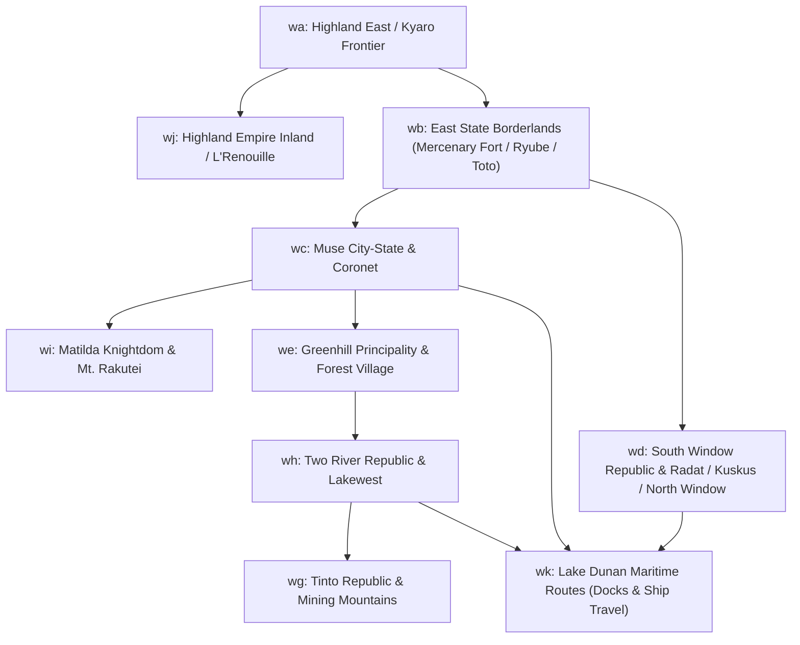

# Suikoden II Geographic Area Catalog: World Map Overworld Sectors (Regions A–K)

**Geographic Scope & Role**: The 10 contiguous overworld map sectors (`wa` through `wk`) governing terrestrial exploration, territorial borders, location proximity banners, town/dungeon entrance warps, and Lake Dunan maritime navigation across the Dunan Republic, Highland Kingdom, Tinto Republic, Two River Republic, and Matilda Knightdom.

**Regional Category**: Regions `WA` through `WK` | **Master Maps Included**: `wa`, `wb`, `wc`, `wd`, `we`, `wg`, `wh`, `wi`, `wj`, `wk`

**Grounding Reference**: Compiled from `suikoden_2_map_ids_and_areas_breakdown.md` and direct bytecode inspection of all corresponding assets in `D:\Modding\suikodum\Mobobehaviour`.

---

## 📖 Human-Readable Field & Engine Legend

| Field / Concept | Engine Term | Human Meaning & Allowed Values |
|---|---|---|
| **Class (`otyp`)** | Object Type | **1** = NPC / Actor **2** = Prop / Scenery **3** = World Device / Point of Interest (boats, landmark markers, waypoints) **4** = Spatial Hitbox / Barrier / Trigger Zone |
| **Collision (`ozok`)** | Obstacle Mask | **0** = Passable (traversable plains, open water, entrance rug) **2** = Solid Obstacle (mountains, coastlines, fortress gates) |
| **Facing (`ano`)** | Animation / State | For overland markers: landmark visual model index or vehicle orientation frame. |
| **Display (`disp`)** | Visibility State | **1** = Active & Rendered on overworld **0** = Dormant / Hidden (waiting for story flags to spawn) |
| **Coords (`x, y`)** | Tile Grid Position | Exact tile coordinate on the world map grid (`(0, 0)` is top-left) |
| **Size (`w, h`)** | Trigger Dimensions | `0x0` = 1 single 1x1 tile ("A Dot"). `w x h` = Multi-tile bounding box |
| **Speed (`spd`)** | Movement Rate | **0** = Immobile landmark; **4** = Standard overworld travel speed |
| **Wait (`wt`)** | Wander Timer | **255** = Stationary fixture (no independent wander) |
| **Priority (`pri`)** | Z-Order Layer | **0** = Standard ground layer; **480** = Elevated terrain layer |
| **Mode (`etyp`)** | Trigger Mode | **1 (Action / Enter)** = Fired when standing on/adjacent to location and pressing Confirm/Action button (entering town/dungeon) **2 (Map Init)** = Fired once immediately upon loading the sector before fade-in **128 (Proximity Tripwire)** = Fired continuously while player coordinates fall inside the spatial bounding box to display HUD location banner popup |
| **`eventForm`** | Preconditions | Conditions that MUST be true for script execution (story flags, item prerequisites, or coordinate boundaries `1, Xmin, Xmax, 2, Ymin, Ymax`) |
| **`eventCom`** | Action Sequence | The actual actions executed (HUD banner display via `ECMachiStControll`, town transition via `ECSMapChenge`, boat boarding via Opcode `122`) |

---

## Sector Overview & Regional Architecture

Overworld sectors are divided into 10 regional partitions directly paired with Konami's local town/dungeon archives:

---

## 1. Sector `WA`: Highland Kingdom East / Kyaro Frontier

- **Master Map Container**: `wa.json`
- **Submap Layer Files**: `wa_00.json`, `wa_00_00.json`, `wa_00_01.json`, `wa_00_02.json`, `wa_00_04.json`, `wa_00_obj.json`
- **Collision Grid Files**: `wa_map_00.json`
- **Encounter Zone (`batlno`)**: `1` (Random overworld encounters active)
- **Entity Count (`okaz`)**: `23` Objects | **Script Count (`evkaz`)**: `18` Scripts

### Physical Entity Inventory (23 Objects)

| Slot | Class (`otyp`) | Identity / Description | Sprite Pattern (`fpno`) | Coords (`x, y`) | Size (`w, h`) | Facing (`ano`) | State (`disp`) | Collision (`ozok`) | Speed | Wait | Priority |
|:---:|---|---|:---:|:---:|:---:|:---:|---|---|:---:|:---:|:---:|
| `obj[00-06]` | World Device | Sector Border Markers / Nav Anchors | `0` | `(0, 0)` | `0x0` | Frame 0–2 | Dormant (0) | Passable (0) | 4 | 255 | 0 |
| `obj[07-14]` | World Device | Mountain Terrain Obstacle Nodes | `0` | `(0, 0)` | `0x0` | Frame 6 | Dormant (0) | Passable (0) | 4 | 255 | 0 |
| `obj[15-22]` | World Device | Territorial Border Waypoint Anchors | `0` | `(0, 0)` | `0x0` | Frame 9 | Dormant (0) | Passable (0) | 4 | 255 | 0 |

### Trigger & Event Inventory (18 Scripts)

| Script | Trigger Mode (`etyp`) | Spatial Bounding Box / Condition | Engine Action / Target | Gameplay Significance |
|:---:|---|---|---|---|
| `ev[00-05]` | Map Init (2) | Sector load initialization | Camera binding, coordinate offsets, initial HUD setup | Prepares camera viewport tracking on player upon world spawn. |
| `ev[06]` | Action (1) | Story flag preconditions | Engine state sync | Story progress validation. |
| `ev[07]` | Proximity (128) | `X: 40–100, Y: 60–110` | `Opcode 31 (0, 2)` -> **`va02`** | Spawns **Kyaro Town** HUD location banner at screen top. |
| `ev[08]` | Action (1) | `X: 70–75, Y: 89–90` (South approach) | `Opcode 32 -> (12, 178)` | **Kyaro Town Entrance**: Warps player to southern entrance of Kyaro. |
| `ev[09]` | Action (1) | `X: 70–75, Y: 84–85` (North approach) | `Opcode 32 -> (113, 8)` | **Kyaro Town Entrance**: Warps player to northern outskirts of Kyaro. |
| `ev[10-11]` | Action (1) | `X: 70–76, Y: 84–89` (East/West perimeter) | `Opcode 32 -> (12, 178)` | Secondary collision steps into Kyaro Town. |
| `ev[12]` | Proximity (128) | `X: 47–72, Y: 112–138` | `Opcode 31 (1, 16)` -> **`vb16`** | Spawns **North Sparrow Pass** HUD location banner. |
| `ev[13]` | Action (1) | `X: 53–58, Y: 131–132` | `Opcode 32 -> (26, 9)` | **North Sparrow Pass Entrance**: Warps player into mountain trail. |
| `ev[14]` | Proximity (128) | `X: 40–90, Y: 35–58` (Early Story) | `Opcode 31 (0, 10)` -> **`va10`** | Spawns **Tenzan Pass** HUD location banner (Prologue / Chapter 1). |
| `ev[15]` | Action (1) | `X: 46–48, Y: 43–45` (Early Story) | `Opcode 32 -> (250, 0)` | **Tenzan Pass Entrance**: Warps player into prologue cliff approach. |
| `ev[16]` | Proximity (128) | `X: 40–90, Y: 35–58` (Late Story) | `Opcode 31 (0, 24)` -> **`va24`** | Spawns **Tenzan Pass** HUD location banner (Endgame Duel state). |
| `ev[17]` | Action (1) | `X: 46–48, Y: 43–45` (Late Story) | `Opcode 32 -> (250, 0)` | **Tenzan Pass Endgame Entrance**: Warps player to true ending duel grounds. |

---

## 2. Sector `WB`: East State Borderlands

- **Master Map Container**: `wb.json`
- **Submap Layer Files**: `wb_00.json`, `wb_00_00.json` through `wb_00_06.json`, `wb_01.json`, `wb_01_00.json` through `wb_01_06.json`, `wb_00_obj.json`
- **Collision Grid Files**: `wb_map_00.json`
- **Encounter Zone (`batlno`)**: `1` (Random overworld encounters active)
- **Entity Count (`okaz`)**: `26` Objects | **Script Count (`evkaz`)**: `32` Scripts

### Physical Entity Inventory (26 Objects)

| Slot | Class (`otyp`) | Identity / Description | Sprite Pattern (`fpno`) | Coords (`x, y`) | Size (`w, h`) | Facing (`ano`) | State (`disp`) | Collision (`ozok`) | Speed | Wait | Priority |
|:---:|---|---|:---:|:---:|:---:|:---:|---|---|:---:|:---:|:---:|
| `obj[00-22]` | World Device | Nav Anchors & Terrain Waypoints | `0` | `(0, 0)` | `0x0` | Frame 0–11 | Dormant (0) | Passable (0) | 4 | 255 | 0 |
| `obj[23]` | World Device | Mercenary Fort Road Marker | `0` | `(80, 46)` | `0x0` | Frame 12 | Dormant (0) | Passable (0) | 4 | 255 | 0 |
| `obj[24]` | World Device | Ryube / Toto Crossroads Landmark | `0` | `(169, 122)` | `0x0` | Frame 13 | Dormant (0) | Passable (0) | 4 | 255 | 0 |
| `obj[25]` | World Device | Swallow Pass Approach Marker | `0` | `(142, 149)` | `0x0` | Frame 14 | Dormant (0) | Passable (0) | 4 | 255 | 0 |

### Trigger & Event Inventory (32 Scripts)

| Script | Trigger Mode (`etyp`) | Spatial Bounding Box / Condition | Engine Action / Target | Gameplay Significance |
|:---:|---|---|---|---|
| `ev[00-08]` | Map Init (2) | Sector load initialization | Camera setup, story state checks | Prepares world map sector states. |
| `ev[09]` | Proximity (128) | `X: 60–100, Y: 28–61` (Intact Fort) | `Opcode 31 (1, 2)` -> **`vb02`** | Spawns **Mercenary Fortress** HUD banner (Viktor/Flik intact fort). |
| `ev[10]` | Proximity (128) | `X: 60–100, Y: 28–61` (Burned Fort) | `Opcode 31 (1, 3)` -> **`vb03`** | Spawns **Mercenary Fortress (Ruins)** HUD banner after Luca's attack. |
| `ev[11-12]` | Action (1) | `X: 78–86, Y: 42–48` | `Opcode 32 -> (103, 158)` | **Mercenary Fort Entrance**: Warps player into the fortress courtyard. |
| `ev[14-15]` | Proximity (128) | `X: 130–163, Y: 134–165` (Intact) | `Opcode 31 (1, 1)` -> **`vb01`** | Spawns **Ryube Village** HUD banner. |
| `ev[16-17]` | Proximity (128) | `X: 130–163, Y: 134–165` (Burned) | `Opcode 31 (1, 9)` -> **`vb09`** | Spawns **Ryube Village (Ruins)** HUD banner following destruction. |
| `ev[18-19]` | Action (1) | `X: 141–149, Y: 145–150` | `Opcode 32 -> (82, 122)` | **Ryube Village Entrance**: Warps player into Ryube center square. |
| `ev[21, 23]` | Proximity (128) | `X: 150–175, Y: 110–133` (Intact) | `Opcode 31 (1, 4)` -> **`vb04`** | Spawns **Toto Village** HUD banner (Pilika's village). |
| `ev[22]` | Proximity (128) | `X: 150–175, Y: 110–133` (Burned) | `Opcode 31 (1, 17)` -> **`vb17`** | Spawns **Toto Village (Ruins)** HUD banner. |
| `ev[24]` | Proximity (128) | `X: 150–175, Y: 110–133` (Woodland) | `Opcode 31 (1, 5)` -> **`vb05`** | Spawns **Ryube Forest / Deep Forest** HUD banner. |
| `ev[25]` | Action (1) | `X: 168–172, Y: 118–123` | `Opcode 32 -> (3, 40)` | **Ryube Forest Entrance**: Warps player to forest path & Tsai's hut. |
| `ev[26]` | Proximity (128) | `X: 152–185, Y: 63–78` | `Opcode 31 (1, 7)` -> **`vb07`** | Spawns **Swallow Pass** HUD banner. |
| `ev[27]` | Proximity (128) | `X: 152–185, Y: 63–78` (Alt state) | `Opcode 31 (1, 16)` -> **`vb16`** | Spawns **Highland Border Gate** HUD banner. |
| `ev[28]` | Action (1) | `X: 162–165, Y: 71–74` | `Opcode 32 -> (6, 87)` | **Swallow Pass Entrance**: Warps player into mountain border pass. |
| `ev[29]` | Proximity (128) | `X: 25–45, Y: 185–210` | `Opcode 31 (3, 1)` -> **`vd01`** | Spawns **South Window Road** border banner. |
| `ev[30-31]` | Action (1) | `X: 30–35, Y: 195–200` | `Opcode 32 -> (118, 28)` | **Southern Highway Transition**: Warps player to South Window region. |

---

## 3. Sector `WC`: Muse City-State & Coronet Port

- **Master Map Container**: `wc.json`
- **Submap Layer Files**: `wc_00.json`, `wc_00_00.json` through `wc_00_07.json`, `wc_01.json`, `wc_02.json`, `wc_etc_05.json`, `wc_map_00.json`
- **Collision Grid Files**: `wc_map_00.json`
- **Encounter Zone (`batlno`)**: `1` (Random overworld encounters active)
- **Entity Count (`okaz`)**: `51` Objects | **Script Count (`evkaz`)**: `31` Scripts

### Physical Entity Inventory (51 Objects)

| Slot | Class (`otyp`) | Identity / Description | Sprite Pattern (`fpno`) | Coords (`x, y`) | Size (`w, h`) | Facing (`ano`) | State (`disp`) | Collision (`ozok`) | Speed | Wait | Priority |
|:---:|---|---|:---:|:---:|:---:|:---:|---|---|:---:|:---:|:---:|
| `obj[00-47]` | World Device | Nav Anchors, Lake Shoreline & Road Markers | `0` | `(0, 0)` | `0x0` | Frame 0–20 | Dormant (0) | Passable (0) | 4 | 255 | 0 |
| `obj[48]` | World Device | Muse City Gateway Prop Anchor | `0` | `(208, 134)` | `0x0` | Frame 21 | Dormant (0) | Passable (0) | 4 | 255 | 0 |
| `obj[49]` | World Device | White Deer Inn Landmark Anchor | `0` | `(242, 131)` | `0x0` | Frame 22 | Dormant (0) | Passable (0) | 4 | 255 | 0 |
| `obj[50]` | World Device | Coronet Harbor Mooring Anchor | `0` | `(195, 55)` | `0x0` | Frame 23 | Dormant (0) | Passable (0) | 4 | 255 | 0 |

### Trigger & Event Inventory (31 Scripts)

| Script | Trigger Mode (`etyp`) | Spatial Bounding Box / Condition | Engine Action / Target | Gameplay Significance |
|:---:|---|---|---|---|
| `ev[00-07]` | Map Init (2) | Sector load initialization | Camera viewport initialization | Overworld engine setup. |
| `ev[08-14]` | Proximity (128) | `X: 186–230, Y: 115–147` | `Opcode 31 (2, 0/14/15/23/25)` -> **`vc00/vc14/vc25`** | Spawns **Muse City** HUD banner across story chapters (Open, Sealed, Occupied, Liberated). |
| `ev[15]` | Action (1) | `X: 205–211, Y: 131–137` | `Opcode 32 -> (3, 17)` | **Muse City Main Gate Entrance**: Warps player into Muse entrance plaza (`vc01`). |
| `ev[16]` | Proximity (128) | `X: 231–255, Y: 117–146` | `Opcode 31 (2, 3)` -> **`vc03`** | Spawns **White Deer Inn** HUD banner. |
| `ev[17]` | Action (1) | `X: 240–245, Y: 128–133` | `Opcode 32 -> (250, 0)` | **White Deer Inn Entrance**: Warps player into country inn exterior (`vc04`). |
| `ev[18]` | Proximity (128) | `X: 139–199, Y: 155–195` | `Opcode 31 (2, 5)` -> **`vc05`** | Spawns **Sindar Ruins** HUD banner (Alex ancient temple excavation). |
| `ev[19-21]` | Proximity (128) | `X: 170–219, Y: 38–72` | `Opcode 31 (2, 6/21)` -> **`vc06/vc21`** | Spawns **Coronet Port** HUD banner. |
| `ev[22]` | Action (1) | `X: 192–198, Y: 52–58` | `Opcode 32 -> (21, 58)` | **Coronet Port Entrance**: Warps player into Coronet town avenue (`vc17`). |
| `ev[23]` | Proximity (128) | `X: 80–140, Y: 31–52` | `Opcode 31 (8, 10)` -> **`vi10`** | Spawns **Matilda Checkpoint** HUD banner (Muse-Matilda frontier gate). |
| `ev[24-25]` | Action (1) | `X: 104–106, Y: 29–30` | `Opcode 32 -> (20, 89) / (3, 48)` | **Matilda Checkpoint Entrance**: Warps player into checkpoint approach. |
| `ev[26-27]` | Proximity (128) | `Y: 115–195` (Eastern boundary) | `Opcode 31 (1, 2/3)` -> **`vb02/vb03`** | Spawns **Mercenary Fortress Highway** banner entering from West. |
| `ev[28]` | Action (1) | `X: 205–211, Y: 131–137` | `Opcode 32 -> (250, 0)` | Secondary gate check for occupied Muse infiltration. |
| `ev[29]` | Proximity (128) | `X: 30–60, Y: 90–130` | `Opcode 31 (4, 4)` -> **`ve04`** | Spawns **Forest Path to Greenhill** HUD banner. |
| `ev[30]` | Action (1) | `X: 27–28, Y: 107–107` | `Opcode 32 -> (55, 24)` | **Greenhill Forest Entrance**: Warps player into Greenhill mountain path. |

---

## 4. Sector `WD`: South Window Republic & Radat / Kuskus / North Window

- **Master Map Container**: `wd.json`
- **Submap Layer Files**: `wd_00.json`, `wd_00_00.json` through `wd_00_08.json`, `wd_00_obj.json`, `wd_map_00.json`
- **Collision Grid Files**: `wd_map_00.json`
- **Encounter Zone (`batlno`)**: `1` (Random overworld encounters active)
- **Entity Count (`okaz`)**: `13` Objects | **Script Count (`evkaz`)**: `28` Scripts

### Physical Entity Inventory (13 Objects)

| Slot | Class (`otyp`) | Identity / Description | Sprite Pattern (`fpno`) | Coords (`x, y`) | Size (`w, h`) | Facing (`ano`) | State (`disp`) | Collision (`ozok`) | Speed | Wait | Priority |
|:---:|---|---|:---:|:---:|:---:|:---:|---|---|:---:|:---:|:---:|
| `obj[00-09]` | World Device | Nav Anchors & Regional Boundary Waypoints | `0` | `(0, 0)` | `0x0` | Frame 0–5 | Dormant (0) | Passable (0) | 4 | 255 | 0 |
| `obj[10]` | World Device | North Window Castle Landmark Anchor | `0` | `(138, 33)` | `0x0` | Frame 6 | Dormant (0) | Passable (0) | 4 | 255 | 0 |
| `obj[11]` | World Device | South Window Capital Gate Landmark | `0` | `(201, 63)` | `0x0` | Frame 7 | Dormant (0) | Passable (0) | 4 | 255 | 0 |
| `obj[12]` | World Device | Radat Canal Wharf Landmark Anchor | `0` | `(148, 105)` | `0x0` | Frame 8 | Dormant (0) | Passable (0) | 4 | 255 | 0 |

### Trigger & Event Inventory (28 Scripts)

| Script | Trigger Mode (`etyp`) | Spatial Bounding Box / Condition | Engine Action / Target | Gameplay Significance |
|:---:|---|---|---|---|
| `ev[00-08]` | Map Init (2) | Sector load initialization | Camera binding and viewport setup | Overworld sector initialization. |
| `ev[09]` | Proximity (128) | `X: 120–156, Y: 23–44` (Castle Level 1–4) | `Opcode 31 (10, 33)` -> **`vk33`** | Spawns **Dunan Castle HQ** HUD banner when castle is restored. |
| `ev[10]` | Proximity (128) | `X: 120–156, Y: 23–44` (Early HQ) | `Opcode 31 (10, 0)` -> **`vk00`** | Spawns **Dunan Castle HQ (Founding)** HUD banner. |
| `ev[11]` | Action (1) | `X: 135–142, Y: 30–36` | `Opcode 32 -> (84, 153)` | **Castle HQ Main Gate Entrance**: Warps player to Dunan Castle entrance bridge (`vk01`). |
| `ev[12]` | Proximity (128) | `X: 120–156, Y: 23–44` (Neclord Era) | `Opcode 31 (3, 3)` -> **`vd03`** | Spawns **North Window (Ruins)** HUD banner during Neclord vampire siege. |
| `ev[13]` | Action (1) | `X: 135–142, Y: 30–36` (Ruins) | `Opcode 32 -> (84, 153)` | **North Window Ruins Entrance**: Warps player into monster-infested ruins (`vd04`). |
| `ev[14]` | Proximity (128) | `X: 183–219, Y: 51–76` | `Opcode 31 (3, 0)` -> **`vd00`** | Spawns **South Window City** HUD banner. |
| `ev[15]` | Action (1) | `X: 198–204, Y: 60–66` | `Opcode 32 -> (100, 96)` | **South Window City Entrance**: Warps player into main capital plaza (`vd01`). |
| `ev[16-17]` | Proximity (128) | `Y: 88–120` | `Opcode 31 (3, 1/4)` -> **`vd01/vd04`** | Spawns **Radat Town** HUD banner. |
| `ev[18]` | Action (1) | `X: 145–151, Y: 102–108` | `Opcode 32 -> (100, 96)` | **Radat Town Entrance**: Warps player into Radat central canal bridge (`vd02`). |
| `ev[19]` | Proximity (128) | `X: 70–110, Y: 30–60` | `Opcode 31 (3, 6)` -> **`vd06`** | Spawns **Cave of the Wind** HUD banner (Star Dragon Sword cavern). |
| `ev[20]` | Action (1) | `X: 88–92, Y: 43–47` | `Opcode 32 -> (6, 12)` | **Cave of the Wind Entrance**: Warps player into cavern entrance (`vd06`). |
| `ev[21]` | Proximity (128) | `X: 110–145, Y: 130–165` | `Opcode 31 (3, 15)` -> **`vd15`** | Spawns **Kuskus Town** HUD banner. |
| `ev[22]` | Action (1) | `X: 125–130, Y: 145–150` | `Opcode 32 -> (3, 69)` | **Kuskus Town Entrance**: Warps player into Kuskus river docks (`vd15`). |
| `ev[23-27]` | Action (1) | Sector border triggers | `Opcode 32/33` inter-sector transitions | Coordinates transitions into neighboring overworld regions. |

---

## 5. Sector `WE`: Greenhill Principality & Forest Village

- **Master Map Container**: `we.json`
- **Submap Layer Files**: `we_00.json`, `we_00_00.json` through `we_00_10.json`, `we_01.json`, `we_02.json`, `we_00_obj.json`
- **Collision Grid Files**: Serialized in `we.json`
- **Encounter Zone (`batlno`)**: `1` (Random overworld encounters active)
- **Entity Count (`okaz`)**: `23` Objects | **Script Count (`evkaz`)**: `25` Scripts

### Physical Entity Inventory (23 Objects)

| Slot | Class (`otyp`) | Identity / Description | Sprite Pattern (`fpno`) | Coords (`x, y`) | Size (`w, h`) | Facing (`ano`) | State (`disp`) | Collision (`ozok`) | Speed | Wait | Priority |
|:---:|---|---|:---:|:---:|:---:|:---:|---|---|:---:|:---:|:---:|
| `obj[00-19]` | World Device | Nav Anchors & Woodland Forest Boundary Anchors | `0` | `(0, 0)` | `0x0` | Frame 0–15 | Dormant (0) | Passable (0) | 4 | 255 | 0 |
| `obj[20]` | World Device | Greenhill City Main Gate Landmark | `0` | `(154, 125)` | `0x0` | Frame 16 | Dormant (0) | Passable (0) | 4 | 255 | 0 |
| `obj[21]` | World Device | Forest Village Woodland Landmark | `0` | `(239, 58)` | `0x0` | Frame 17 | Dormant (0) | Passable (0) | 4 | 255 | 0 |
| `obj[22]` | World Device | Matilda Border Checkpoint Landmark | `0` | `(82, 130)` | `0x0` | Frame 18 | Dormant (0) | Passable (0) | 4 | 255 | 0 |

### Trigger & Event Inventory (25 Scripts)

| Script | Trigger Mode (`etyp`) | Spatial Bounding Box / Condition | Engine Action / Target | Gameplay Significance |
|:---:|---|---|---|---|
| `ev[00-08]` | Map Init (2) | Sector load initialization | Viewport anchor setup | Overworld engine initialization. |
| `ev[09-10]` | Proximity (128) | `X: 136–173, Y: 115–135` | `Opcode 31 (4, 0/12)` -> **`ve00/ve12`** | Spawns **Greenhill City** HUD banner (Open Academy vs Highland Occupation). |
| `ev[11]` | Proximity (128) | `X: 224–254, Y: 45–70` | `Opcode 31 (4, 3)` -> **`ve03`** | Spawns **Forest Village** HUD banner. |
| `ev[12]` | Proximity (128) | `Y: 114–145` (Western border) | `Opcode 31 (4, 4)` -> **`ve04`** | Spawns **Greenhill-Matilda Border Checkpoint** HUD banner. |
| `ev[13]` | Proximity (128) | `X: 180–220, Y: 190–205` | `Opcode 31 (7, 5)` -> **`vh05`** | Spawns **Two River Southern Trail** banner. |
| `ev[14]` | Action (1) | `X: 151–157, Y: 122–128` | `Opcode 32 -> (64, 195)` | **Greenhill City Entrance**: Warps player into Greenhill entrance gate (`ve01`). |
| `ev[15]` | Action (1) | `X: 236–242, Y: 55–61` | `Opcode 32 -> (20, 56)` | **Forest Village Entrance**: Warps player into Forest Village trading path (`ve03`). |
| `ev[16]` | Action (1) | `X: 80–84, Y: 128–132` | `Opcode 32 -> (44, 100)` | **Matilda Border Entrance**: Warps player into border fortress checkpoint (`ve05`). |
| `ev[17-19]` | Action (1) | `X: 195–205, Y: 195–200` | `Opcode 32 -> (4, 11)` | **Two River Highway Transition**: Warps player to Two River Republic overworld. |
| `ev[20-24]` | Proximity (128) | Peripheral sector tripwires | `Opcode 33` border warps | Dynamic inter-sector transitions into Sectors `WC`, `WH`, and `WI`. |

---

## 6. Sector `WG`: Tinto Republic & Mining Mountains

- **Master Map Container**: `wg.json`
- **Submap Layer Files**: `wg_00.json`, `wg_00_00.json`, `wg_00_01.json`, `wg_00_02.json`, `wg_00_04.json`, `wg_00_05.json`, `wg_00_06.json`, `wg_00_08.json`, `wg_00_10.json`, `wg_00_obj.json`
- **Collision Grid Files**: Serialized in `wg.json`
- **Encounter Zone (`batlno`)**: `1` (Random overworld encounters active)
- **Entity Count (`okaz`)**: `23` Objects | **Script Count (`evkaz`)**: `21` Scripts

### Physical Entity Inventory (23 Objects)

| Slot | Class (`otyp`) | Identity / Description | Sprite Pattern (`fpno`) | Coords (`x, y`) | Size (`w, h`) | Facing (`ano`) | State (`disp`) | Collision (`ozok`) | Speed | Wait | Priority |
|:---:|---|---|:---:|:---:|:---:|:---:|---|---|:---:|:---:|:---:|
| `obj[00-19]` | World Device | Nav Anchors & Mountain Pass Waypoints | `0` | `(0, 0)` | `0x0` | Frame 0–12 | Dormant (0) | Passable (0) | 4 | 255 | 0 |
| `obj[20]` | World Device | Tinto Mining City Landmark Anchor | `0` | `(85, 50)` | `0x0` | Frame 13 | Dormant (0) | Passable (0) | 4 | 255 | 0 |
| `obj[21]` | World Device | Crom Village Mountain Refuge Anchor | `0` | `(39, 78)` | `0x0` | Frame 14 | Dormant (0) | Passable (0) | 4 | 255 | 0 |
| `obj[22]` | World Device | Tigermouth Pass Road Landmark | `0` | `(110, 95)` | `0x0` | Frame 15 | Dormant (0) | Passable (0) | 4 | 255 | 0 |

### Trigger & Event Inventory (21 Scripts)

| Script | Trigger Mode (`etyp`) | Spatial Bounding Box / Condition | Engine Action / Target | Gameplay Significance |
|:---:|---|---|---|---|
| `ev[00-05]` | Map Init (2) | Sector load initialization | Viewport & camera tracking | Overworld engine initialization. |
| `ev[06]` | Proximity (128) | `X: 108–113, Y: 80–110` | `Opcode 31 (6, 6)` -> **`vg06`** | Spawns **Tigermouth Pass** HUD banner. |
| `ev[07-08]` | Proximity (128) | `X: 74–97, Y: 66–110` | `Opcode 31 (6, 1)` -> **`vg01`** | Spawns **Tinto Mines / Mt. Senai** HUD banner. |
| `ev[09]` | Proximity (128) | `X: 20–58, Y: 61–95` | `Opcode 31 (6, 2)` -> **`vg02`** | Spawns **Crom Village** HUD banner (Mountain refuge). |
| `ev[10-11]` | Proximity (128) | `X: 79–100, Y: 20–60` | `Opcode 31 (6, 0/16)` -> **`vg00/vg16`** | Spawns **Tinto Mining City** HUD banner (Normal vs Zombie invasion). |
| `ev[12]` | Action (1) | `X: 109–112, Y: 92–98` | `Opcode 32 -> (2, 82)` | **Tigermouth Pass Entrance**: Warps player to mountain pass trail (`vg05`). |
| `ev[13]` | Action (1) | `X: 89–93, Y: 75–81` | `Opcode 32 -> (28, 115)` | **Tinto Mines Entrance**: Warps player to mine cavern mouth (`vg07`). |
| `ev[14]` | Action (1) | `X: 36–42, Y: 75–81` | `Opcode 32 -> (77, 220)` | **Crom Village Entrance**: Warps player into Crom village street (`vg02`). |
| `ev[15-16]` | Action (1) | `X: 84–87, Y: 49–51` | `Opcode 32 -> (79, 233)` | **Tinto City Entrance**: Warps player into Tinto city square (`vg01`). |
| `ev[17-20]` | Action (1) | Inter-sector mountain transitions | `Opcode 32/33` transitions | Coordinates passage into Drakemouth Village & Two River (`WH`). |

---

## 7. Sector `WH`: Two River Republic & Lakewest

- **Master Map Container**: `wh.json`
- **Submap Layer Files**: `wh_00.json`, `wh_00_00.json`, `wh_00_01.json`, `wh_00_02.json`, `wh_00_05.json`, `wh_00_06.json`, `wh_00_08.json`, `wh_00_10.json` through `wh_00_13.json`
- **Collision Grid Files**: `wh_map_00.json`
- **Encounter Zone (`batlno`)**: `1` (Random overworld encounters active)
- **Entity Count (`okaz`)**: `23` Objects | **Script Count (`evkaz`)**: `14` Scripts

### Physical Entity Inventory (23 Objects)

| Slot | Class (`otyp`) | Identity / Description | Sprite Pattern (`fpno`) | Coords (`x, y`) | Size (`w, h`) | Facing (`ano`) | State (`disp`) | Collision (`ozok`) | Speed | Wait | Priority |
|:---:|---|---|:---:|:---:|:---:|:---:|---|---|:---:|:---:|:---:|
| `obj[00-19]` | World Device | Nav Anchors & River Shoreline Waypoints | `0` | `(0, 0)` | `0x0` | Frame 0–14 | Dormant (0) | Passable (0) | 4 | 255 | 0 |
| `obj[20]` | World Device | Two River Capital Gate Landmark | `0` | `(178, 84)` | `0x0` | Frame 15 | Dormant (0) | Passable (0) | 4 | 255 | 0 |
| `obj[21]` | World Device | Lakewest Docks Landmark Anchor | `0` | `(176, 143)` | `0x0` | Frame 16 | Dormant (0) | Passable (0) | 4 | 255 | 0 |
| `obj[22]` | World Device | Drakemouth Village Landmark Anchor | `0` | `(93, 184)` | `0x0` | Frame 17 | Dormant (0) | Passable (0) | 4 | 255 | 0 |

### Trigger & Event Inventory (14 Scripts)

| Script | Trigger Mode (`etyp`) | Spatial Bounding Box / Condition | Engine Action / Target | Gameplay Significance |
|:---:|---|---|---|---|
| `ev[00-05]` | Map Init (2) | Sector load initialization | Viewport & camera tracking | Overworld engine initialization. |
| `ev[06-07]` | Proximity (128) | `X: 160–250, Y: 56–100` | `Opcode 31 (7, 0/1)` -> **`vh00/vh01`** | Spawns **Two River Republic** HUD banner (Human/Wingly/Kobold districts). |
| `ev[08]` | Proximity (128) | `X: 156–197, Y: 128–159` | `Opcode 31 (7, 2)` -> **`vh02`** | Spawns **Lakewest Town** HUD banner. |
| `ev[09]` | Proximity (128) | `X: 80–106, Y: 169–200` | `Opcode 31 (6, 5)` -> **`vg05`** | Spawns **Drakemouth Village** HUD banner. |
| `ev[10]` | Action (1) | `X: 175–181, Y: 81–87` | `Opcode 32 -> (139, 67)` | **Two River Main Gate Entrance**: Warps player into Human District entrance (`vh01`). |
| `ev[11]` | Action (1) | `X: 173–179, Y: 140–146` | `Opcode 32 -> (44, 128)` | **Lakewest Entrance**: Warps player into Lakewest docks and village street (`vh02`). |
| `ev[12]` | Action (1) | `X: 90–96, Y: 181–187` | `Opcode 32 -> (133, 148)` | **Drakemouth Entrance**: Warps player into Drakemouth mountain village (`vg05`). |
| `ev[13]` | Action (1) | Inter-sector transitions | `Opcode 32/33` transitions | Coordinates passage into Greenhill (`WE`) and Lake Dunan waters (`WK`). |

---

## 8. Sector `WI`: Matilda Knightdom & Mt. Rakutei

- **Master Map Container**: `wi.json`
- **Submap Layer Files**: `wi_00.json`, `wi_00_00.json`, `wi_00_01.json`, `wi_00_02.json`, `wi_00_04.json`, `wi_00_05.json`, `wi_00_08.json`, `wi_00_09.json`, `wi_00_13.json`, `wi_00_17.json`, `wi_01.json`
- **Collision Grid Files**: `wi_map_00.json`
- **Encounter Zone (`batlno`)**: `1` (Random overworld encounters active)
- **Entity Count (`okaz`)**: `18` Objects | **Script Count (`evkaz`)**: `15` Scripts

### Physical Entity Inventory (18 Objects)

| Slot | Class (`otyp`) | Identity / Description | Sprite Pattern (`fpno`) | Coords (`x, y`) | Size (`w, h`) | Facing (`ano`) | State (`disp`) | Collision (`ozok`) | Speed | Wait | Priority |
|:---:|---|---|:---:|:---:|:---:|:---:|---|---|:---:|:---:|:---:|
| `obj[00-13]` | World Device | Nav Anchors & Mountain Cliff Waypoints | `0` | `(0, 0)` | `0x0` | Frame 0–9 | Dormant (0) | Passable (0) | 4 | 255 | 0 |
| `obj[14]` | World Device | Rockaxe Castle Grand Keep Landmark | `0` | `(52, 81)` | `0x0` | Frame 10 | Dormant (0) | Passable (0) | 4 | 255 | 0 |
| `obj[15]` | World Device | Highway Village Frontier Landmark | `0` | `(91, 116)` | `0x0` | Frame 11 | Dormant (0) | Passable (0) | 4 | 255 | 0 |
| `obj[16]` | World Device | Mt. Rakutei Dragon Peak Mountain Anchor | `0` | `(91, 19)` | `0x0` | Frame 12 | Dormant (0) | Passable (0) | 4 | 255 | 0 |
| `obj[17]` | World Device | Matilda Border Checkpoint Gate Landmark | `0` | `(160, 166)` | `0x0` | Frame 13 | Dormant (0) | Passable (0) | 4 | 255 | 0 |

### Trigger & Event Inventory (15 Scripts)

| Script | Trigger Mode (`etyp`) | Spatial Bounding Box / Condition | Engine Action / Target | Gameplay Significance |
|:---:|---|---|---|---|
| `ev[00-03]` | Map Init (2) | Sector load initialization | Viewport tracking | Overworld engine initialization. |
| `ev[04]` | Action (1) | `X: 51–53, Y: 81–81` | `Opcode 32 -> (250, 0)` | **Rockaxe Castle Entrance**: Warps player to Rockaxe main gate plaza (`vi02`). |
| `ev[05]` | Proximity (128) | `X: 40–80, Y: 60–100` | `Opcode 31 (8, 0)` -> **`vi00`** | Spawns **Rockaxe Castle & Capital** HUD banner. |
| `ev[06-07]` | Action (1) | `X: 89–94, Y: 115–118` | `Opcode 32 -> (2, 79)` | **Highway Village Entrance**: Warps player to Humphrey & Futch's village (`vi11`). |
| `ev[08]` | Proximity (128) | `X: 70–115, Y: 102–135` | `Opcode 31 (8, 11)` -> **`vi11`** | Spawns **Highway Village** HUD banner. |
| `ev[09]` | Action (1) | `X: 90–92, Y: 18–19` | `Opcode 32 -> (250, 0)` | **Mt. Rakutei Entrance**: Warps player into mountain dragon peak trail (`vi12`). |
| `ev[10]` | Proximity (128) | `X: 70–115, Y: 20–40` | `Opcode 31 (8, 12)` -> **`vi12`** | Spawns **Mt. Rakutei** HUD banner. |
| `ev[11]` | Action (1) | `X: 159–161, Y: 166–167` | `Opcode 32 -> (250, 0)` | **Matilda Checkpoint Entrance**: Warps player into border fortress (`vi10`). |
| `ev[12]` | Proximity (128) | `X: 130–170, Y: 150–190` | `Opcode 31 (8, 10)` -> **`vi10`** | Spawns **Matilda Checkpoint** HUD banner. |
| `ev[13]` | Action (1) | `X: 48–48, Y: 134–135` | `Opcode 32 -> (4, 66)` | **Forest Trail Transition**: Warps player to Forest Village northern fringe (`ve03`). |
| `ev[14]` | Proximity (128) | `X: 30–70, Y: 120–150` | `Opcode 31 (4, 3)` -> **`ve03`** | Spawns **Forest Village Path** banner. |

---

## 9. Sector `WJ`: Highland Empire Inland & L'Renouille

- **Master Map Container**: `wj.json`
- **Submap Layer Files**: `wj_00.json`, `wj_00_00.json`, `wj_00_01.json`, `wj_00_02.json`, `wj_00_03.json`, `wj_00_05.json`, `wj_00_07.json`, `wj_00_08.json`, `wj_00_obj.json`
- **Collision Grid Files**: `wj_map_00.json`
- **Encounter Zone (`batlno`)**: `1` (Random overworld encounters active)
- **Entity Count (`okaz`)**: `33` Objects | **Script Count (`evkaz`)**: `12` Scripts

### Physical Entity Inventory (33 Objects)

| Slot | Class (`otyp`) | Identity / Description | Sprite Pattern (`fpno`) | Coords (`x, y`) | Size (`w, h`) | Facing (`ano`) | State (`disp`) | Collision (`ozok`) | Speed | Wait | Priority |
|:---:|---|---|:---:|:---:|:---:|:---:|---|---|:---:|:---:|:---:|
| `obj[00-09]` | World Device | Nav Anchors & Imperial Valley Waypoints | `0` | `(0, 0)` | `0x0` | Frame 0–12 | Visible (1) | Obstacle (2) | 4 | 255 | 0 |
| `obj[10-24]` | World Device | Capital Defensive Wall Obstacles | `0` | `(64-88, 193-208)` | `0x0` | Frame 13–21 | Visible (1) | Obstacle (2) | 4 | 255 | 0 |
| `obj[25-29]` | World Device | Imperial Road Barricade Entities | `0` | `(65-77, 194-198)` | `0x0` | Frame 24–28 | Visible (1) | Obstacle (2) | 4 | 255 | 0 |
| `obj[30-31]` | World Device | Imperial Valley High Elevation Anchors | `0` | `(23, 20) / (63, 20)` | `0x0` | Frame 22–23 | Visible (1) | Obstacle (2) | 4 | 255 | 480 |
| `obj[32]` | Spatial Hitbox | L'Renouille Grand Gate Perimeter Barrier | `0` | `(55, 180)` | `3x3` | Frame 0 | Visible (1) | Obstacle (2) | 4 | 255 | 0 |

### Trigger & Event Inventory (12 Scripts)

| Script | Trigger Mode (`etyp`) | Spatial Bounding Box / Condition | Engine Action / Target | Gameplay Significance |
|:---:|---|---|---|---|
| `ev[00-02]` | Map Init (2) | Sector load initialization | Viewport setup | Overworld engine initialization. |
| `ev[03]` | Proximity (128) | `X: 140–174, Y: 66–96` | `Opcode 31 (9, 0)` -> **`vj00`** | Spawns **L'Renouille Imperial Capital** HUD banner. |
| `ev[04]` | Action (1) | `X: 153–161, Y: 77–86` | `Opcode 32 -> (40, 96)` | **L'Renouille Main Gate Entrance**: Warps player into imperial palace approach (`vj01`). |
| `ev[05-06]` | Proximity (128) | `X: 210–244, Y: 177–199` | `Opcode 31 (0, 10/24)` -> **`va10/va24`** | Spawns **Tenzan Pass Northern Descent** HUD banner. |
| `ev[07]` | Action (1) | `X: 233–240, Y: 193–200` | `Opcode 32 -> (3, 74)` | **Tenzan Pass Northern Entrance**: Warps player into mountain pass. |
| `ev[08]` | Proximity (128) | `X: 76–100, Y: 176–183` | `Opcode 31 (2, 6)` -> **`vc06`** | Spawns **Highland Border Camp** banner. |
| `ev[09]` | Action (1) | `X: 68–79, Y: 191–195` | `Opcode 32 -> (20, 8)` | **Highland Forward Camp Entrance**: Warps player into border encampment (`vj10`). |
| `ev[10]` | Proximity (128) | `X: 40–86, Y: 0–41` | `Opcode 31 (9, 16)` -> **`vj16`** | Spawns **Sajah Village** HUD banner (Northern rare item/rune vendor). |
| `ev[11]` | Action (1) | `X: 59–67, Y: 20–26` | `Opcode 32 -> (154, 55)` | **Sajah Village Entrance**: Warps player into northern desert oasis settlement (`vj16`). |

---

## 10. Sector `WK`: Lake Dunan Maritime Navigation

- **Master Map Container**: `wk.json`
- **Submap Layer Files**: `wk.json`
- **Collision Grid Files**: `wk_map_00.json`
- **Encounter Zone (`batlno`)**: `0` (**Encounter-Free Zone**: Peace of Lake Dunan waters)
- **Entity Count (`okaz`)**: `3` Objects | **Script Count (`evkaz`)**: `22` Scripts

### Physical Entity Inventory (3 Objects)

| Slot | Class (`otyp`) | Identity / Description | Sprite Pattern (`fpno`) | Coords (`x, y`) | Size (`w, h`) | Facing (`ano`) | State (`disp`) | Collision (`ozok`) | Speed | Wait | Priority |
|:---:|---|---|:---:|:---:|:---:|:---:|---|---|:---:|:---:|:---:|
| `obj[00]` | World Device | Castle HQ Fast Boat / Ferry Anchor | `0` | `(0, 0)` | `0x0` | Frame 13 | Dormant (0) | Passable (0) | 4 | 255 | 0 |
| `obj[01]` | World Device | Lakewest Ferry Boat Dock Anchor | `0` | `(0, 0)` | `0x0` | Frame 14 | Dormant (0) | Passable (0) | 4 | 255 | 0 |
| `obj[02]` | World Device | Kuskus River Mooring Vessel Anchor | `0` | `(0, 0)` | `0x0` | Frame 15 | Dormant (0) | Passable (0) | 4 | 255 | 0 |

### Trigger & Event Inventory (22 Scripts)

| Script | Trigger Mode (`etyp`) | Spatial Bounding Box / Condition | Engine Action / Target | Gameplay Significance |
|:---:|---|---|---|---|
| `ev[00-08]` | Map Init (2) | Sector load initialization | Camera binding, ship tracking coordinates `(81, 121)` & `(99, 47)` | Prepares maritime boat camera and binds player movement to boat vessel controls. |
| `ev[09]` | Proximity (128) | `X: 70–110, Y: 104–134` | `Opcode 31 (10, 21)` -> **`vk21`** | Spawns **Dunan Castle HQ Harbor** HUD banner. |
| `ev[10]` | Action (1) | `X: 82–86, Y: 116–118` | `Opcode 122 + 32 -> (52, 58)` | **Dunan Castle Harbor Disembark**: Disembarks boat and warps party onto Castle HQ wooden pier (`vk09`). |
| `ev[11]` | Proximity (128) | `X: 16–60, Y: 56–94` | `Opcode 31 (7, 1)` -> **`vh01`** | Spawns **Lakewest Docks** HUD banner. |
| `ev[12]` | Action (1) | `X: 31–34, Y: 74–78` | `Opcode 122 + 32 -> (107, 55)` | **Lakewest Pier Disembark**: Disembarks boat and warps party onto Lakewest lakeside boardwalk (`vh02`). |
| `ev[13]` | Proximity (128) | `X: 123–161, Y: 132–152` | `Opcode 31 (3, 15)` -> **`vd15`** | Spawns **Kuskus Port** HUD banner. |
| `ev[14-15]` | Action (1) | `X: 138–145, Y: 146–150` | `Opcode 122 + 32 -> (3, 69) / (20, 28)` | **Kuskus Port Disembark**: Disembarks boat and warps party onto Kuskus ferry landing (`vd15`). |
| `ev[16]` | Proximity (128) | `X: 153–184, Y: 76–79` | `Opcode 31 (2, 17)` -> **`vc17`** | Spawns **Coronet Harbor** HUD banner. |
| `ev[17]` | Action (1) | `X: 171–173, Y: 52–53` | `Opcode 122 + 32 -> (60, 72)` | **Coronet Harbor Disembark**: Disembarks boat and warps party onto Coronet wooden dock (`vc17`). |
| `ev[18]` | Action (1) | `(172, 54)` | `Opcode 36 + 122 + 32 -> (38, 31)` | Special story boat transition (Amada / Tai Ho river crossing sequence). |
| `ev[19-21]` | Proximity (128) | Maritime navigation waypoints | `Opcode 31/11` flags | Manages water boundaries, lake current obstacles, and safe passage triggers. |

---

## 11. Overworld Engine Mechanics Summary

1. **Dual-Trigger Spatial Architecture**:
   - Every location on the world map possesses **two coordinated triggers**:
     - An **outer bounding box (`etyp = 128`)** covering the surrounding geographic approach (typically 20–40 tiles wide/tall), which fires `Opcode 31 (ECMachiStControll)` to show the scrolling town banner name on the top UI HUD.
     - An **inner focal point (`etyp = 1`)** directly over the town graphic icon (typically 2–6 tiles wide/tall), which executes `Opcode 32 (ECSMapChenge)` to load the local town map and position Riou at the entrance coordinates.
2. **State-Sensitive Location Swapping**:
   - World map triggers dynamically branch their destination based on game progression flags:
     - **Mercenary Fortress (`wb`)**: Points to `vb02` (Intact Fort) before Lucas's ambush, swapping to `vb03` (Smoking Ruins) afterward.
     - **Toto Village (`wb`)**: Points to `vb04` (Lively village) in the prologue, swapping to `vb17` (Burned ruins) following Lucas's raid.
     - **Ryube Village (`wb`)**: Points to `vb01` until destroyed, swapping to `vb09`.
     - **North Window (`wd`)**: Points to `vd03` (Haunted ruins) during Neclord's occupation, transitioning permanently to `vk33` / `vk00` (Dunan Castle HQ Levels 1–4) once Riou conquers the fortress.
     - **Tinto City (`wg`)**: Points to `vg00` normally, swapping to `vg16` during Neclord's zombie plague.
     - **Tenzan Pass (`wa`, `wj`)**: Points to `va10` for early story mountain travel, swapping to `va24` for the true ending duel with Jowy.
3. **Maritime Vessel System (`wk`)**:
   - `batlno = 0` guarantees that boat travel across Lake Dunan is free of random encounter interruptions.
   - Opcode `122` synchronizes vessel embarking and disembarking at the four official ports: Dunan Castle HQ (`vk21`), Lakewest (`vh01`), Kuskus (`vd15`), and Coronet (`vc17`).
