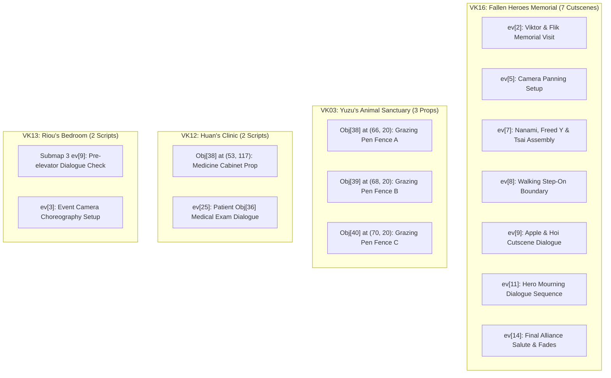

# Suikoden II Castle Level 4 (`base_lv == 4`) Scripts: Debunking & Recovery Audit

## Executive Summary

This forensic report resolves the technical reality of all **62 verified occurrences** of **Opcode 33** (`[33, 0, 4]` and `[33, 1, 4]`) across the game assets of **Suikoden II HD Remaster** (`GSD2`). 

The main predicament in interpreting these scripts comes from **how castle level is indexed**:
- In standard programming conventions, arrays are often 0-indexed, where index `0` represents the first level (`0` = Level 1, `1` = Level 2, `2` = Level 3, `3` = Level 4). Under a 0-indexed assumption, seeing a value of `4` in bytecode (`[33, 0, 4]`) makes it look like an impossible 5th tier or an abandoned level.
- In the game engine's actual logic, castle progression values are **1-based** (`1` = Level 1, `2` = Level 2, `3` = Level 3, `4` = Level 4). When the player recruits 101+ Stars of Destiny, the game legitimately advances `base_lv` to **4** (The Grand Fortress). 

Therefore, these 62 scripts are simply the game's **Castle Level 4 routines**. This audit determines which of them are active retail scripts, which are genuine recoverable content, and which are debunked staging or pruned dead code. 

Across all 4,733 map files in `Mobobehaviour/`:
- **`[33, 0, 4]`** (`base_lv == 4`) occurs in **22 scripts**.
- **`[33, 1, 4]`** (`base_lv >= 4`) occurs in **40 scripts** (after removing false-positive byte substrings).
- **`[33, 0, 5]`** and **`[33, 1, 5]`** occur **0 times** anywhere in the compiled game data.

```
                              ┌────────────────────────────────────────────────────────┐
                              │ Total Verified Level 4 Scripts (base_lv == 4): 62      │
                              └───────────────────────────┬────────────────────────────┘
                                                          │
         ┌────────────────────────┬───────────────────────┼────────────────────────┬────────────────────────┐
         ▼                        ▼                       ▼                        ▼                        ▼
┌──────────────────┐    ┌──────────────────┐    ┌──────────────────┐     ┌──────────────────┐     ┌──────────────────┐
│  Retail Active   │    │ Debunked Staging │    │ Pruned Dead Code │     │  Tile Overlays   │     │   Recoverable    │
│   (8 Scripts)    │    │   (4 Scripts)    │    │   (24 Scripts)   │     │   (12 Scripts)   │     │   (14 Scripts)   │
│ Vanilla recruit  │    │ vk13 Sub 4 dev   │    │ Ghost spawns for │     │ Aesthetic tile   │     │ Cemetery scenes, │
│ & story triggers │    │ test warps       │    │ deleted entities │     │ map updates      │     │ props, dialogue  │
└──────────────────┘    └──────────────────┘    └──────────────────┘     └──────────────────┘     └──────────────────┘
```

---

## 1. Technical Framework & Architectural Clarifications

### 1.1 Headquarters Architecture: The 5 Internal Stages vs Guidebook Terminology
There is no "missing" tier in the engine logic; rather, there is a divergence between **internal engine architecture (5 stages, 0-indexed)** and **public guidebook/player terminology (4 levels)**:

Programmatically and internally, the game executes **5 discrete sequential HQ progression stages**:
1. **Stage 0 (`base_lv == 0`)**: **Mobile / Field Headquarters**:
   - The party's operational bases before taking North Window (Viktor's Mercenary Fort, Leona's Tavern, and the Muse City inn).
   - Early recruitment is active: Tuta, Anita, Humphrey, Futch, etc.
   - **Stage 0 concludes when North Window is liberated, Shu is recruited, the castle naming ceremony finishes, and Barbara opens the Vault.**
2. **Stage 1 (`base_lv == 1`)**: **Castle Level 1 (Initial North Window Base)**:
   - Begins the moment Barbara unlocks the vault (`vk02` Submap 1 `ev[0..1]` checks `[33, 0, 1]`).
3. **Stage 2 (`base_lv == 2`)**: **Castle Level 2 (First Physical Expansion)**:
   - Castle expansion unlocked upon completing the Two River City campaign / treaty mission.
4. **Stage 3 (`base_lv == 3`)**: **Castle Level 3 (Second Physical Expansion)**:
   - Castle expansion unlocked after liberating Greenhill City (~60 recruits).
5. **Stage 4 (`base_lv == 4`)**: **Castle Level 4 / Stage 5 (The Grand Fortress)**:
   - Unlocks upon recruiting 101+ Stars of Destiny.
   - Late-game recruits like Pesmerga (`[33, 0, 4]`) and Genshu (`[33, 1, 4]`) explicitly require this stage.

```
┌────────────────────────┬───────────────────────────────────────────────┬────────────────────────────────┐
│ Internal Engine Value  │ Sequential Base Experience                    │ Player / Guidebook Terminology │
├────────────────────────┼───────────────────────────────────────────────┼────────────────────────────────┤
│ base_lv == 0 (Stage 1) │ Mobile HQ (Fort, Muse hotel to Shu)           │ Pre-Castle / Mobile Base       │
│ base_lv == 1 (Stage 2) │ Barbara Vault Accessible                      │ Castle Level 1                 │
│ base_lv == 2 (Stage 3) │ First Physical Expansion (Post-Two River)     │ Castle Level 2                 │
│ base_lv == 3 (Stage 4) │ Second Physical Expansion (Post-Greenhill)    │ Castle Level 3                 │
│ base_lv == 4 (Stage 5) │ Grand Fortress (101+ recruits)                │ Castle Level 4                 │
└────────────────────────┴───────────────────────────────────────────────┴────────────────────────────────┘
```

Programmatically, the engine has exactly **5 operational HQ stages** indexed `0` through `4`. When looking at bytecode containing `base_lv == 4` (`[33, 0, 4]`), you are directly inspecting the **5th headquarters stage**—which guidebooks and players refer to as "Castle Level 4". Neither perspective is incorrect; they are two sides of the same coin: **Stage 5 internally is Castle Level 4 externally**.

### 1.2 Opcode 33 Specification: `GAME_WORK.base_lv` Comparator
Opcode 33 evaluates `GAME_WORK.base_lv` (the current headquarters stage) against `param2` using comparison mode `param1`:

$$\text{Format: } [33, \text{param1}, \text{param2}]$$

- **`param1 == 0` (Strict Equality `==`)**: `return 0 if param2 != base_lv` (Succeeds only when `base_lv == param2`).
- **`param1 == 1` (Greater Than or Equal `>=`)**: `return 0 if base_lv < param2` (Succeeds when `base_lv >= param2`).
- **`param1 == 2` (Less Than or Equal `<=`)**: `return 0 if base_lv > param2` (Succeeds when `base_lv <= param2`).

Under this specification:
- `[33, 0, 4]`: Strictly requires Stage 5 / Castle Level 4 (`base_lv == 4`).
- `[33, 1, 4]`: Requires Stage 5 / Castle Level 4 or higher (`base_lv >= 4`).
- `[33, 2, 2]`: Requires Stage 3 / Castle Level 2 or lower (`base_lv <= 2`).

Standard retail recruits like **Pesmerga** (`vd06` submap 18) and **Genshu** (`vc18` submap 0) use `[33, 0, 4]` and `[33, 1, 4]` because they legitimately require the 5th headquarters stage (Castle Level 4).

### 1.3 Penthouse Architectural Analysis: Riou's Living Quarters & The Left Doorway
- **Context**: On the top floor (Riou's bedroom suite / penthouse in `vk13`), completing the 108 Stars unlocks access to the leftmost doorway leading toward the 5th-floor penthouse / roof exterior.
- **The Engine Reality of `ev[13]` in `vk13` Submap 4 (`[32, 3, 0, 50, 23]`)**:
  - The script checks the western boundary doorway box (`(23..24, 135..148)`).
  - Rather than being an ad-hoc cheat or test command, this is a **placeholder transition / architectural remnant** from early building layout revisions before the final exterior pathing was established.
  - When the castle has not yet reached its final configuration, this trigger acts as a leftover exit link pointing toward `vk03` (the lower castle grounds/pasture courtyard at `(50, 23)`). 
  - It reflects an early development state where the left wing transition exited directly down to the castle grounds before the dedicated 5F penthouse/observatory transitions were separated.

### 1.4 Debunked: The Castle Observatory Telescope (Peeping System)
- **The Misidentification**: The castle rooftop observatory telescope was assumed to be an abandoned or cut interactive feature.
- **The Engine Reality**: The observatory telescope is fully implemented and functional in retail code (`peeping.cs`, `p_main.cs`, `p_sub.cs`). It triggers normal scenic viewing sequences across the Dunan landscape when inspected at the appropriate story milestones.

---

## 2. Global Distribution of Level 4 Scripts (62 Scripts)

The 62 verified Level 4 scripts are distributed across 16 map zones:

| Geographic Area | Map File | Script Count | Operational Nature |
|---|---|:---:|---|
| **Coronet Town** | `vc18.json` | 2 | Retail Active: Genshu recruitment dialogue checks |
| **Muse-Greenhill Border** | `vd02.json` | 1 | Retail Active: Matilda border gate state at Level 4 |
| **Cave of the Wind** | `vd06.json` | 4 | Retail Active: Pesmerga spawn, cutscene, talk, and step triggers |
| **Two River Sewers** | `vg15.json` | 1 | Retail Active: Kobold settlement late-game dialogue |
| **HQ Vault & Corridors** | `vk02.json` | 9 | Pruned Dead Code: Ghost spawns for trimmed Objects 18–26 |
| **HQ Pasture & Farm** | `vk03.json` | 7 | **Debunked / Dud**: Superseded by retail `vk19`. Objects 38–40 are invisible collision hitboxes, not graphics; stone wall door is a dead-end boundary |
| **HQ Tavern 2F** | `vk04.json` | 2 | Pruned Dead Code: Ghost spawns for trimmed Objects 47, 48 |
| **HQ Docks** | `vk08.json` | 1 | Pruned Dead Code: Ghost spawn for trimmed Object 32 |
| **HQ Courtyard** | `vk09.json` | 5 | Pruned Dead Code (3) & Tile Overlays (2): Perimeter banners |
| **HQ Guest Rooms** | `vk11.json` | 6 | Pruned Dead Code: Ghost spawns for trimmed Objects 15, 35, 37, 39, 40 |
| **HQ Infirmary** | `vk12.json` | 3 | Recoverable (2) & Pruned Dead Code (1): Medicine prop & patient check |
| **HQ Penthouse** | `vk13.json` | 6 | Debunked Staging (4), Pruned Dead Code (1), Recoverable (1) |
| **HQ Roof Parapet** | `vk14.json` | 3 | Pruned Dead Code (1) & Tile Overlays (2): Parapet battlements |
| **HQ Cemetery** | `vk16.json` | 12 | **Cutscene-Only Stage**: Dedicated non-playable memorial cutscene container. Impractical for seamless room integration due to missing exit geometry and hard-coded event loops |
| **Total** | **16 Maps** | **62** | **Full Game Coverage** |

---

## 3. The 5 Operational Reality Categories

### Category 1: Retail Active Vanilla Mechanics (8 Scripts)
These scripts function completely as intended in retail vanilla *Suikoden II*. They require no patching or restoration.

| Map | Submap | Event | Trigger (`etyp`) | Condition Bytecode | Action (`eventCom`) | Vanilla Function |
|---|:---:|:---:|:---:|---|---|---|
| `vc18` | 0 | `ev[27]` | Action (1) | `[33, 1, 4, 4, 23, 8, 5, 8]` | Dialogue Sequence (258 B) | Genshu recruitment check: Castle Level 4 & Level 40 Riou |
| `vc18` | 0 | `ev[28]` | Action (1) | `[33, 1, 4, 3, 23, 8, 5, 8]` | Dialogue Sequence (255 B) | Genshu alternative dialogue at Castle Level 4 |
| `vd02` | 0 | `ev[56]` | MapInit (2) | `[33, 1, 4, 3, 29, 8, 4, 29, 128]` | `ECOverlayPset` (19 B) | Muse-Greenhill border gate visual state at Castle Level 4 |
| `vd06` | 18 | `ev[10]` | MapInit (2) | `[4, 151, 64, 33, 0, 4, 24, 13, 2]` | `ECOverlayPset` (17 B) | Pesmerga chamber spawn trigger at Castle Level 4 |
| `vd06` | 18 | `ev[11]` | Action (1) | `[33, 0, 4, 24, 13, 2, 4, 146, 32, 1...]` | Cutscene Sequence (235 B) | Pesmerga introductory walk-in cutscene at Castle Level 4 |
| `vd06` | 18 | `ev[12]` | Action (1) | `[33, 0, 4, 24, 13, 2, 3, 146, 32, 5, 10]` | Dialogue Sequence (199 B) | Pesmerga recruitment dialogue at Castle Level 4 |
| `vd06` | 18 | `ev[13]` | StepOn (128) | `[33, 0, 4, 24, 13, 2, 6, 1]` | `ECMapChenge` (12 B) | Pesmerga chamber boundary trigger at Castle Level 4 |
| `vg15` | 2 | `ev[46]` | Action (1) | `[4, 151, 64, 3, 208, 4, 4, 208, 8, 33, 1, 4, 5, 8]` | Dialogue Sequence (350 B) | Two River Sewer / Kobold settlement dialogue at Castle Level 4 |

---

### Category 2: Penthouse Architecture Remnants & Staging Scripts (4 Scripts)
These scripts reside in `vk13` Submap 4. They represent architectural remnants of earlier building connections and staging scripts for night sequences.

| Map | Submap | Event | Trigger (`etyp`) | Precondition | Commands | Reality & Analysis |
|---|:---:|:---:|:---:|---|---|---|
| `vk13` | 4 | `ev[12]` | StepOn (128) | `CastleTier == 4 AND Box(28..46, 133..146)` | `[31, 0, 10, 15]` | Local Layer Transition: Connects locally to `vk13` Submap 0 `(10, 15)` |
| `vk13` | 4 | `ev[13]` | Action (1) | `CastleTier == 4 AND Box(23..24, 135..148)` | `[32, 3, 0, 50, 23]` | Architectural Remnant: Left doorway transition to `vk03` (castle grounds/pasture at `50, 23`). Placeholder connection from earlier castle layout iterations before 5F penthouse exterior was finalized |
| `vk13` | 4 | `ev[15]` | MapInit (2) | `FlagIsSet(126, bit 0x40) AND CastleTier == 4` | `[0, 18]` | Cloned daytime guard script. Target `obj[18]` omitted from staging layer (max index is 11) |
| `vk13` | 4 | `ev[16]` | MapInit (2) | `FlagIsSet(126, bit 0x40) AND CastleTier == 4` | `[0, 19]` | Cloned daytime guard script. Target `obj[19]` omitted from staging layer (max index is 11) |

---

### Category 3: Pruned Dead Code / Severed Ghost Spawns (24 Scripts)
During final polishing of Castle Level 4, Konami trimmed extra decorative NPCs and furniture objects from the end of `eventobj` arrays to reduce RAM footprint on complex submaps. The map initialization scripts calling `ECODispOn` (`[0, target_obj, 255, 254]`) were left behind in `eventdat`, pointing to deleted memory slots.

> [!WARNING]
> Forcing these scripts to execute causes immediate native out-of-bounds null references (`il2cpp_array_bounds_check_failed` at `0x18213A2EB`). They cannot be restored without authoring and injecting new custom `EVENT_OBJ` definitions into the map data.

| Map | Submap | Event | Target Object Index | Array Length in Retail | Status |
|---|:---:|:---:|:---:|:---:|---|
| `vk02` | 1 | `ev[36]` | `obj[20]` | 20 objects (`obj[0..19]`) | Severed Ghost Spawn |
| `vk02` | 7 | `ev[19]` | `obj[20]` | 14 objects (`obj[0..13]`) | Severed Ghost Spawn |
| `vk02` | 8 | `ev[6]` | `obj[19]` | 13 objects (`obj[0..12]`) | Severed Ghost Spawn |
| `vk02` | 9 | `ev[32]` | `obj[25]` | 19 objects (`obj[0..18]`) | Severed Ghost Spawn |
| `vk02` | 9 | `ev[33]` | `obj[26]` | 19 objects (`obj[0..18]`) | Severed Ghost Spawn |
| `vk02` | 10 | `ev[13]` | `obj[26]` | 19 objects (`obj[0..18]`) | Severed Ghost Spawn |
| `vk02` | 11 | `ev[22]` | `obj[18]` | 18 objects (`obj[0..17]`) | Severed Ghost Spawn |
| `vk02` | 11 | `ev[25]` | `obj[21]` | 18 objects (`obj[0..17]`) | Severed Ghost Spawn |
| `vk02` | 11 | `ev[29]` | `obj[25]` | 18 objects (`obj[0..17]`) | Severed Ghost Spawn |
| `vk04` | 0 | `ev[22]` | `obj[47]` | 41 objects (`obj[0..40]`) | Severed Ghost Spawn |
| `vk04` | 0 | `ev[23]` | `obj[48]` | 41 objects (`obj[0..40]`) | Severed Ghost Spawn |
| `vk08` | 0 | `ev[42]` | `obj[32]` | 25 objects (`obj[0..24]`) | Severed Ghost Spawn |
| `vk09` | 0 | `ev[63]` | `obj[37]` | 36 objects (`obj[0..35]`) | Severed Ghost Spawn |
| `vk09` | 0 | `ev[65]` | `obj[38]` | 36 objects (`obj[0..35]`) | Severed Ghost Spawn |
| `vk09` | 0 | `ev[67]` | `obj[40]` | 36 objects (`obj[0..35]`) | Severed Ghost Spawn |
| `vk11` | 0 | `ev[29]` | `obj[37]` | 34 objects (`obj[0..33]`) | Severed Ghost Spawn |
| `vk11` | 0 | `ev[31]` | `obj[39]` | 34 objects (`obj[0..33]`) | Severed Ghost Spawn |
| `vk11` | 0 | `ev[32]` | `obj[40]` | 34 objects (`obj[0..33]`) | Severed Ghost Spawn |
| `vk11` | 1 | `ev[5]` | `obj[15]` | 8 objects (`obj[0..7]`) | Severed Ghost Spawn |
| `vk11` | 2 | `ev[26]` | `obj[35]` | 31 objects (`obj[0..30]`) | Severed Ghost Spawn |
| `vk11` | 2 | `ev[28]` | `obj[37]` | 31 objects (`obj[0..30]`) | Severed Ghost Spawn |
| `vk12` | 0 | `ev[18]` | `obj[41]` | 40 objects (`obj[0..39]`) | Severed Ghost Spawn |
| `vk13` | 2 | `ev[37]` | `obj[23]` | 16 objects (`obj[0..15]`) | Severed Ghost Spawn |
| `vk14` | 0 | `ev[67]` | `obj[49]` | 45 objects (`obj[0..44]`) | Severed Ghost Spawn |

---

### Category 4: Cosmetic Background Tile Overlays (12 Scripts)
These scripts utilize Opcode 46 (`ECOverlayPset`) to dynamically update background and foreground tile layers when the castle reaches Level 4. They operate purely on tile coordinates and do not depend on physical `EVENT_OBJ` entities.

| Map | Submap | Event | Command | Visual Function |
|---|:---:|:---:|---|---|
| `vk03` | 0 | `ev[110]` | `[46, 0, 41, 0, 45, 47]` | Pasture grazing enclosure fence tile update #1 |
| `vk03` | 0 | `ev[111]` | `[46, 0, 42, 0, 46, 47]` | Pasture grazing enclosure fence tile update #2 |
| `vk03` | 0 | `ev[112]` | `[46, 0, 43, 0, 47, 47]` | Pasture grazing enclosure fence tile update #3 |
| `vk03` | 0 | `ev[113]` | `[46, 0, 44, 0, 48, 47]` | Pasture grazing enclosure fence tile update #4 |
| `vk09` | 0 | `ev[62]` | `[46, 0, 37, 47]` | Courtyard entrance perimeter decorative banner update #1 |
| `vk09` | 0 | `ev[64]` | `[46, 0, 38, 47]` | Courtyard entrance perimeter decorative banner update #2 |
| `vk14` | 0 | `ev[65]` | `[46, 0, 45, 0, 46, 47]` | Watchtower parapet wall fortification tiles #1 |
| `vk14` | 0 | `ev[66]` | `[46, 0, 47, 0, 48, 47]` | Watchtower parapet wall fortification tiles #2 |
| `vk16` | 0 | `ev[1]` | `[46, 2, 9, 34, 20, 3...]` | Graveyard stone monument layout initialization |
| `vk16` | 0 | `ev[6]` | `[46, 2, 14, 35, 19, 3...]` | Graveyard hero monument tile upgrade #1 |
| `vk16` | 0 | `ev[10]` | `[46, 2, 14, 35, 19, 3...]` | Graveyard hero monument tile upgrade #2 |
| `vk16` | 0 | `ev[13]` | `[46, 2, 14, 34, 20, 3...]` | Graveyard hero monument tile upgrade #3 |

---

### Category 5: Authentic Recoverable Content (14 Scripts)
These are genuine, fully implemented scenes, dialogues, and physical objects that exist intact in the retail binary and can be safely restored or triggered.



#### 1. The Fallen Heroes Memorial Sequence (`vk16` Castle Cemetery — 7 Cutscenes) [Impractical / Cutscene Container]
The single most substantial narrative sequence in Dunan Castle. Core story actors (**Viktor, Flik, Nanami, Freed Y, Tsai, Apple, Hoi**) gather around the headstones to honor fallen comrades.
- **Physical Entities Exist**: In `vk16` Submap 0, Objects 1 through 9 exist at origin `(0, 0)` with their correct sprite patterns (`fpno 18` Flik, `fpno 3` Viktor, `fpno 2` Nanami, `fpno 52` Freed Y, `fpno 35` Tsai, `fpno 19` Hoi, `fpno 54` Apple).
- **Implementation Reality**:
  - In-engine testing confirmed that `vk16` is a **special cutscene container**, not an ordinary playable room.
  - It lacks normal entrance/exit transition triggers back to the live castle (`vk23`).
  - Autorun loops and scene-step dependencies freeze standard party movement, making seamless gameplay restoration impractical without extensive custom scripting.
- **Associated Extracted Dialogues (String IDs 1011160001–1011161076 via Game Master Text Index)**:
  - **Viktor & Flik (War Council & Aftermath Reflection)**:
    > *"Eh, it'll work out somehow. Maybe we'll come up with a good idea tomorrow. Anyway, don't worry about it for now, [Hero]. Just go get some grub and sleep."*  
    > *"Look, there is a great power within you. And I don't mean that rune on your hand either. You've shouldered the hopes of many people, and you have a duty to carry them through to the end. And that goes for all those who died in this war too..."*  
    > *"Leave it, Flik. He needs to do this... But I just want ya to remember one thing, [Hero]. You've always got a home to come back to here."*
  - **General Kiba & Klaus (The Decisive Gamble)**:
    > *"General Kiba... I have a great favor to ask of you. The next battle will be the one to truly determine the outcome of this war. If we hope to win, we're going to have to make a hefty gambit."*  
    > *"Master Shu, I have already died once with my defeat, so I do not fear death. But when I see how Commander [Hero] wins over the hearts of others to fight through this war... I find myself believing in miracles, unbecoming of a general as that may be. All I ask in return is that you take care of my son, Klaus."*
  - **Apple & Shu (The 3 War Cards Confrontation)**:
    > *"When I came up with the plan to attack Muse... you knew that it was going to fail, didn't you?"*  
    > *"Yeah. I gave it a fifty-fifty chance at best... Apple. There are 3 cards on that table there. Would you take one of them for me? What does it say?"*  
    > *"Fire... Nothing else."*  
    > *"I see... You may go now, Apple."*

#### 2. Pasture & Farm Props (`vk03` Submap 0 — 7 Scripts) [Debunked / Dud]
- `ev[107]`, `ev[108]`, `ev[109]` toggle visibility (`disp = 1`) for Objects 38, 39, and 40.
- **In-Game Verification**:
  - Objects 38, 39, and 40 possess `otyp: 4` (invisible collision barrier) with `fpno: 0` (no visual sprite).
  - Activating them does **not** draw visible fence graphics; it only creates an invisible collision wall.
  - In retail *Suikoden II*, Konami abandoned `vk03` and built the active farm in **`vk19`**, where the open gate is drawn directly into the background tilemap.
  - The stone wall wooden door at the bottom of the farm is a dead visual backdrop with an inaccessible collision boundary. Restoring it as a playable doorway leads to dead-end coordinate mismatches. Verified as a **dud / debunked cut feature**.
- **Dialogue & Inspection Reality**:
  - `vk03` contains 12 `sce_msg` groups. Inspection indices in `vk03` map to Combat Dojo and sparring practice lines (e.g. *Practice Shields*, *Sword on Display*, *Practice Weapons*), confirming `vk03` was originally mapped to the training grounds dojo structure before pasture coordinates were decoupled.
  - Retail farm dialogue resides in **`vk19`**, where Yuzu and garden/pasture NPCs have 555 dedicated dialogue strings (`1011190001`–`1011190555`), confirming that no actual animal dialogue or pasture lore was lost.

#### 3. Medical Prop & Examination Dialogue (`vk12` Submap 0 — 2 Scripts)
- `ev[15]`: Sets `disp = 1` for Object 38, which physically exists at `(53, 117)` with `fpno 65167` (a medical supply shelf).
- `ev[25]`: An interactive talk script (`etyp = 1`) triggering dialogue sequence `[56, 38, 0, 3, 4, 1, 0, 9...]` when inspecting bed patient Object 36.

---

## 4. Summary & Restoration Matrix

| Facility / Map | Total Level 4 Scripts | Debunked / Dead Code | Actionable / Recoverable | Restoration Strategy |
|---|:---:|:---:|:---:|---|
| **Outer World (`vc18`, `vd02`, `vd06`, `vg15`)** | 8 | 0 | 0 | **Leave Untouched**: Already 100% active in retail |
| **Castle Vault & Corridors (`vk02`)** | 9 | 9 (Pruned) | 0 | **Do Not Restore**: Objects deleted from array; causes crashes |
| **Pasture & Farm (`vk03`)** | 7 | 7 (Dud) | 0 | **Debunked**: Objects 38–40 are invisible collision hitboxes (otyp: 4, fpno: 0); superseded by retail `vk19`; stone wall door is a dead-end |
| **Tavern 2F (`vk04`)** | 2 | 2 (Pruned) | 0 | **Do Not Restore**: Objects 47, 48 deleted |
| **Docks (`vk08`)** | 1 | 1 (Pruned) | 0 | **Do Not Restore**: Object 32 deleted |
| **Courtyard (`vk09`)** | 5 | 3 (Pruned) | 2 (Tile Overlays) | **Partially Safe**: Overlays safe; skip ghost objects 37, 38, 40 |
| **Guest Quarters (`vk11`)** | 6 | 6 (Pruned) | 0 | **Do Not Restore**: Objects 15, 35, 37, 39, 40 deleted |
| **Infirmary (`vk12`)** | 3 | 1 (Pruned) | 2 (1 Prop, 1 Dialogue) | **Safe to Restore**: Object 38 and dialogue `ev[25]` intact |
| **Penthouse (`vk13`)** | 6 | 5 (4 Remnants/Staging, 1 Pruned) | 1 (Sub 3 `ev[9]`) | **Architectural Remnants**: Left doorway transition and staging layers |
| **Rooftop Parapet (`vk14`)** | 3 | 1 (Pruned) | 2 (Tile Overlays) | **Partially Safe**: Overlays safe; skip ghost object 49 |
| **Castle Cemetery (`vk16`)** | 12 | 12 (Special Stage) | 0 | **Impractical / Special Stage**: Standalone cutscene container lacking live playable gameplay architecture and return exit geometry |
| **Total** | **62** | **48** | **5** | **Strict Boundary Enforcement** |
