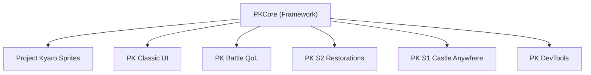

# Project Kyaro Feature Realignment

Working document for splitting PKCore into several smaller mods.
Snapshot taken **2026-10-25**. Source of truth: `ModConfiguration.cs` and `CHANGELOG.md`.

---

## 1. Current Settings Inventory

PKCore has **70 user-facing config entries** in `PKCore.cfg`, plus **5 hidden or hardcoded entries**, for **75 in total**.

| Section | Count | Settings |
| :--- | :---: | :--- |
| `01 Project Kyaro Sprites` | 4 | `EnableProjectKyaroSprites`, `DisableSpritePostProcessing`, `SpriteFilteringEnabled`, `SMAAQuality` |
| `02 User Interface` | 16 | `ControllerPromptType`, `LoadLauncherUITextures`, `MinimalUI`, `ClassicSaveWindow`, `ShowSaveSlotPartyPortraits`, `DisablePortraitDialogMask`, `ScaleDownDialogBox`, `ImGuiTheme`, `ShowLocationHUD`, `ScaledDownMenu`, `ShowBattleMaxHP`, `ShowEnemyLevelInBattle`, `ShowEnemyHpInBattle`, `PSPLauncher`, `EnhancedGallery`, `DisableUITips` |
| `03 General` | 5 | `SavePointColor`, `DisableSavePointGlow`, `DisableWorldMapClouds`, `DisableWorldMapSunrays`, `BetterLauncherBGM` |
| `04 Game : Suikoden 1` | 2 | `S1ScaledDownWorldMap`, `TirRunTexture` |
| `05 Game : Suikoden 2` | 24 | `EnablePortraitSystem`, `MercFortFence`, `ColoredIntroAndFlashbacks`, `EnableWarAbilityMod`, `EnableBattlePositionAdjustments`, `S2BattlePositionPreset`, `EnableTenzanChimeraFix`, `ForceTenzanChimeraEncounter`, `TenzanChimeraCycloneDropRate`, `UnlockSajahRareShopEarly`, `EnableMuseRuinsSurvivorsRestoration`, `EnableCharacterRangeOverrides`, `S2CharacterRangeOverrides`, `EnableRuneUnbalanceRemoval`, `DisableAllRuneUnbalance`, `DisabledRuneUnbalanceList`, `EnableUnlimitedCommandRunes`, `UnlimitedTrickRune`, `UnlimitedGroundhogRune`, `UnlimitedSpiderSlayRune`, `AlwaysAvailableAngryDragon`, `EnableMemoryAutoBattle`, `EnableSmartHealing`, `EnableNPCBathVisitors` |
| `06 Game : Suikoden 1` | 5 | `EnableS1QuickStorage`, `S1QuickStorageRequireRock`, `EnableS1QuickRuneMaster`, `S1QuickRuneMasterRequireJeane`, `EnableS1JeaneRuneShop` |
| `Performance` | 4 | `EnableTextureManifestCache`, `EnableMemoryCaching`, `EnableResolutionScaling`, `ResolutionScale` |
| `Utilty` | 1 | `ShowMouseCursor` |
| `zz - Diagnostics` | 8 | `LogTextIDs`, `DumpTextDatabase`, `DumpJsonAssets`, `EnableJsonOverrides`, `DetailedLogs`, `LogReplaceableTextures`, `LogBattlePositions`, `LogBattleUnitWindow` |
| `zz - Experimental` | 1 | `EnableDebugMenu2` |

**Hidden or hardcoded (5):** `EnableCustomTextures`, `ForceControllerPrompts`, `EnableSoundRedirect`, `EnableDialogOverrides`, `SpriteMipmapBias`.

**External data config:** `PKCore/Config/S2WarAbilities.json`.

> [!NOTE]
> Existing config issues:
> - The Suikoden 1 settings are split across two sections, `04 Game : Suikoden 1` and `06 Game : Suikoden 1`.
> - The section name `Utilty` is misspelled.
> - The `ShowBattleMaxHP`, `ShowEnemyLevelInBattle` and `ShowEnemyHpInBattle` settings are battle features, but they sit under `02 User Interface`.

---

## 2. Features Added on 2026-10-18

Commits: `67c8732`, `0384225`, `117eda3`, `e1ba8a4`.

| Feature | Game | Patch | Config |
| :--- | :--- | :--- | :--- |
| Battle Enemy HP Display | S1 + S2 | `BattleEnemyLevelPatch.cs` | `ShowEnemyHpInBattle` |
| Smart After-Battle Auto-Healing | S2 | `SmartHealingPatch.cs` | `EnableSmartHealing` |
| Memory Auto-Battle | S2 | `MemoryAutoBattlePatch.cs` | `EnableMemoryAutoBattle` |
| Tenzan Pass Chimera and Cyclone Rune Restoration | S2 | `TenzanPassEncounterPatch.cs` | `EnableTenzanChimeraFix`, `ForceTenzanChimeraEncounter`, `TenzanChimeraCycloneDropRate` |
| Sajah Village Rare Shop Early Unlock | S2 | `SajahShopUnlockPatch.cs` | `UnlockSajahRareShopEarly` |
| S2 Map IDs and Areas Reference (doc) | S2 | `Documentation/suikoden_2_map_ids_and_areas_breakdown.md` | — |

Same-day commits also added `RuneUnbalancePatch` / `CommandRuneUnlimitedPatch` (commit `117eda3`) and the room_item antique display restoration (commit `e1ba8a4`). The changelog files these under 2026-10-05.

---

## 3. Proposed Split (Suggestion)

This split is based on **what kind of player wants each feature**. A purist who wants HD sprites usually doesn't want balance changes. A speedrunner wants QoL but not restored content.

### 3.1 PKCore (Framework, required dependency)
This mod has no gameplay changes. It holds the shared infrastructure that the other mods use.
- Texture replacement engine (`EnableCustomTextures`), manifest cache, memory caching
- Sound redirect, dialog overrides, JSON overrides and dumps
- `GameDetection`, `MACHICON_OnMapInitPatch.CurrentMapId`, shared helpers
- Dear ImGui overlay **host**: other mods register their own panels with it
- Diagnostics logging, `ShowMouseCursor`, resolution scaling
- **About 14 settings**

### 3.2 Project Kyaro Sprites (Visual)
This is the flagship mod: visuals only.
- `EnableProjectKyaroSprites`, `SpriteFilteringEnabled`, `SMAAQuality`, `DisableSpritePostProcessing`
- `TirRunTexture`, `MercFortFence`, `SavePointColor`, `DisableSavePointGlow`
- `DisableWorldMapClouds`, `DisableWorldMapSunrays`, `ColoredIntroAndFlashbacks`
- `EnablePortraitSystem` (NPC portraits)
- **About 12 settings**

### 3.3 PK Classic UI (Interface / PSP-PSX feel)
- `ClassicSaveWindow`, `ShowSaveSlotPartyPortraits`, `ScaleDownDialogBox`, `ScaledDownMenu`, `MinimalUI`
- `DisablePortraitDialogMask`, `DisableUITips`, `S1ScaledDownWorldMap`
- `LoadLauncherUITextures`, `PSPLauncher`, `EnhancedGallery`, `BetterLauncherBGM`
- *(Note: `ControllerPromptType` / `ForceControllerPrompts` migrated to dedicated `PKButtonPrompts` plugin on 2026-10-25)*
- **About 12 settings**

### 3.4 PK Battle Patch (`PKBattlePatch`, completed on 2026-10-25)
- **Status: Migrated to dedicated standalone plugin `d:\Appz\PKBattlePatch` (`faospark.pkbattlepatch`)**.
- Info display: `ShowBattleMaxHP`, `ShowEnemyLevelInBattle`, `ShowEnemyHpInBattle`
- Convenience: `EnableMemoryAutoBattle`, `EnableSmartHealing`, `EnableBattlePositionAdjustments` and its preset
- Balance: `EnableUnlimitedCommandRunes` (and 4 per-rune toggles), `EnableRuneUnbalanceRemoval` (and list/all), `EnableCharacterRangeOverrides` (and list)
- Diagnostics: `LogBattlePositions`, `LogBattleUnitWindow`, `DetailedLogs`
- **19 settings completely decoupled from PKCore**.

### 3.5 PK S2 Restorations (Cut / bugged content)
These changes are all lore- or content-faithful and are a natural fit for "restoration" players.
- Tenzan Chimera (3 settings), Sajah Rare Shop, Muse Ruins Survivors, NPC Bath Visitors, room_item antiques
- **About 7 settings**

### 3.6 PK S1 Castle Anywhere (S1 QoL)
- `EnableS1QuickStorage`, `S1QuickStorageRequireRock`, `EnableS1QuickRuneMaster`, `S1QuickRuneMasterRequireJeane`, `EnableS1JeaneRuneShop`
- **5 settings**. This is a good candidate to merge into Battle QoL as a general **PK QoL** mod.

### 3.7 PK DevTools (Modder-only, not for players)
- ImGui Tile and Entity Editor, Map Teleport, Encounter None (`F4`), location HUD and dump
- `EnableDebugMenu2`, all `Log*` / `Dump*` diagnostics
- Players never see these options.

---

## 4. Ways to Reduce Settings Without Splitting

Options that could be merged or removed:

| Current | Suggestion | Saves |
| :--- | :--- | :---: |
| `EnableUnlimitedCommandRunes` and 4 per-rune toggles | Keep only the master toggle | 4 |
| `EnableRuneUnbalanceRemoval`, `DisableAllRuneUnbalance`, `DisabledRuneUnbalanceList` | Keep the master toggle and list | 1–2 |
| `EnableCharacterRangeOverrides` and `S2CharacterRangeOverrides` | Treat an empty list as off | 1 |
| `EnableBattlePositionAdjustments` and `S2BattlePositionPreset` | Treat `default` as off | 1 |
| `EnableResolutionScaling` and `ResolutionScale` | Treat `1.0` as off | 1 |
| `ForceTenzanChimeraEncounter` | Move to DevTools | 1 |
| `TenzanChimeraCycloneDropRate` | Hardcode to 100 or move to DevTools | 1 |
| `EnableMemoryCaching` (description says "never turn off") | Hide it | 1 |

**Possible savings: about 11–12 settings**, without removing any feature.

---

## 5. Open Decisions

- [ ] Should each split mod be its own DLL with a shared `PKCore.dll` dependency, or should one DLL build into several packages?
- [ ] Should the ImGui overlay stay in Core as a host, or move to DevTools?
- [ ] Should Battle QoL and Rebalance be separate mods?
- [ ] Should S1 Castle Anywhere be its own mod or merge into a general QoL mod?
- [ ] Should each mod keep its own `.cfg` file, or should all mods share `PKCore.cfg` with prefixed sections?

