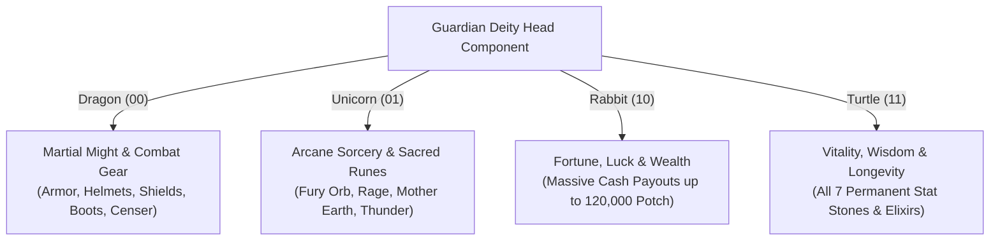

# Suikoden II - Guardian Deity (Syugoshin) Subsystem & 256 Statues Complete Master Guide

> [!NOTE]
> **Ground-Truth Forensic Documentation**: This document presents the complete, native disassembly and reverse-engineered architecture of the Guardian Deity (`syugoitm`) subsystem in *Suikoden II HD Remaster* (`GameAssembly.dll`). It resolves the 25-year-old mystery of sculptor Jude's statue rewards, corrects historical misconceptions originating from naive memory dumps, and catalogs all **256 bitwise statue combinations** (`0x00` through `0xFF`).

## 1. Executive Summary & Historical Background
In *Suikoden II*, Jude the Sculptor (Chikou Star / Earth Skill Star) can be recruited at Greenhill Academy by bringing him Clay (*Nendo*). Once recruited to Dunan Castle, Jude establishes his sculpture workshop on the living quarters floor (`vk20`) and the Guardian Deity Shrine (`vk33`). By collecting 16 blueprints scattered across the world (Dragon, Unicorn, Rabbit, and Turtle plans 1 through 4), the player can commission Jude to craft a Guardian Deity for Dunan Castle.

Upon completing the statue and inspecting it at the shrine, Jude evaluates his masterpiece. Depending on the exact combination of Head, Body, Legs, and Tail chosen by the player, Jude bestows a unique blessing / reward:
- **Pure Statues**: Distinct legendary relics such as the **Dragon Censer**, the sacred **Blue Gate Orb**, a massive payout of **110,000 Potch**, or a permanent **Stone of Magic**.
- **Permanent Stat Stones**: Permanent attribute boosts (+3 to ATK, MAG, DEF, M-DEF, SKL, SPD, or LUK).
- **Supreme Runes**: Late-game orbs including the **Fury Orb**, **Mother Earth Orb**, **Thunder Orb**, **Rage Orb**, **Double-Jab Orb**, and **Killer Orb**.
- **Heavy Equipment**: High-tier armor and gear including **Master Garb**, **Windspun Armor**, **Chaos Shield**, and **Winged Boots**.
- **Vast Fortunes in Potch**: Cash windfalls up to **120,000 Potch**.
- **Trap / Empty Duds**: 19 grotesque or discordant combinations that yield **0 rewards**, accompanied by Jude's creative dismay.

### The 25-Year Mystery & The Myth-Busting of Early Dumps
For decades, published strategy guides (such as BradyGames) only listed approximately 10 statue combinations. Early emulator tools and naive disassembly dumps (such as `tools/statues_full_table.json`) examined raw memory writes in `syugoitm$$.cctor` (`VA 0x1821b09b0`) but misinterpreted the native 2D array structure (`byte[2, 3]`). 

Specifically, naive tools read Column 1 (which encodes the category/type byte) and Column 2 (which encodes the item ID) as *two separate items*, erroneously claiming that statues yielded phantom rewards like early Blacksmith Hammers (`Gold Hammer`, `Silver Hammer`, `Copper Hammer`) or impossible quest skips (`Leon's Letter`, `Highland Uniform`, `Entry Permit`, `Secret Writings`).

**The Ground Truth**:
1. When Column 0 is `2`, the reward is **POTCH (Cash)**, calculated as `((Col 1 * 10) + Col 2) * 100`. The number `74` was not "Entry Permit" (Item ID 74), but **74,000 Potch**!
2. When Column 0 is `0`, Column 1 encodes `(Kind << 4) | Quantity`. `0x10` was not "Revenge Earth" (Item ID 16), but `Kind = 1` (**Equipment**)! ID 48 was `Winged Boots` (Equipment #48), not `Copper Hammer`.
3. `0x20` in Column 1 was not "Drinking Set" (Item ID 32), but `Kind = 2` (**Runes & Orbs**)! ID 87 was `Fury Orb` (Rune #87), not trade goods.

## 2. Blueprint Acquisition Reference (All 16 Plans)
To commission Jude, the player must gather plans for the four anatomical segments:
- **Plan 1** = Head Part
- **Plan 2** = Body Part
- **Plan 3** = Legs Part
- **Plan 4** = Tail Part

| Blueprint Name | Segment | In-Game Acquisition Location | Method / Details |
|:---|:---:|:---|:---|
| **Dragon Plans 1** | Head | Ryube Village | Dropped by Wild Pig in the forest outskirts |
| **Dragon Plans 2** | Body | Mt. Senhu | Treasure chest along the cliff trail |
| **Dragon Plans 3** | Legs | Tinto Mines | Dropped by Lizard enemy in lower shafts |
| **Dragon Plans 4** | Tail | Crom Village | Boy NPC behind elder's residence |
| **Unicorn Plans 1** | Head | Radat Town | Fishing / appraisal mini-event or dropped by White Wolf |
| **Unicorn Plans 2** | Body | Two River City (Winger Quarter) | Treasure chest in the underground sewers |
| **Unicorn Plans 3** | Legs | Mt. Rakutei | Treasure chest near the summit cliff |
| **Unicorn Plans 4** | Tail | Coronet Town | Won as prize in Tai Ho's Chinchirorin / boat wharf chest |
| **Rabbit Plans 1** | Head | South Window | Treasure chest in City Hall / outskirts |
| **Rabbit Plans 2** | Body | Banner Village | Dropped by Samurai enemy in Banner Pass |
| **Rabbit Plans 3** | Legs | Forest Path to Matilda | Dropped by target enemy / hidden clearing chest |
| **Rabbit Plans 4** | Tail | Greenhill Forest Trail | Treasure chest in forest before path convergence |
| **Turtle Plans 1** | Head | Two River City (Kobold District) | Given by Kobold villager near water well |
| **Turtle Plans 2** | Body | Radat Town | Won by scoring high in Clive's target practice / rope minigame |
| **Turtle Plans 3** | Legs | Mt. Tigerwolf | Treasure chest midway through the rocky ascent |
| **Turtle Plans 4** | Tail | Kuskus Town | Appraiser shop woman NPC reward |

## 3. Bitwise Binary Architecture & Engine Implementation
### Class Structure & Native Address
The statue evaluation engine is implemented in `EventOverlayClass.syugoitm` within `GameAssembly.dll`:
- **Static Array Constructor (`syugoitm$$.cctor`)**: `VA 0x1821b09b0`
- **Array Container**: `syugoitm.sitem_tbl` (Static field of type `Il2CppReferenceArray<SYUGO_ITM_DATA>`)
- **Evaluation Handler**: `s_OverlayAddItem2Main` (`VA 0x1821bc320`)
- **Item Setting Hook**: `s_AI2EV_SetItem` (`VA 0x1821bc270`)
- **Object Data Dispatcher**: `g2_over_c$$G2_ovit_data` (`VA 0x181a3ef40`)

### Bitwise Encoding Formula
A single 8-bit unsigned integer (`0x00` through `0xFF`, 0 to 255) uniquely identifies the statue composition:

```text
Bit 7  Bit 6  Bit 5  Bit 4  Bit 3  Bit 2  Bit 1  Bit 0
[   Tail   ]  [   Legs   ]  [   Body   ]  [   Head   ]
```

Where each 2-bit pair represents one of the four mythological beasts:
- `00` (0) = **Dragon**
- `01` (1) = **Unicorn**
- `10` (2) = **Rabbit**
- `11` (3) = **Turtle**

$$	ext{Index} = 	ext{Head} + (	ext{Body} 	imes 4) + (	ext{Legs} 	imes 16) + (	ext{Tail} 	imes 64)$$
$$	ext{Index} = (	ext{Tail} \ll 6) \mid (	ext{Legs} \ll 4) \mid (	ext{Body} \ll 2) \mid 	ext{Head}$$

### Internal 2D Reward Matrix: `byte[2, 3]`
Each entry in `sitem_tbl` contains a `SYUGO_ITM_DATA` object wrapping:
- `byte itemkaz`: Number of valid reward rows (0, 1, or 2).
- `byte[,] item`: 2D array of dimensions `[2, 3]` (Row 0 and Row 1; Columns 0, 1, and 2).

```text
                 Col 0             Col 1                   Col 2
Row 0: [ Mode Flag (0 or 2) ] [ (Kind << 4) | Qty ] [ Exact Item / Entity ID ]
Row 1: [ Mode Flag (0 or 2) ] [ (Kind << 4) | Qty ] [ Exact Item / Entity ID ]
```

#### Mode Flag Decoding (Column 0)
1. **Mode 2 (Potch Payout)**:
   When `Column 0 == 2`, the engine executes the currency calculation branch at `0x1821bc6fa`:
   $$	ext{Potch Amount} = [(	ext{Column 1} 	imes 10) + 	ext{Column 2}] 	imes 100$$
   *Example*: Statue `0xAA` (Pure Rabbit) has `Col 0 = 2`, `Col 1 = 110`, `Col 2 = 0` $
ightarrow (110 	imes 10 + 0) 	imes 100 =$ **110,000 Potch**!
2. **Mode 0 (Standard Entity Award)**:
   When `Column 0 == 0`, Column 1 is bit-shifted to extract the object category:
   - `Kind = (Column 1 >> 4) & 0x07`
   - `Quantity = Column 1 & 0x0F` (if 0, defaults to 1)
   - `Item ID = Column 2`

#### `G2_ovit_data` Jump Table Dispatch (`0x181a3ef40`)
The engine passes `Kind` directly into the master `OVIT_DATA` structure:
- **Kind 0** (`rbx + 0x10`): `dogu_data` $
ightarrow$ **Usable Items / Consumables / Stat Stones**
- **Kind 1** (`rbx + 0x18`): `bogu_data` $
ightarrow$ **Equipment (Helmets, Armor, Shields, Accessories)**
- **Kind 2** (`rbx + 0x38`): `embl_data` $
ightarrow$ **Runes & Orbs**
- **Kind 3** (`rbx + 0x30`): `food_data` $
ightarrow$ **Farming Crops & Seeds**
- **Kind 4** (`rbx + 0x20`): `trade_data` $
ightarrow$ **Trade Goods**
- **Kind 5** (`rbx + 0x28`): `ex_it_data` $
ightarrow$ **Valuables & Antiques**
- **Kind 6** (`rbx + 0x40`): `dish_data` $
ightarrow$ **Hai Yo Cooked Dishes**

## 4. The Four Mythological Archetypes
The game's design assigns a distinct functional domain to each beast's Head component:



### 1. Dragon Head (Martial Equipment)
- Grants high-tier defensive gear and offensive accessories.
- Includes `Silver Armor`, `Master Garb`, `Windspun Armor`, `Chaos Shield`, `Silver Shield`, `Winged Boots`, `Flame Helmet`, and the pure **Dragon Censer**.

### 2. Unicorn Head (Arcane Runes & Orbs)
- Grants 41 distinct supreme runes, including rare and late-game magical orbs.
- Includes `Fury Orb`, `Mother Earth Orb`, `Thunder Orb`, `Rage Orb`, `Double-Jab Orb`, `Killer Orb`, `Spark Orb`, `Wizard Orb`, `Warrior Orb`, and the pure **Blue Gate Orb**.

### 3. Rabbit Head (Prosperity & Potch)
- 51 combinations award direct windfalls of Potch ranging from 11,000 to 120,000 Potch.
- Perfect for financing mid-game weapon sharpening, armor upgrades, and castle renovations.

### 4. Turtle Head (Longevity & Stat Stones)
- **Every single permanent stat stone in the game requires a Turtle Head**.
- All seven core attributes can be permanently enhanced through specific Turtle-headed combinations.

## 5. Strategic High-Tier Catalogs
### The 4 Pure Statues
| Hex | Binary | Statue Name | Blessing Reward | Significance |
|:---:|:---:|:---|:---|:---|
| `0x00` | `00000000` | Pure Dragon | **Dragon Censer** [Item #28] | Legendary antique decoration for the castle showroom |
| `0x55` | `01010101` | Pure Unicorn | **Blue Gate Orb** [Rune #17] | High-level Tier-4 spatial magic summon rune |
| `0xAA` | `10101010` | Pure Rabbit | **110,000 Potch** | Second-highest raw cash bounty from Jude |
| `0xFF` | `11111111` | Pure Turtle | **Stone of Magic** [Item #22] | Permanently increases target character's Magic attribute (+3 MAG) |

### The 7 Permanent Stat Stone Combinations
Every permanent stat stone in *Suikoden II* requires a **Turtle Head**. Use this exact matrix to target specific character growth:

| Stat Enhanced | Hex | Binary | Required Combination | Exact Reward |
|:---|:---:|:---:|:---|:---|
| **Power (+3 ATK)** | `0x0B` | `00001011` | **Turtle Head** / Rabbit Body / Dragon Legs / Dragon Tail | **Stone of Power** [Item #21] |
| **Magic (+3 MAG)** | `0xFF` | `11111111` | **Turtle Head** / Turtle Body / Turtle Legs / Turtle Tail | **Stone of Magic** [Item #22] |
| **Defense (+3 DEF)** | `0x9B` | `10011011` | **Turtle Head** / Rabbit Body / Unicorn Legs / Rabbit Tail | **Stone of Defense** [Item #23] |
| **Magic-Defense (+3 MDEF)** | `0xE7` | `11100111` | **Turtle Head** / Unicorn Body / Rabbit Legs / Turtle Tail | **Stone of Magic-Defense** [Item #24] |
| **Dexterity (+3 SKL)** | `0x53` | `01010011` | **Turtle Head** / Dragon Body / Unicorn Legs / Unicorn Tail | **Stone of Dexterity** [Item #25] |
| **Speed (+3 SPD)** | `0x07` | `00000111` | **Turtle Head** / Unicorn Body / Dragon Legs / Dragon Tail | **Stone of Speed** [Item #26] |
| **Luck (+3 LUK)** | `0x2F` | `00101111` | **Turtle Head** / Turtle Body / Rabbit Legs / Dragon Tail | **Stone of Luck** [Item #27] |

### Supreme Runes & Orbs (Unicorn Head Focus)
| Hex | Configuration | Awarded Rune | Effect / Strategic Value |
|:---:|:---|:---|:---|
| `0x05` | Unicorn / Unicorn / Dragon / Dragon | **Fury Orb** [Rune #87] | Enters battle permanently in Berserk state (+50% attack power) |
| `0x11` | Unicorn / Dragon / Unicorn / Dragon | **Rage Orb** [Rune #2] | Advanced Fire Rune (Explosion, Final Flame) |
| `0x25` | Unicorn / Unicorn / Rabbit / Dragon | **Double-Jab Orb** [Rune #65] | Chance to attack twice per turn |
| `0x29` | Unicorn / Rabbit / Rabbit / Dragon | **Killer Orb** [Rune #66] | Doubles critical hit rate |
| `0x35` | Unicorn / Unicorn / Turtle / Dragon | **Spark Orb** [Rune #68] | Party members act immediately following rune-bearer |
| `0x55` | Unicorn / Unicorn / Unicorn / Unicorn | **Blue Gate Orb** [Rune #17] | Pure Unicorn reward: High-tier summoning magic |
| `0x65` | Unicorn / Unicorn / Rabbit / Unicorn | **Thunder Orb** [Rune #10] | Advanced Lightning Rune (Thunder God, Ball of Lightning) |
| `0x66` | Rabbit / Unicorn / Rabbit / Unicorn | **Flowing Orb** [Rune #4] | Advanced Water Rune (Fog of Death, Mother Ocean) |
| `0x99` | Unicorn / Rabbit / Unicorn / Rabbit | **Mother Earth Orb** [Rune #8] | Advanced Earth Rune (Guardian Earth, Earthquake) |
| `0xBB` | Turtle / Rabbit / Turtle / Rabbit | **Cyclone Orb** [Rune #6] | Advanced Wind Rune (Shredding, Healing Wind) |
| `0xD1` | Unicorn / Dragon / Unicorn / Turtle | **Darkness Orb** [Rune #16] | Powerful single-target offensive death magic |
| `0x78` | Dragon / Rabbit / Turtle / Unicorn | **Fire Sealing Orb** [Rune #78] | Grants 100% immunity to all fire damage |
| `0x95` | Unicorn / Unicorn / Unicorn / Rabbit | **Wizard Orb** [Rune #83] | Halves ATK to double Magic attribute |
| `0xF5` | Unicorn / Unicorn / Turtle / Turtle | **Warrior Orb** [Rune #84] | Halves DEF to double physical attack power |

### Top Cash Payouts (Rabbit Head Focus)
| Rank | Hex | Binary | Statue Combination | Potch Awarded |
|:---:|:---:|:---:|:---|:---:|
| **1** | `0xA6` | `10100110` | **Rabbit Head** / Unicorn Body / Rabbit Legs / Rabbit Tail | **120,000 Potch** |
| **2** | `0xAA` | `10101010` | **Rabbit Head** / Rabbit Body / Rabbit Legs / Rabbit Tail | **110,000 Potch** |
| **3** | `0xAE` | `10101110` | **Rabbit Head** / Turtle Body / Rabbit Legs / Rabbit Tail | **98,000 Potch** |
| **4** | `0x8A` | `10001010` | **Rabbit Head** / Rabbit Body / Dragon Legs / Rabbit Tail | **88,000 Potch** |
| **5** | `0xBE` | `10111110` | **Rabbit Head** / Turtle Body / Turtle Legs / Rabbit Tail | **83,000 Potch** |
| **6** | `0xBA` | `10111010` | **Rabbit Head** / Rabbit Body / Turtle Legs / Rabbit Tail | **78,000 Potch** |
| **7** | `0xFA` | `11111010` | **Rabbit Head** / Rabbit Body / Turtle Legs / Turtle Tail | **74,000 Potch** |
| **8** | `0x9E` | `10011110` | **Rabbit Head** / Turtle Body / Unicorn Legs / Rabbit Tail | **72,000 Potch** |
| **8** | `0x5A` | `01011010` | **Rabbit Head** / Rabbit Body / Unicorn Legs / Unicorn Tail | **72,000 Potch** |
| **10** | `0x6E` | `01101110` | **Rabbit Head** / Turtle Body / Rabbit Legs / Unicorn Tail | **67,000 Potch** |

### The 19 Trap / Empty Dud Combinations (Zero Rewards)
> [!CAUTION]
> Assembling any of the following 19 combinations results in an empty `Array.Clear` execution (`VA 0x182487dc0`). Jude expresses intense dismay at the grotesque monstrosity and awards **nothing**. Avoid assembling these configurations:

| Index | Hex | Binary | Combination (Head / Body / Legs / Tail) | Result |
|:---:|:---:|:---:|:---|:---|
| 2 | `0x02` | `00000010` | Rabbit Head / Dragon Body / Dragon Legs / Dragon Tail | **No Reward (Dud)** |
| 33 | `0x21` | `00100001` | Unicorn Head / Dragon Body / Rabbit Legs / Dragon Tail | **No Reward (Dud)** |
| 34 | `0x22` | `00100010` | Rabbit Head / Dragon Body / Rabbit Legs / Dragon Tail | **No Reward (Dud)** |
| 51 | `0x33` | `00110011` | Turtle Head / Dragon Body / Turtle Legs / Dragon Tail | **No Reward (Dud)** |
| 74 | `0x4A` | `01001010` | Rabbit Head / Rabbit Body / Dragon Legs / Unicorn Tail | **No Reward (Dud)** |
| 106 | `0x6A` | `01101010` | Rabbit Head / Rabbit Body / Rabbit Legs / Unicorn Tail | **No Reward (Dud)** |
| 119 | `0x77` | `01110111` | Turtle Head / Unicorn Body / Turtle Legs / Unicorn Tail | **No Reward (Dud)** |
| 130 | `0x82` | `10000010` | Rabbit Head / Dragon Body / Dragon Legs / Rabbit Tail | **No Reward (Dud)** |
| 135 | `0x87` | `10000111` | Turtle Head / Unicorn Body / Dragon Legs / Rabbit Tail | **No Reward (Dud)** |
| 139 | `0x8B` | `10001011` | Turtle Head / Rabbit Body / Dragon Legs / Rabbit Tail | **No Reward (Dud)** |
| 143 | `0x8F` | `10001111` | Turtle Head / Turtle Body / Dragon Legs / Rabbit Tail | **No Reward (Dud)** |
| 147 | `0x93` | `10010011` | Turtle Head / Dragon Body / Unicorn Legs / Rabbit Tail | **No Reward (Dud)** |
| 159 | `0x9F` | `10011111` | Turtle Head / Turtle Body / Unicorn Legs / Rabbit Tail | **No Reward (Dud)** |
| 195 | `0xC3` | `11000011` | Turtle Head / Dragon Body / Dragon Legs / Turtle Tail | **No Reward (Dud)** |
| 199 | `0xC7` | `11000111` | Turtle Head / Unicorn Body / Dragon Legs / Turtle Tail | **No Reward (Dud)** |
| 210 | `0xD2` | `11010010` | Rabbit Head / Dragon Body / Unicorn Legs / Turtle Tail | **No Reward (Dud)** |
| 222 | `0xDE` | `11011110` | Rabbit Head / Turtle Body / Unicorn Legs / Turtle Tail | **No Reward (Dud)** |
| 234 | `0xEA` | `11101010` | Rabbit Head / Rabbit Body / Rabbit Legs / Turtle Tail | **No Reward (Dud)** |
| 238 | `0xEE` | `11101110` | Rabbit Head / Turtle Body / Rabbit Legs / Turtle Tail | **No Reward (Dud)** |

## 6. The Complete 256 Guardian Deity Master Table
The following table catalogs every possible statue combination from `0x00` through `0xFF` in numerical order, detailing the exact hex code, binary encoding, anatomical breakdown, primary reward, and internal category:

| Index | Hex | Binary | Head | Body | Legs | Tail | Primary Blessing / Award | Category |
|:---:|:---:|:---:|:---:|:---:|:---:|:---:|:---|:---:|
| 0 | `0x00` | `00000000` | Dragon | Dragon | Dragon | Dragon | Dragon Censer [Item #28] | Item |
| 1 | `0x01` | `00000001` | Unicorn | Dragon | Dragon | Dragon | Fire Orb [Rune #1] | Rune |
| 2 | `0x02` | `00000010` | Rabbit | Dragon | Dragon | Dragon | **None (Dud)** | None |
| 3 | `0x03` | `00000011` | Turtle | Dragon | Dragon | Dragon | 6x Medicine [Item #1] | Item |
| 4 | `0x04` | `00000100` | Dragon | Unicorn | Dragon | Dragon | Flame Helmet [Equipment #11] | Equipment |
| 5 | `0x05` | `00000101` | Unicorn | Unicorn | Dragon | Dragon | Fury Orb [Rune #87] | Rune |
| 6 | `0x06` | `00000110` | Rabbit | Unicorn | Dragon | Dragon | 9,000 Potch | Currency |
| 7 | `0x07` | `00000111` | Turtle | Unicorn | Dragon | Dragon | Stone of Speed [Item #26] | Item |
| 8 | `0x08` | `00001000` | Dragon | Rabbit | Dragon | Dragon | Headgear [Equipment #7] | Equipment |
| 9 | `0x09` | `00001001` | Unicorn | Rabbit | Dragon | Dragon | Balance Orb [Rune #77] | Rune |
| 10 | `0x0A` | `00001010` | Rabbit | Rabbit | Dragon | Dragon | 30,000 Potch | Currency |
| 11 | `0x0B` | `00001011` | Turtle | Rabbit | Dragon | Dragon | Stone of Power [Item #21] | Item |
| 12 | `0x0C` | `00001100` | Dragon | Turtle | Dragon | Dragon | Leather Hat [Equipment #2] | Equipment |
| 13 | `0x0D` | `00001101` | Unicorn | Turtle | Dragon | Dragon | Double-Edged Orb [Rune #82] | Rune |
| 14 | `0x0E` | `00001110` | Rabbit | Turtle | Dragon | Dragon | 8,000 Potch | Currency |
| 15 | `0x0F` | `00001111` | Turtle | Turtle | Dragon | Dragon | 9x Protect Mist [Item #10] | Item |
| 16 | `0x10` | `00010000` | Dragon | Dragon | Unicorn | Dragon | Bandanna [Equipment #1] | Equipment |
| 17 | `0x11` | `00010001` | Unicorn | Dragon | Unicorn | Dragon | Rage Orb [Rune #2] | Rune |
| 18 | `0x12` | `00010010` | Rabbit | Dragon | Unicorn | Dragon | 15,000 Potch | Currency |
| 19 | `0x13` | `00010011` | Turtle | Dragon | Unicorn | Dragon | 9x Flaming Arrows [Item #6] | Item |
| 20 | `0x14` | `00010100` | Dragon | Unicorn | Unicorn | Dragon | Silver Hat [Equipment #8] | Equipment |
| 21 | `0x15` | `00010101` | Unicorn | Unicorn | Unicorn | Dragon | Skunk Orb [Rune #79] | Rune |
| 22 | `0x16` | `00010110` | Rabbit | Unicorn | Unicorn | Dragon | 22,000 Potch | Currency |
| 23 | `0x17` | `00010111` | Turtle | Unicorn | Unicorn | Dragon | 9x Clay Guardian [Item #15] | Item |
| 24 | `0x18` | `00011000` | Dragon | Rabbit | Unicorn | Dragon | Circlet [Equipment #5] | Equipment |
| 25 | `0x19` | `00011001` | Unicorn | Rabbit | Unicorn | Dragon | Firefly Orb [Rune #80] | Rune |
| 26 | `0x1A` | `00011010` | Rabbit | Rabbit | Unicorn | Dragon | 32,000 Potch | Currency |
| 27 | `0x1B` | `00011011` | Turtle | Rabbit | Unicorn | Dragon | 9x Thunder Runner [Item #19] | Item |
| 28 | `0x1C` | `00011100` | Dragon | Turtle | Unicorn | Dragon | Silver Hat [Equipment #8] | Equipment |
| 29 | `0x1D` | `00011101` | Unicorn | Turtle | Unicorn | Dragon | Fire Sealing Orb [Rune #78] | Rune |
| 30 | `0x1E` | `00011110` | Rabbit | Turtle | Unicorn | Dragon | 17,000 Potch | Currency |
| 31 | `0x1F` | `00011111` | Turtle | Turtle | Unicorn | Dragon | 9x Raw Tomato [Dish #9] | Dish |
| 32 | `0x20` | `00100000` | Dragon | Dragon | Rabbit | Dragon | Full Helmet [Equipment #9] | Equipment |
| 33 | `0x21` | `00100001` | Unicorn | Dragon | Rabbit | Dragon | **None (Dud)** | None |
| 34 | `0x22` | `00100010` | Rabbit | Dragon | Rabbit | Dragon | **None (Dud)** | None |
| 35 | `0x23` | `00100011` | Turtle | Dragon | Rabbit | Dragon | 9x Kindness Drops [Item #9] | Item |
| 36 | `0x24` | `00100100` | Dragon | Unicorn | Rabbit | Dragon | Wind Hat [Equipment #10] | Equipment |
| 37 | `0x25` | `00100101` | Unicorn | Unicorn | Rabbit | Dragon | Double-Jab Orb [Rune #65] | Rune |
| 38 | `0x26` | `00100110` | Rabbit | Unicorn | Rabbit | Dragon | 36,000 Potch | Currency |
| 39 | `0x27` | `00100111` | Turtle | Unicorn | Rabbit | Dragon | 9x Tom Yum Stew [Dish #216] | Dish |
| 40 | `0x28` | `00101000` | Dragon | Rabbit | Rabbit | Dragon | Half Helmet [Equipment #6] | Equipment |
| 41 | `0x29` | `00101001` | Unicorn | Rabbit | Rabbit | Dragon | Killer Orb [Rune #66] | Rune |
| 42 | `0x2A` | `00101010` | Rabbit | Rabbit | Rabbit | Dragon | Gold Bar [Trade #41] | Trade |
| 43 | `0x2B` | `00101011` | Turtle | Rabbit | Rabbit | Dragon | 6x Beefsteak [Dish #219] | Dish |
| 44 | `0x2C` | `00101100` | Dragon | Turtle | Rabbit | Dragon | Wind Feather Ornament [Equipment #3] | Equipment |
| 45 | `0x2D` | `00101101` | Unicorn | Turtle | Rabbit | Dragon | Wall Orb [Rune #73] | Rune |
| 46 | `0x2E` | `00101110` | Rabbit | Turtle | Rabbit | Dragon | 35,000 Potch | Currency |
| 47 | `0x2F` | `00101111` | Turtle | Turtle | Rabbit | Dragon | Stone of Luck [Item #27] | Item |
| 48 | `0x30` | `00110000` | Dragon | Dragon | Turtle | Dragon | Circlet [Equipment #5] | Equipment |
| 49 | `0x31` | `00110001` | Unicorn | Dragon | Turtle | Dragon | Counter Orb [Rune #67] | Rune |
| 50 | `0x32` | `00110010` | Rabbit | Dragon | Turtle | Dragon | 17,000 Potch | Currency |
| 51 | `0x33` | `00110011` | Turtle | Dragon | Turtle | Dragon | **None (Dud)** | None |
| 52 | `0x34` | `00110100` | Dragon | Unicorn | Turtle | Dragon | Pointed Hat [Equipment #4] | Equipment |
| 53 | `0x35` | `00110101` | Unicorn | Unicorn | Turtle | Dragon | Spark Orb [Rune #68] | Rune |
| 54 | `0x36` | `00110110` | Rabbit | Unicorn | Turtle | Dragon | 22,000 Potch | Currency |
| 55 | `0x37` | `00110111` | Turtle | Unicorn | Turtle | Dragon | 9x Medicine [Item #1] | Item |
| 56 | `0x38` | `00111000` | Dragon | Rabbit | Turtle | Dragon | Half Helmet [Equipment #6] | Equipment |
| 57 | `0x39` | `00111001` | Unicorn | Rabbit | Turtle | Dragon | Gale Orb [Rune #69] | Rune |
| 58 | `0x3A` | `00111010` | Rabbit | Rabbit | Turtle | Dragon | 39,000 Potch | Currency |
| 59 | `0x3B` | `00111011` | Turtle | Rabbit | Turtle | Dragon | 6x Bolt of Wrath [Item #20] | Item |
| 60 | `0x3C` | `00111100` | Dragon | Turtle | Turtle | Dragon | Full Helmet [Equipment #9] | Equipment |
| 61 | `0x3D` | `00111101` | Unicorn | Turtle | Turtle | Dragon | Titan Orb [Rune #19] | Rune |
| 62 | `0x3E` | `00111110` | Rabbit | Turtle | Turtle | Dragon | 12,000 Potch | Currency |
| 63 | `0x3F` | `00111111` | Turtle | Turtle | Turtle | Dragon | 6x Revenge Earth [Item #16] | Item |
| 64 | `0x40` | `01000000` | Dragon | Dragon | Dragon | Unicorn | Wing Ornament [Equipment #64] | Equipment |
| 65 | `0x41` | `01000001` | Unicorn | Dragon | Dragon | Unicorn | Knight Orb [Rune #72] | Rune |
| 66 | `0x42` | `01000010` | Rabbit | Dragon | Dragon | Unicorn | 8,000 Potch | Currency |
| 67 | `0x43` | `01000011` | Turtle | Dragon | Dragon | Unicorn | 6x Flaming Sea Special [Dish #240] | Dish |
| 68 | `0x44` | `01000100` | Dragon | Unicorn | Dragon | Unicorn | Horned Helmet [Equipment #12] | Equipment |
| 69 | `0x45` | `01000101` | Unicorn | Unicorn | Dragon | Unicorn | Viper Orb [Rune #20] | Rune |
| 70 | `0x46` | `01000110` | Rabbit | Unicorn | Dragon | Unicorn | 16,000 Potch | Currency |
| 71 | `0x47` | `01000111` | Turtle | Unicorn | Dragon | Unicorn | 8x Tekka-don [Dish #198] | Dish |
| 72 | `0x48` | `01001000` | Dragon | Rabbit | Dragon | Unicorn | Crimson Cape [Equipment #59] | Equipment |
| 73 | `0x49` | `01001001` | Unicorn | Rabbit | Dragon | Unicorn | Great Hawk Orb [Rune #21] | Rune |
| 74 | `0x4A` | `01001010` | Rabbit | Rabbit | Dragon | Unicorn | **None (Dud)** | None |
| 75 | `0x4B` | `01001011` | Turtle | Rabbit | Dragon | Unicorn | Chick (Bath Set) [Item #31] | Item |
| 76 | `0x4C` | `01001100` | Dragon | Turtle | Dragon | Unicorn | Gloves [Equipment #50] | Equipment |
| 77 | `0x4D` | `01001101` | Unicorn | Turtle | Dragon | Unicorn | Lion Orb [Rune #22] | Rune |
| 78 | `0x4E` | `01001110` | Rabbit | Turtle | Dragon | Unicorn | 17,000 Potch | Currency |
| 79 | `0x4F` | `01001111` | Turtle | Turtle | Dragon | Unicorn | Toy Boat [Item #33] | Item |
| 80 | `0x50` | `01010000` | Dragon | Dragon | Unicorn | Unicorn | Goldlet [Equipment #54] | Equipment |
| 81 | `0x51` | `01010001` | Unicorn | Dragon | Unicorn | Unicorn | Water Orb [Rune #3] | Rune |
| 82 | `0x52` | `01010010` | Rabbit | Dragon | Unicorn | Unicorn | 19,000 Potch | Currency |
| 83 | `0x53` | `01010011` | Turtle | Dragon | Unicorn | Unicorn | Stone of Dexterity [Item #25] | Item |
| 84 | `0x54` | `01010100` | Dragon | Unicorn | Unicorn | Unicorn | Rose Brooch [Equipment #75] | Equipment |
| 85 | `0x55` | `01010101` | Unicorn | Unicorn | Unicorn | Unicorn | Blue Gate Orb [Rune #17] | Rune |
| 86 | `0x56` | `01010110` | Rabbit | Unicorn | Unicorn | Unicorn | 22,000 Potch | Currency |
| 87 | `0x57` | `01010111` | Turtle | Unicorn | Unicorn | Unicorn | 4x Antitoxin [Item #3] | Item |
| 88 | `0x58` | `01011000` | Dragon | Rabbit | Unicorn | Unicorn | Wind Amulet [Equipment #78] | Equipment |
| 89 | `0x59` | `01011001` | Unicorn | Rabbit | Unicorn | Unicorn | Hunter Orb [Rune #94] | Rune |
| 90 | `0x5A` | `01011010` | Rabbit | Rabbit | Unicorn | Unicorn | 72,000 Potch | Currency |
| 91 | `0x5B` | `01011011` | Turtle | Rabbit | Unicorn | Unicorn | 9x Mega Medicine [Item #2] | Item |
| 92 | `0x5C` | `01011100` | Dragon | Turtle | Unicorn | Unicorn | Power Ring [Equipment #82] | Equipment |
| 93 | `0x5D` | `01011101` | Unicorn | Turtle | Unicorn | Unicorn | Kite Orb [Rune #23] | Rune |
| 94 | `0x5E` | `01011110` | Rabbit | Turtle | Unicorn | Unicorn | 16,000 Potch | Currency |
| 95 | `0x5F` | `01011111` | Turtle | Turtle | Unicorn | Unicorn | 6x Kindness Rain [Item #11] | Item |
| 96 | `0x60` | `01100000` | Dragon | Dragon | Rabbit | Unicorn | Guard Ring [Equipment #79] | Equipment |
| 97 | `0x61` | `01100001` | Unicorn | Dragon | Rabbit | Unicorn | Unicorn Orb [Rune #24] | Rune |
| 98 | `0x62` | `01100010` | Rabbit | Dragon | Rabbit | Unicorn | 39,000 Potch | Currency |
| 99 | `0x63` | `01100011` | Turtle | Dragon | Rabbit | Unicorn | 9x Revenge Earth [Item #16] | Item |
| 100 | `0x64` | `01100100` | Dragon | Unicorn | Rabbit | Unicorn | Belt of Strength [Equipment #68] | Equipment |
| 101 | `0x65` | `01100101` | Unicorn | Unicorn | Rabbit | Unicorn | Thunder Orb [Rune #10] | Rune |
| 102 | `0x66` | `01100110` | Rabbit | Unicorn | Rabbit | Unicorn | Flowing Orb [Rune #4] | Rune |
| 103 | `0x67` | `01100111` | Turtle | Unicorn | Rabbit | Unicorn | 7x Mellow Stew [Dish #233] | Dish |
| 104 | `0x68` | `01101000` | Dragon | Rabbit | Rabbit | Unicorn | Blue Ribbon [Equipment #71] | Equipment |
| 105 | `0x69` | `01101001` | Unicorn | Rabbit | Rabbit | Unicorn | Gozu Orb [Rune #25] | Rune |
| 106 | `0x6A` | `01101010` | Rabbit | Rabbit | Rabbit | Unicorn | **None (Dud)** | None |
| 107 | `0x6B` | `01101011` | Turtle | Rabbit | Rabbit | Unicorn | 9x Antitoxin [Item #3] | Item |
| 108 | `0x6C` | `01101100` | Dragon | Turtle | Rabbit | Unicorn | Cape of Darkness [Equipment #58] | Equipment |
| 109 | `0x6D` | `01101101` | Unicorn | Turtle | Rabbit | Unicorn | Pixie Orb [Rune #26] | Rune |
| 110 | `0x6E` | `01101110` | Rabbit | Turtle | Rabbit | Unicorn | 67,000 Potch | Currency |
| 111 | `0x6F` | `01101111` | Turtle | Turtle | Rabbit | Unicorn | 9x Needle [Item #5] | Item |
| 112 | `0x70` | `01110000` | Dragon | Dragon | Turtle | Unicorn | Wooden Shoes [Equipment #45] | Equipment |
| 113 | `0x71` | `01110001` | Unicorn | Dragon | Turtle | Unicorn | Banshee Orb [Rune #27] | Rune |
| 114 | `0x72` | `01110010` | Rabbit | Dragon | Turtle | Unicorn | Ancient Text [Trade #40] | Trade |
| 115 | `0x73` | `01110011` | Turtle | Dragon | Turtle | Unicorn | 9x Throat Drops [Item #4] | Item |
| 116 | `0x74` | `01110100` | Dragon | Unicorn | Turtle | Unicorn | Star Earrings [Equipment #72] | Equipment |
| 117 | `0x75` | `01110101` | Unicorn | Unicorn | Turtle | Unicorn | Sylph Orb [Rune #28] | Rune |
| 118 | `0x76` | `01110110` | Rabbit | Unicorn | Turtle | Unicorn | 9,000 Potch | Currency |
| 119 | `0x77` | `01110111` | Turtle | Unicorn | Turtle | Unicorn | **None (Dud)** | None |
| 120 | `0x78` | `01111000` | Dragon | Rabbit | Turtle | Unicorn | Iron Boots [Equipment #49] | Equipment |
| 121 | `0x79` | `01111001` | Unicorn | Rabbit | Turtle | Unicorn | Chimera Orb [Rune #29] | Rune |
| 122 | `0x7A` | `01111010` | Rabbit | Rabbit | Turtle | Unicorn | 35,000 Potch | Currency |
| 123 | `0x7B` | `01111011` | Turtle | Rabbit | Turtle | Unicorn | 9x Rising Sun Bento [Dish #189] | Dish |
| 124 | `0x7C` | `01111100` | Dragon | Turtle | Turtle | Unicorn | Gold Emblem [Equipment #70] | Equipment |
| 125 | `0x7D` | `01111101` | Unicorn | Turtle | Turtle | Unicorn | Haziness Orb [Rune #74] | Rune |
| 126 | `0x7E` | `01111110` | Rabbit | Turtle | Turtle | Unicorn | 11,000 Potch | Currency |
| 127 | `0x7F` | `01111111` | Turtle | Turtle | Turtle | Unicorn | Fortune Orb [Rune #62] | Rune |
| 128 | `0x80` | `10000000` | Dragon | Dragon | Dragon | Rabbit | Silver Armor [Equipment #34] | Equipment |
| 129 | `0x81` | `10000001` | Unicorn | Dragon | Dragon | Rabbit | Fire Lizard Orb [Rune #92] | Rune |
| 130 | `0x82` | `10000010` | Rabbit | Dragon | Dragon | Rabbit | **None (Dud)** | None |
| 131 | `0x83` | `10000011` | Turtle | Dragon | Dragon | Rabbit | Drinking Set [Item #32] | Item |
| 132 | `0x84` | `10000100` | Dragon | Unicorn | Dragon | Rabbit | Master Garb [Equipment #30] | Equipment |
| 133 | `0x85` | `10000101` | Unicorn | Unicorn | Dragon | Rabbit | Technique Orb [Rune #95] | Rune |
| 134 | `0x86` | `10000110` | Rabbit | Unicorn | Dragon | Rabbit | 32,000 Potch | Currency |
| 135 | `0x87` | `10000111` | Turtle | Unicorn | Dragon | Rabbit | **None (Dud)** | None |
| 136 | `0x88` | `10001000` | Dragon | Rabbit | Dragon | Rabbit | Windspun Armor [Equipment #37] | Equipment |
| 137 | `0x89` | `10001001` | Unicorn | Rabbit | Dragon | Rabbit | Silence Orb [Rune #96] | Rune |
| 138 | `0x8A` | `10001010` | Rabbit | Rabbit | Dragon | Rabbit | 88,000 Potch | Currency |
| 139 | `0x8B` | `10001011` | Turtle | Rabbit | Dragon | Rabbit | **None (Dud)** | None |
| 140 | `0x8C` | `10001100` | Dragon | Turtle | Dragon | Rabbit | Scale Mail [Equipment #25] | Equipment |
| 141 | `0x8D` | `10001101` | Unicorn | Turtle | Dragon | Rabbit | Poison Orb [Rune #97] | Rune |
| 142 | `0x8E` | `10001110` | Rabbit | Turtle | Dragon | Rabbit | 63,000 Potch | Currency |
| 143 | `0x8F` | `10001111` | Turtle | Turtle | Dragon | Rabbit | **None (Dud)** | None |
| 144 | `0x90` | `10010000` | Dragon | Dragon | Unicorn | Rabbit | Thunder God Garb [Equipment #24] | Equipment |
| 145 | `0x91` | `10010001` | Unicorn | Dragon | Unicorn | Rabbit | Knockdown Orb [Rune #98] | Rune |
| 146 | `0x92` | `10010010` | Rabbit | Dragon | Unicorn | Rabbit | 34,000 Potch | Currency |
| 147 | `0x93` | `10010011` | Turtle | Dragon | Unicorn | Rabbit | **None (Dud)** | None |
| 148 | `0x94` | `10010100` | Dragon | Unicorn | Unicorn | Rabbit | Knight Armor [Equipment #35] | Equipment |
| 149 | `0x95` | `10010101` | Unicorn | Unicorn | Unicorn | Rabbit | Wizard Orb [Rune #83] | Rune |
| 150 | `0x96` | `10010110` | Rabbit | Unicorn | Unicorn | Rabbit | 31,000 Potch | Currency |
| 151 | `0x97` | `10010111` | Turtle | Unicorn | Unicorn | Rabbit | Drinking Set [Item #32], Toy Boat [Item #33] | Item |
| 152 | `0x98` | `10011000` | Dragon | Rabbit | Unicorn | Rabbit | Ninja Suit [Equipment #21] | Equipment |
| 153 | `0x99` | `10011001` | Unicorn | Rabbit | Unicorn | Rabbit | Mother Earth Orb [Rune #8] | Rune |
| 154 | `0x9A` | `10011010` | Rabbit | Rabbit | Unicorn | Rabbit | 65,000 Potch | Currency |
| 155 | `0x9B` | `10011011` | Turtle | Rabbit | Unicorn | Rabbit | Stone of Defense [Item #23] | Item |
| 156 | `0x9C` | `10011100` | Dragon | Turtle | Unicorn | Rabbit | Dream Robe [Equipment #33] | Equipment |
| 157 | `0x9D` | `10011101` | Unicorn | Turtle | Unicorn | Rabbit | Sleep Orb [Rune #99] | Rune |
| 158 | `0x9E` | `10011110` | Rabbit | Turtle | Unicorn | Rabbit | 72,000 Potch | Currency |
| 159 | `0x9F` | `10011111` | Turtle | Turtle | Unicorn | Rabbit | **None (Dud)** | None |
| 160 | `0xA0` | `10100000` | Dragon | Dragon | Rabbit | Rabbit | Master Robe [Equipment #27] | Equipment |
| 161 | `0xA1` | `10100001` | Unicorn | Dragon | Rabbit | Rabbit | Friendship Orb [Rune #100] | Rune |
| 162 | `0xA2` | `10100010` | Rabbit | Dragon | Rabbit | Rabbit | Prosperity Orb [Rune #63] | Rune |
| 163 | `0xA3` | `10100011` | Turtle | Dragon | Rabbit | Rabbit | 4x Throat Drops [Item #4] | Item |
| 164 | `0xA4` | `10100100` | Dragon | Unicorn | Rabbit | Rabbit | Magic Robe [Equipment #23] | Equipment |
| 165 | `0xA5` | `10100101` | Unicorn | Unicorn | Rabbit | Rabbit | Magic Drain Orb [Rune #93] | Rune |
| 166 | `0xA6` | `10100110` | Rabbit | Unicorn | Rabbit | Rabbit | 120,000 Potch | Currency |
| 167 | `0xA7` | `10100111` | Turtle | Unicorn | Rabbit | Rabbit | 9x Wind of Sleep [Item #12] | Item |
| 168 | `0xA8` | `10101000` | Dragon | Rabbit | Rabbit | Rabbit | Earth Armor [Equipment #32] | Equipment |
| 169 | `0xA9` | `10101001` | Unicorn | Rabbit | Rabbit | Rabbit | Earth Orb [Rune #7] | Rune |
| 170 | `0xAA` | `10101010` | Rabbit | Rabbit | Rabbit | Rabbit | 110,000 Potch | Currency |
| 171 | `0xAB` | `10101011` | Turtle | Rabbit | Rabbit | Rabbit | 9x Canopy Defense [Item #17] | Item |
| 172 | `0xAC` | `10101100` | Dragon | Turtle | Rabbit | Rabbit | Half Plate [Equipment #22] | Equipment |
| 173 | `0xAD` | `10101101` | Unicorn | Turtle | Rabbit | Rabbit | Kindness Orb [Rune #102] | Rune |
| 174 | `0xAE` | `10101110` | Rabbit | Turtle | Rabbit | Rabbit | 98,000 Potch | Currency |
| 175 | `0xAF` | `10101111` | Turtle | Turtle | Rabbit | Rabbit | 6x Red Curry [Dish #168] | Dish |
| 176 | `0xB0` | `10110000` | Dragon | Dragon | Turtle | Rabbit | Robe of Mist [Equipment #31] | Equipment |
| 177 | `0xB1` | `10110001` | Unicorn | Dragon | Turtle | Rabbit | Nymph Orb [Rune #30] | Rune |
| 178 | `0xB2` | `10110010` | Rabbit | Dragon | Turtle | Rabbit | 55,000 Potch | Currency |
| 179 | `0xB3` | `10110011` | Turtle | Dragon | Turtle | Rabbit | 9x Tonkatsu [Dish #157] | Dish |
| 180 | `0xB4` | `10110100` | Dragon | Unicorn | Turtle | Rabbit | Full Plate [Equipment #28] | Equipment |
| 181 | `0xB5` | `10110101` | Unicorn | Unicorn | Turtle | Rabbit | Rune #103 [Rune #103] | Rune |
| 182 | `0xB6` | `10110110` | Rabbit | Unicorn | Turtle | Rabbit | 28,000 Potch | Currency |
| 183 | `0xB7` | `10110111` | Turtle | Unicorn | Turtle | Rabbit | 9x Pancakes [Dish #146] | Dish |
| 184 | `0xB8` | `10111000` | Dragon | Rabbit | Turtle | Rabbit | Taikyoku Wear [Equipment #29] | Equipment |
| 185 | `0xB9` | `10111001` | Unicorn | Rabbit | Turtle | Rabbit | Dryad Orb [Rune #31] | Rune |
| 186 | `0xBA` | `10111010` | Rabbit | Rabbit | Turtle | Rabbit | 78,000 Potch | Currency |
| 187 | `0xBB` | `10111011` | Turtle | Rabbit | Turtle | Rabbit | Cyclone Orb [Rune #6] | Rune |
| 188 | `0xBC` | `10111100` | Dragon | Turtle | Turtle | Rabbit | Blood Armor [Equipment #36] | Equipment |
| 189 | `0xBD` | `10111101` | Unicorn | Turtle | Turtle | Rabbit | Water Orb [Rune #3] | Rune |
| 190 | `0xBE` | `10111110` | Rabbit | Turtle | Turtle | Rabbit | 83,000 Potch | Currency |
| 191 | `0xBF` | `10111111` | Turtle | Turtle | Turtle | Rabbit | Wine [Trade #34] | Trade |
| 192 | `0xC0` | `11000000` | Dragon | Dragon | Dragon | Turtle | Lucky Ring [Equipment #84] | Equipment |
| 193 | `0xC1` | `11000001` | Unicorn | Dragon | Dragon | Turtle | Drain Orb [Rune #75] | Rune |
| 194 | `0xC2` | `11000010` | Rabbit | Dragon | Dragon | Turtle | 57,000 Potch | Currency |
| 195 | `0xC3` | `11000011` | Turtle | Dragon | Dragon | Turtle | **None (Dud)** | None |
| 196 | `0xC4` | `11000100` | Dragon | Unicorn | Dragon | Turtle | Fire Emblem [Equipment #69] | Equipment |
| 197 | `0xC5` | `11000101` | Unicorn | Unicorn | Dragon | Turtle | Barrier Orb [Rune #76] | Rune |
| 198 | `0xC6` | `11000110` | Rabbit | Unicorn | Dragon | Turtle | 22,000 Potch | Currency |
| 199 | `0xC7` | `11000111` | Turtle | Unicorn | Dragon | Turtle | **None (Dud)** | None |
| 200 | `0xC8` | `11001000` | Dragon | Rabbit | Dragon | Turtle | Kite Shield [Equipment #40] | Equipment |
| 201 | `0xC9` | `11001001` | Unicorn | Rabbit | Dragon | Turtle | Balance Orb [Rune #77] | Rune |
| 202 | `0xCA` | `11001010` | Rabbit | Rabbit | Dragon | Turtle | 56,000 Potch | Currency |
| 203 | `0xCB` | `11001011` | Turtle | Rabbit | Dragon | Turtle | 4x Needle [Item #5] | Item |
| 204 | `0xCC` | `11001100` | Dragon | Turtle | Dragon | Turtle | Lucky Ring [Equipment #84] | Equipment |
| 205 | `0xCD` | `11001101` | Unicorn | Turtle | Dragon | Turtle | Fire Sealing Orb [Rune #78] | Rune |
| 206 | `0xCE` | `11001110` | Rabbit | Turtle | Dragon | Turtle | 14,000 Potch | Currency |
| 207 | `0xCF` | `11001111` | Turtle | Turtle | Dragon | Turtle | 9x Fire Wall [Item #8] | Item |
| 208 | `0xD0` | `11010000` | Dragon | Dragon | Unicorn | Turtle | Sun Badge [Equipment #73] | Equipment |
| 209 | `0xD1` | `11010001` | Unicorn | Dragon | Unicorn | Turtle | Darkness Orb [Rune #16] | Rune |
| 210 | `0xD2` | `11010010` | Rabbit | Dragon | Unicorn | Turtle | **None (Dud)** | None |
| 211 | `0xD3` | `11010011` | Turtle | Dragon | Unicorn | Turtle | 9x Angry Blow [Item #18] | Item |
| 212 | `0xD4` | `11010100` | Dragon | Unicorn | Unicorn | Turtle | Silver Shield [Equipment #42] | Equipment |
| 213 | `0xD5` | `11010101` | Unicorn | Unicorn | Unicorn | Turtle | Medicine Orb [Rune #81] | Rune |
| 214 | `0xD6` | `11010110` | Rabbit | Unicorn | Unicorn | Turtle | 14,000 Potch | Currency |
| 215 | `0xD7` | `11010111` | Turtle | Unicorn | Unicorn | Turtle | 6x Japanese Curry [Dish #166] | Dish |
| 216 | `0xD8` | `11011000` | Dragon | Rabbit | Unicorn | Turtle | Fish Badge [Equipment #74] | Equipment |
| 217 | `0xD9` | `11011001` | Unicorn | Rabbit | Unicorn | Turtle | Resurrection Orb [Rune #12] | Rune |
| 218 | `0xDA` | `11011010` | Rabbit | Rabbit | Unicorn | Turtle | 34,000 Potch | Currency |
| 219 | `0xDB` | `11011011` | Turtle | Rabbit | Unicorn | Turtle | 8x Sukiyaki [Dish #170] | Dish |
| 220 | `0xDC` | `11011100` | Dragon | Turtle | Unicorn | Turtle | Magic Ring [Equipment #80] | Equipment |
| 221 | `0xDD` | `11011101` | Unicorn | Turtle | Unicorn | Turtle | Phero Orb [Rune #71] | Rune |
| 222 | `0xDE` | `11011110` | Rabbit | Turtle | Unicorn | Turtle | **None (Dud)** | None |
| 223 | `0xDF` | `11011111` | Turtle | Turtle | Unicorn | Turtle | 8x Ship Combo [Dish #226] | Dish |
| 224 | `0xE0` | `11100000` | Dragon | Dragon | Rabbit | Turtle | Main-Gauche [Equipment #41] | Equipment |
| 225 | `0xE1` | `11100001` | Unicorn | Dragon | Rabbit | Turtle | Earth Orb [Rune #7] | Rune |
| 226 | `0xE2` | `11100010` | Rabbit | Dragon | Rabbit | Turtle | 58,000 Potch | Currency |
| 227 | `0xE3` | `11100011` | Turtle | Dragon | Rabbit | Turtle | 3x Mega Medicine [Item #2] | Item |
| 228 | `0xE4` | `11100100` | Dragon | Unicorn | Rabbit | Turtle | Winged Boots [Equipment #48] | Equipment |
| 229 | `0xE5` | `11100101` | Unicorn | Unicorn | Rabbit | Turtle | Fire Orb [Rune #1] | Rune |
| 230 | `0xE6` | `11100110` | Rabbit | Unicorn | Rabbit | Turtle | 63,000 Potch | Currency |
| 231 | `0xE7` | `11100111` | Turtle | Unicorn | Rabbit | Turtle | Stone of Magic-Defense [Item #24] | Item |
| 232 | `0xE8` | `11101000` | Dragon | Rabbit | Rabbit | Turtle | Earth Shield [Equipment #44] | Equipment |
| 233 | `0xE9` | `11101001` | Unicorn | Rabbit | Rabbit | Turtle | Water Orb [Rune #3] | Rune |
| 234 | `0xEA` | `11101010` | Rabbit | Rabbit | Rabbit | Turtle | **None (Dud)** | None |
| 235 | `0xEB` | `11101011` | Turtle | Rabbit | Rabbit | Turtle | 9x Healing Wind [Item #13] | Item |
| 236 | `0xEC` | `11101100` | Dragon | Turtle | Rabbit | Turtle | Speed Ring [Equipment #81] | Equipment |
| 237 | `0xED` | `11101101` | Unicorn | Turtle | Rabbit | Turtle | Wind Orb [Rune #5] | Rune |
| 238 | `0xEE` | `11101110` | Rabbit | Turtle | Rabbit | Turtle | **None (Dud)** | None |
| 239 | `0xEF` | `11101111` | Turtle | Turtle | Rabbit | Turtle | Escape Talisman [Item #34] | Item |
| 240 | `0xF0` | `11110000` | Dragon | Dragon | Turtle | Turtle | Boots [Equipment #46] | Equipment |
| 241 | `0xF1` | `11110001` | Unicorn | Dragon | Turtle | Turtle | Lightning Orb [Rune #9] | Rune |
| 242 | `0xF2` | `11110010` | Rabbit | Dragon | Turtle | Turtle | 22,000 Potch | Currency |
| 243 | `0xF3` | `11110011` | Turtle | Dragon | Turtle | Turtle | 8x Chinese Noodles [Dish #176] | Dish |
| 244 | `0xF4` | `11110100` | Dragon | Unicorn | Turtle | Turtle | Iron Shield [Equipment #39] | Equipment |
| 245 | `0xF5` | `11110101` | Unicorn | Unicorn | Turtle | Turtle | Warrior Orb [Rune #84] | Rune |
| 246 | `0xF6` | `11110110` | Rabbit | Unicorn | Turtle | Turtle | 13,000 Potch | Currency |
| 247 | `0xF7` | `11110111` | Turtle | Unicorn | Turtle | Turtle | 6x Dancing Flames [Item #7] | Item |
| 248 | `0xF8` | `11111000` | Dragon | Rabbit | Turtle | Turtle | Wooden Shield [Equipment #38] | Equipment |
| 249 | `0xF9` | `11111001` | Unicorn | Rabbit | Turtle | Turtle | Earth Orb [Rune #7] | Rune |
| 250 | `0xFA` | `11111010` | Rabbit | Rabbit | Turtle | Turtle | 74,000 Potch | Currency |
| 251 | `0xFB` | `11111011` | Turtle | Rabbit | Turtle | Turtle | 6x The Shredding [Item #14] | Item |
| 252 | `0xFC` | `11111100` | Dragon | Turtle | Turtle | Turtle | Chaos Shield [Equipment #43] | Equipment |
| 253 | `0xFD` | `11111101` | Unicorn | Turtle | Turtle | Turtle | Wind Orb [Rune #5] | Rune |
| 254 | `0xFE` | `11111110` | Rabbit | Turtle | Turtle | Turtle | 66,000 Potch | Currency |
| 255 | `0xFF` | `11111111` | Turtle | Turtle | Turtle | Turtle | Stone of Magic [Item #22] | Item |

## 7. Technical Cross-References & Source Code Anchors
- **Disassembly Extraction Script**: `tools/parse_statues_accurate.py`
- **Full JSON Dataset**: `tools/statues_accurate_table.json`
- **IL2CPP Assembly Location**: `GameAssembly.dll` @ `VA 0x1821B09B0` (`syugoitm$$.cctor`)
- **Castle Living Quarters Map**: `vk20` (Jude's Workshop)
- **Castle Rooftop / Terrace Map**: `vk13` (Guardian Deity Pedestal)
- **Engine Object Dispatcher**: `g2_over_c$$G2_ovit_data` (`VA 0x181A3EF40`)
