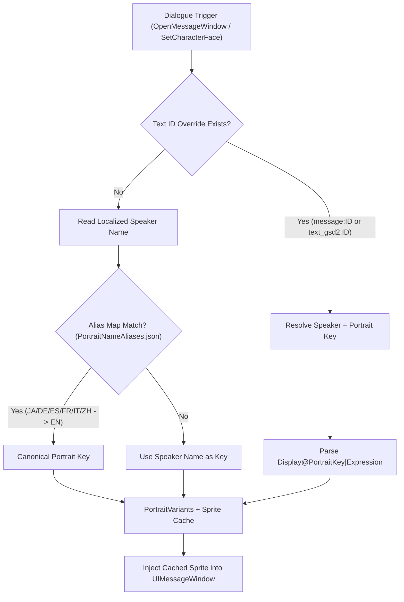

# Multi-Language Custom NPC Portrait System — Implementation Plan

## Overview

`PKCore`'s custom NPC portrait system currently relies on matching **localized speaker display names** (e.g., `"Ace"`, `"Elf Village Chief"`) directly against PNG filenames (`NPCPortraits/<name>.png`), and only normalizes `text_gsd1_<lang>:` / `text_add_<lang>:` keys (omitting `text_gsd2_<lang>:`). As a result, custom portraits and S2 speaker overrides only work reliably in English unless modders duplicate textures or rewrite localized dialogue lines with `<speaker:...>` tags.

Because all 8 game language tables (`en`, `ja`, `de`, `es`, `fr`, `it`, `zh-hans`, `zh-hant`) in `text_gsd1_*`, `text_gsd2_*`, and `text_add_*` share **identical numeric `id`s**, we can make custom NPC portraits work automatically across every language while keeping a single canonical English texture set.

---

## Architecture & Resolution Pipeline

---

## Implementation Phases

### Phase 1 — Language-Agnostic Text ID Normalization & S2 ID-First Lookup
**Target files:**
* [PortraitSystemPatch.cs](../../Patches/PortraitSystemPatch.cs)
* [TextDatabasePatch.cs](../../Patches/TextDatabasePatch.cs)

**Changes:**
1. **Normalize `text_gsd2_<lang>:` in `PortraitSystemPatch.TryGetSpeaker`:**
   * Extend the existing prefix check (`text_gsd1_`, `text_add_`) to also strip `text_gsd2_<lang>:` → `message:<id>`.
   * When loading `S1SpeakerOverrides.json` / `S2SpeakerOverrides.json` via `LocalizedOverrideMap`, also index a language-agnostic fallback key (`message:<id>`) for any entry keyed with `text_gsd1_<lang>:`, `text_gsd2_<lang>:`, or `text_add_<lang>:` so existing English-keyed configs immediately work in all 8 languages without breaking language-specific overrides.
2. **Enable Text-ID-First Speaker & Portrait Injection in Suikoden II:**
   * In `TextDatabasePatch`, ensure `LastMessageTextId` is reliably populated for S2 dialogue lookups (`text_gsd2_<lang>:<id>` / `text_add_<lang>:<id>`).
   * In `PortraitSystemPatch.OpenMessageWindow_Prefix` (S2), check `GetSpeakerOverride(lastTextId)` when no `<speaker:...>` tag is present.
   * This allows unnamed S2 NPCs to receive portraits (and optional speaker names) purely by numeric Text ID, leaving the game's localized dialogue text 100% untouched.

---

### Phase 2 — Auto-Generated Cross-Language Name Alias Table
**Target files:**
* [PortraitVariants.cs](../../Patches/PortraitVariants.cs)
* New generated data file: `PKCore/Config/PortraitNameAliases.json` (or embedded/shipped alongside `PortraitMappings.json`)

**Changes:**
1. **Build the Alias Map from Extracted `text_gsd1_*`, `text_gsd2_*`, and `text_add_*` Tables:**
   * Cross-reference all 8 language JSON files (`en`, `ja`, `de`, `es`, `fr`, `it`, `zh-hans`, `zh-hant`) by numeric `id`.
   * For every `id` whose English string matches a known NPC speaker name (or portrait filename in `NPCPortraits/`), emit `localizedName -> canonicalEnglishName` entries into `PortraitNameAliases.json` (skipping identical strings and ambiguous collisions).
   * Support separate `GSD1` and `GSD2` sections (or `GSD1/` and `GSD2/` overrides) to avoid cross-game name collisions.
2. **Integrate into `PortraitVariants.GetPortraitPath` and `PortraitSystemPatch`:**
   * Resolution order for any incoming `characterName`:
     1. Explicit mod/user mapping in `PortraitMappings.json` (highest priority).
     2. Direct filename match in `NPCPortraits/` (`<characterName>.png`).
     3. Cross-language alias lookup in `PortraitNameAliases.json` → canonical English filename (`"エース" -> "Ace"` → `Ace.png`).
   * Modders only need to provide **one** `Ace.png` (and optional `Ace_angry.png` expression variants) for it to work in all 8 languages.

---

### Phase 3 — Decouple Display Name from Portrait Asset Key
**Target files:**
* [PortraitSystemPatch.cs](../../Patches/PortraitSystemPatch.cs)
* [PortraitVariants.cs](../../Patches/PortraitVariants.cs)

**Changes:**
1. **Optional `@` Portrait Key Syntax in Speaker Overrides & `<speaker:...>` Tags:**
   * Extend `PortraitVariants.ParseSpeakerString(string raw)` to support:
     * `"Ace"` → Display: `"Ace"`, Portrait Key: `"Ace"`, Expression: `null` (100% backward compatible).
     * `"Ace|angry"` → Display: `"Ace"`, Portrait Key: `"Ace"`, Expression: `"angry"` (backward compatible).
     * `"エース@Ace|angry"` → Display: `"エース"`, Portrait Key: `"Ace"`, Expression: `"angry"`.
     * `"@Ace|angry"` → Keep native UI speaker name untouched, inject `Ace_angry.png`.
2. **Optional Native Text ID Display Name (`#<id>@<PortraitKey>`):**
   * Allow referencing an in-game text ID for the speaker name (e.g., `"#1078@Shopkeeper"`), resolved at runtime through the game's active language text table so `Txt_Name` always matches the player's selected language automatically.

---

### Phase 4 — Sprite & Lookup Caching Cleanup
**Target files:**
* [PortraitSystemPatch.cs](../../Patches/PortraitSystemPatch.cs)

**Changes:**
1. Replace linear `foreach` scans over `portraitCache` with a `Dictionary<string, Sprite>` keyed by canonical `(portraitKey, expression)` (case-insensitive).
2. Reuse cached `Sprite` instances in `InjectPortraitIntoWindow`, `S1_InjectPortrait`, and `SetCharacterFace_Prefix` instead of allocating a new `Sprite.Create(...)` + `DontDestroyOnLoad(...)` on every dialogue line.
3. Clear/invalidate the sprite cache cleanly on config hot-reload.

---

## Verification Plan

1. **Build Verification:**
   * Build `PKCore` in `Debug` (`dotnet build PKCore.csproj`) with 0 warnings and 0 errors.
2. **English Regression Test (S1 & S2):**
   * Verify existing `NPCPortraits/*.png`, `PortraitMappings.json`, `PortraitVariants.json`, `S1SpeakerOverrides.json`, and `S2SpeakerOverrides.json` behave identically.
3. **Multi-Language Runtime Test (JA / ES / DE / ZH):**
   * Switch launcher language to Japanese (and one European language like Spanish/German).
   * Talk to a named NPC with an English-named PNG (e.g., `Ace.png`) → confirm the portrait appears via `PortraitNameAliases.json` while `Txt_Name` stays in the active language.
   * Talk to an unnamed NPC mapped via `message:<id>` in `S2SpeakerOverrides.json` → confirm the portrait injects while the dialogue text remains in the active language.
   * Confirm zero duplicate `Sprite` allocations and zero `LogOutput.log` errors across repeated conversations.
