# Suikoden I Map Identifiers & Geographic Areas Reference

## 1. Engine Architecture & Naming Anatomy

In **Suikoden I** (`GSD1`), the field map, village, and dungeon architecture differs from Suikoden II's unified `MACHIDAT` layout. Instead, Suikoden I coordinates environments through a structured hierarchy of static background configurations and village managers:

```text
G1_fdata_c (Master Field Data Hub)
 ├── area_info (Il2CppReferenceArray<AREAINFO>) ── Regional Sectors (area_a through area_k, area_z)
 │    └── map_info (Il2CppReferenceArray<MAPINFO>) ── Submaps & Rooms within Region
 │         ├── label ("va1", "vb5", "vc1"...) ──── Internal Asset & Room Code
 │         ├── name_id (int) ────────────────────── Localized Village Name String ID
 │         ├── text_base_id (uint) ──────────────── Category Base Key for Dialogues
 │         └── bg (G1_fdata_c.BG_INFO) ──────────── 2D/3D Background Geometry & Palettes
 └── vil_info (Il2CppReferenceArray<VILINFO>) ─── Village Layouts & Collision Masks
```

---

### Core C# Decompiled Handlers in `GSD1`

| Class | Location | Primary Architectural Role |
|---|---|---|
| **`G1_fdata_c`** | `d:/Appz/Suisource/GSD1/GSD1/G1_fdata_c.cs` | Master registry of all 85 background maps (`bg_va1`–`bg_vz5`), regional slices (`map_info_a`–`k`), and area tables (`area_info`). |
| **`VillageManager`** | `d:/Appz/Suisource/GSD1/GSD1/VillageManager.cs` | Runtime map coordinator; loads village records (`GetVillageInfo`), resolves names (`GetVillageNameID`), and manages map cache (`vil_cache`). |
| **`Village_c`** | `d:/Appz/Suisource/GSD1/GSD1/Village_c.cs` | Town state execution loop (`village_init`, `village_main`, `village00`–`village03`, `village_exit`). |
| **`Event_c`** | `d:/Appz/Suisource/GSD1/GSD1/Event_c.cs` | Bytecode event script engine; executes the 70+ `EVENT_COMMAND` opcodes (`GoEventCommand`, `eventCommandFunction`). |
| **`Fmain_c`** | `d:/Appz/Suisource/GSD1/GSD1/Fmain_c.cs` | Overworld field coordinator; checks town entrance collision boundaries (`VillageEnterCheck`). |

---

## 2. Regional Sectors: `area_a` through `area_k` & `area_z`

Like Suikoden II's `va` through `vk`, Suikoden I organizes its storyline into 12 chronological regional sectors:

```mermaid
flowchart LR
    area_a["Area A (Gregminster / Imperial Core)"] --> area_b["Area B (Rockland / Mt. Seifu)"]
    area_b --> area_c["Area C (Lenankamp / Sarady)"]
    area_c --> area_d["Area D (Kouan / Great Forest)"]
    area_d --> area_e["Area E (Lake Toran / Castle Liberation)"]
    area_e --> area_f["Area F (Kaku / Garan Fort)"]
    area_f --> area_g["Area G (Teien / Rikon / Soniere)"]
    area_g --> area_h["Area H (Scarleticia / Dragon Knights)"]
    area_h --> area_i["Area I (Moravia / Shasarazade)"]
    area_i --> area_j["Area J (Gregminster Assault Finale)"]
    area_j -. Castle HQ .- area_k["Area K (Toran Castle HQ Tiers 1-4)"]
    area_z["Area Z (Duels & War Battle Fields)"]
```



| Region Area | Decompiled Field (`G1_fdata_c`) | Major Geographic Territory | Primary Towns, Forts & Dungeons |
| :---: | :---: | :--- | :--- |
| **`area_a`** | `map_info_a` | **Gregminster & Imperial Border** | Imperial Capital Gregminster, Palace, Magician's Island, Mt. Tigerwolf |
| **`area_b`** | `map_info_b` | **Rockland & Mt. Seifu** | Rockland Town, Grady's Mansion, Mt. Seifu Mountain Path, Bandit Lair |
| **`area_c`** | `map_info_c` | **Lenankamp & Sarady** | Lenankamp Town, Rebel Cell Safehouse, Sarady Village, Mountain Trail |
| **`area_d`** | `map_info_d` | **Kouan & The Great Forest** | Kouan Town, Lepant Estate, Great Forest Hamlet, Elf Village, Kobold Village, Dwarves' Vault |
| **`area_e`** | `map_info_e` | **Lake Toran & Castle Liberation** | Lake Fortress exterior, Dragon Zombie cavern arena |
| **`area_f`** | `map_info_f` | **Kaku Port & Garan Frontier** | Kaku Port Town, Tai Ho dice tavern, Garan Border Fortress |
| **`area_g`** | `map_info_g` | **Teien, Rikon & Soniere Prison** | Teien Canal Town, Rikon Rapids, Antei Town, Soniere Subterranean Prison |
| **`area_h`** | `map_info_h` | **Scarleticia & Dragon Knights** | Scarleticia Castle, Milich's Garden, Dragon Knights' Fortress, Seek Valley |
| **`area_i`** | `map_info_i` | **Moravia & Floating Fortress** | Lorimar Outpost, Moravia Castle, Qlon Temple, Floating Fortress Shasarazade |
| **`area_j`** | `map_info_j` | **Imperial Capital Finale** | Ruined Gregminster Capital, Floating Gardens, Barbarossa Golden Hydra Throne |
| **`area_k`** | `map_info_k` | **Toran Castle Headquarters** | Castle HQ (All 4 evolution stages: Great Hall, Docks, Vault, War Room) |
| **`area_z`** | `map_info_z` | **Combat Arenas & Duels** | Pahn vs. Teo duel arena, Army war battle field grids |

---

## 3. Exhaustive Area & Map Asset Breakdown

### `area_a` — Gregminster & Imperial Core
* **Decompiled Registry**: `G1_fdata_c.map_info_a`
* **Background Assets**: `bg_va1`, `bg_va2`, `bg_va3`, `bg_va4`, `bg_va4b`, `bg_va5`, `bg_va6`, `bg_va7`, `bg_va8`, `bg_va9`, `bg_vaa`, `bg_vaad`, `bg_vac`, `bg_vad`
* **Key Locations & Recruits**:
  - `va1`: Imperial Capital Gregminster - Main Gate & Plaza.
  - `va2`: Gregminster - Upper Avenues & Noble District.
  - `va3`: Imperial Palace - Grand Audience Hall (Emperor Barbarossa, Windy).
  - `va4` / `va4b`: Teo McDohl's Private Residence (Tir's home bedroom, Gremio, Cleo, Pahn).
  - `va5`: Magician's Island - Docks & Forest Approach.
  - `va6`: Leknaat's Tower - Astral Chamber (Leknaat, Luc, Astral Gate).
  - `va7`–`vad`: Mt. Tigerwolf ascent trail connecting Gregminster to Lenankamp.

---

### `area_b` — Rockland & Mt. Seifu
* **Decompiled Registry**: `G1_fdata_c.map_info_b`
* **Background Assets**: `bg_vb1`, `bg_vb2`, `bg_vb3`, `bg_vb4`, `bg_vb5`, `bg_vb5a1`–`bg_vb5i4`, `bg_vb6`, `bg_vb7`, `bg_vb7a`, `bg_vb7d`, `bg_vb8`, `bg_vb9`
* **Key Locations & Recruits**:
  - `vb1`: Rockland Town - Main Square & Tax Collector Grady's Office.
  - `vb2`: Rockland - Residential Quarter & Tavern.
  - `vb3`–`vb4`: Mt. Seifu - Mountain Trail & Rope Bridges.
  - `vb5` (all sub-layers): Bandit Mountain Stronghold (Varkas & Sydonia confrontation).
  - `vb6`: Mt. Seifu summit overlook.
  - `vb7`: Secret trail returning to Rockland.

---

### `area_c` — Lenankamp & Sarady
* **Decompiled Registry**: `G1_fdata_c.map_info_c` | **Entity Atlas**: `G1_fdata_c.area_c_opd`
* **Background Assets**: `bg_vc1`, `bg_vc2`, `bg_vc3`, `bg_vc4`, `bg_vc5`, `bg_vc6`
* **Key Locations & Recruits**:
  - `vc1`: Lenankamp Town - Cobblestone Plaza & Inn.
  - `vc2`: Lenankamp - Secret Liberation Army Cell (Odessa Silverberg, Flik).
  - `vc3`: Sarady Hamlet - Mountain pass rest stop (Fortune Teller).
  - `vc4`: Toran Lake Shoreline Approach.
  - `vc5`–`vc6`: Mountain pass cave connecting Sarady.

---

### `area_d` — Kouan & The Great Forest
* **Decompiled Registry**: `G1_fdata_c.map_info_d`
* **Background Assets**: `bg_vd1`, `bg_vd2`, `bg_vd3`, `bg_vd4`, `bg_vd5`, `bg_vd6`, `bg_vd7`
* **Key Locations & Recruits**:
  - `vd1`: Kouan Town - Merchant Avenues.
  - `vd2`: Lepant's Mansion (Kirinji sword heist, Lepant recruitment).
  - `vd3`: Great Forest - Outskirts & Kobold Village.
  - `vd4`: Village of the Elves - Treehouse settlement.
  - `vd5`: Forest of no Return - Maze trails.
  - `vd6`: Dwarves' Village & Blacksmith Forge.
  - `vd7`: Dwarves' Vault - Ancient subterranean treasure dungeon.

---

### `area_e` — Lake Toran & Castle Liberation
* **Decompiled Registry**: `G1_fdata_c.map_info_e`
* **Background Assets**: `bg_ve1`, `bg_ve2`, `bg_ve3`, `bg_ve4`, `bg_ve5`, `bg_ve6`
* **Key Locations & Recruits**:
  - `ve1`: Toran Castle - Foggy Lake Docks approach.
  - `ve2`: Fortress Keep - Overgrown stone foyer.
  - `ve3`–`ve5`: Abandoned castle corridors infested with monsters.
  - `ve6`: Deepest Vault - Zombie Dragon boss arena (Liberation of Toran Castle).

---

### `area_f` — Kaku Port & Garan Fort
* **Decompiled Registry**: `G1_fdata_c.map_info_f`
* **Background Assets**: `bg_vf1`, `bg_vf2`, `bg_vf3`, `bg_vf4`
* **Key Locations & Recruits**:
  - `vf1`: Kaku Port - Boardwalks & Boat Moorings.
  - `vf2`: Kaku - Dice Tavern (Tai Ho & Yam Koo chinchirorin duel).
  - `vf3`: Garan Border Fortress - Massive stone checkpoint gates.
  - `vf4`: South Toran lake crossing.

---

### `area_g` — Teien, Rikon & Soniere Prison
* **Decompiled Registry**: `G1_fdata_c.map_info_g` | **Entity Atlas**: `G1_fdata_c.area_g_opd`
* **Background Assets**: `bg_vg1`, `bg_vg2`, `bg_vg3`
* **Key Locations & Recruits**:
  - `vg1`: Teien Town - Waterway canals and stone bridges.
  - `vg2`: Rikon Town - Rapids ferry pier and inn.
  - `vg3`: Soniere Prison - Subterranean dungeon cells (Milich's prison, Gremio's sacrifice).

---

### `area_h` — Scarleticia & Dragon Knights
* **Decompiled Registry**: `G1_fdata_c.map_info_h`
* **Background Assets**: `bg_vh1`, `bg_vh2`
* **Key Locations & Recruits**:
  - `vh1`: Scarleticia Castle - Poisonous Rose Garden (General Milich Oppenheimer).
  - `vh2`: Dragon Knights' Fortress & Cave of the Past (Joshua, Futch, Black Dragon).

---

### `area_i` — Moravia Castle & Floating Fortress
* **Decompiled Registry**: `G1_fdata_c.map_info_i`
* **Background Assets**: `bg_vi1`, `bg_vi2`
* **Key Locations & Recruits**:
  - `vi1`: Lorimar Fortress & Moravia Castle Keep (General Kasim Hazil).
  - `vi2`: Floating Fortress Shasarazade - Submerged lock gates (General Sonya Shulen).

---

### `area_j` — Imperial Capital Finale
* **Decompiled Registry**: `G1_fdata_c.map_info_j` | **Entity Atlas**: `G1_fdata_c.area_j_opd`
* **Background Assets**: `bg_vs1`, `bg_vs2`
* **Key Locations & Recruits**:
  - `vs1`: Assaulted Gregminster - Burning streets and final resistance.
  - `vs2`: Imperial Palace Rooftop / Floating Garden - Emperor Barbarossa & Golden Hydra finale.

---

### `area_k` — Toran Castle Headquarters (Evolution Stages)
* **Decompiled Registry**: `G1_fdata_c.map_info_k` | **Entity Atlas**: `G1_fdata_c.area_k_opd`
* **Background Assets**: `bg_vz1`, `bg_vz2`, `bg_vz3`, `bg_vz5`
* **Key Locations & Recruits**:
  - `vz1`: Castle HQ Tier 1 - Sparse stone hall.
  - `vz2`: Castle HQ Tier 2 - Expanded living quarters and library.
  - `vz3`: Castle HQ Tier 3 - Completed fortress, bathhouse, stone bridges.
  - `vz5`: Castle HQ Tier 4 - Maximum 108 Stars grand citadel.

---

## 4. Bytecode Event Engine: `Event_c.eventCommandFunction`

In Suikoden I, event triggers are executed by `Event_c.eventCommandFunction`, consuming the `EVENT_COMMAND` enum:

| Opcode | Enum Name | Functional Role in Engine |
|:---:|---|---|
| `0` | `WINOP` | Opens the main dialogue message box. |
| `1` | `WINCL` | Closes and dismisses the dialogue message box. |
| `2` | `PUSHMARU` | Halts bytecode execution and waits for player Confirm button press. |
| `3` | `VILLAGEOUT` | Exits town/village to the overworld map. |
| `4` | `EVENTMSG` | Draws dialogue text string into the active message buffer. |
| `5` | `EVENTSENTAKU` | Spawns interactive multiple-choice selection prompt. |
| `9` | `EVENTFSET` | Sets local event flag. |
| `14` | `DOOROP` | Animates doorway opening. |
| `22` | `STORYFSET` | Sets main storyline progression milestone flag. |
| `26` / `27` | `BRACKUP` / `BRACKDOWN` | Fades screen in/out from black. |
| `31` / `32` | `PADD` / `PDEL` | Recruits or dismisses party companions. |
| `34` | `GURUGURU` | Spins Journeyman Save Crystal orb animation. |
| `65` | `EVENTSND` | Plays sound effect (SE). |
| `67` | `EVENTSHOP` | Opens shop menu interface (Item, Armor, Rune, Blacksmith). |
| `71` | `EVENTBATTLE` | Launches story combat encounter / boss battle. |
| `73` | `EVENTITEM` | Awards inventory item to player. |
| `77` | `EVENTJUMP` | Jumps bytecode instruction execution. |

---

## 5. Architectural Comparison: Suikoden I vs. Suikoden II

| Feature | Suikoden I (`GSD1`) | Suikoden II (`GSD2`) |
|---|---|---|
| **Master Container** | `G1_fdata_c.cs` (`area_info`) | `MACHICON.cs` (`MACHIDAT.cs`) |
| **Area Slices** | `map_info_a` through `map_info_k` | `va01` through `vk37` |
| **Background Files** | `bg_va1` through `bg_vz5` (85 assets) | `v*_*_map_00.json` (226 assets) |
| **Runtime Coordinator** | `VillageManager.cs` | `MACHICON.cs` |
| **Event Script Engine** | `Event_c.cs` (`EVENT_COMMAND`) | `EVENTCON.cs` (`147 EC* methods`) |
| **Town Logic Loop** | `Village_c.cs` (`village00`–`03`) | `EVENTCON.EventMain` |
| **PKCore Injection Point** | `VillageManager.GetVillageInfo` Postfix | `MACHICON.EventInit` Postfix |
