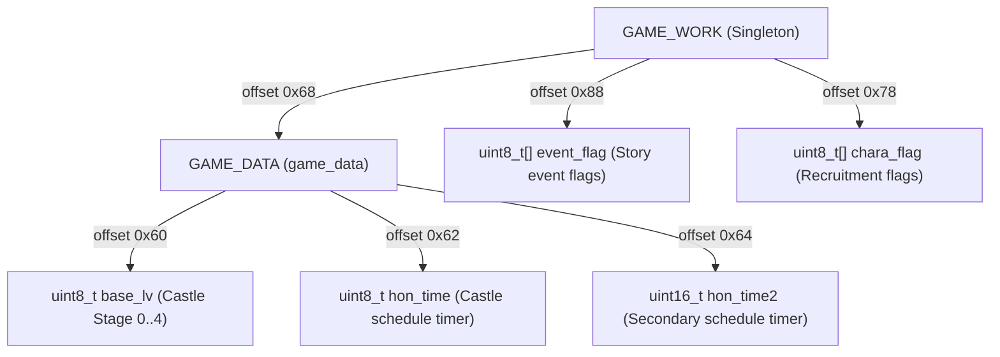
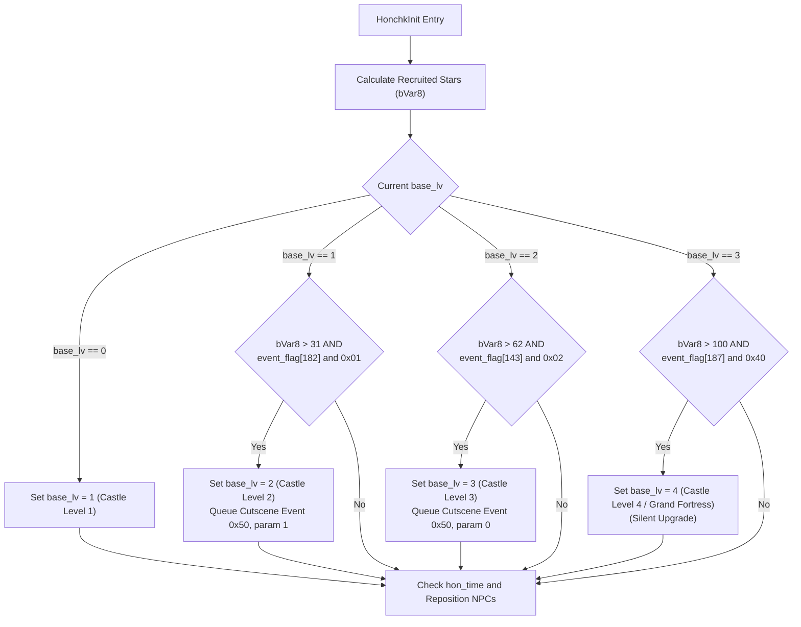

# Suikoden II Castle Level Upgrade Architecture & Forensic Engine Analysis

This technical documentation provides a forensic analysis of how headquarters castle progression and level upgrades are evaluated, computed, and triggered in **Suikoden II HD Remaster (`GSD2`)**.

All findings are grounded directly in the decompiled IL2CPP binary sources:
- `D:\Appz\SuikodenModding\Suisource\GSD2\GSD2\GameAssembly.dll.c`
- `D:\Appz\SuikodenModding\Suisource\Il2CppDump\dump.cs`
- `D:\Appz\SuikodenModding\Suisource\Il2CppDump\il2cpp.h`

---

## 1. Core Data Structures & Memory Offsets

Castle progression is tracked globally in the `GAME_WORK` singleton hierarchy:



### Exact Memory Layout (`il2cpp.h` / `dump.cs`)

| Class | Offset | Type | Field Name | Description |
| :--- | :--- | :--- | :--- | :--- |
| `GAME_WORK` | `0x68` | `GAME_DATA` | `game_data` | Primary runtime game save state data |
| `GAME_WORK` | `0x78` | `byte[]` | `chara_flag` | Character status / recruitment flags |
| `GAME_WORK` | `0x88` | `byte[]` | `event_flag` | Global narrative event flags array |
| `GAME_DATA` | `0x60` | `byte` | `base_lv` | Current headquarters stage (`0` through `4`) |
| `GAME_DATA` | `0x62` | `byte` | `hon_time` | Castle NPC repositioning interval timer |
| `GAME_DATA` | `0x64` | `ushort` | `hon_time2` | Castle secondary time counter |

### Headquarters Stages (`base_lv`)

The engine defines 5 sequential HQ tiers:

| `base_lv` Value | Internal Tier | Public Terminology | Headquarters State |
| :---: | :---: | :--- | :--- |
| **0** | Stage 0 | Pre-Castle | Temporary Mercenary Fortress / pre-North Window base |
| **1** | Stage 1 | **Castle Level 1** | North Window acquired (initial dilapidated fortress) |
| **2** | Stage 2 | **Castle Level 2** | First major physical expansion (post-Two River) |
| **3** | Stage 3 | **Castle Level 3** | Second major physical expansion (post-Greenhill) |
| **4** | Stage 4 | **Castle Level 4** | The Grand Fortress (101+ recruited Stars of Destiny) |

---

## 2. Evaluation Engine: `EventOverlayClass.honchk`

In the original PS1 game, castle progression and NPC routines resided in `HONCHK.OVL` (本拠地チェック, *Honkyochi Check*). In the HD Remaster, this logic is compiled into the `EventOverlayClass.honchk` class:

- **Class Definition**: `public class honchk : OverlayClassBase` (`dump.cs:94146`, TypeDefIndex 1940)
- **Virtual Entry Point**: `honchk.Entry()` (`GameAssembly.dll.c:5293563`, VA `0x181F8E4F0`)
- **Main Evaluation Routine**: `EventOverlayClass_honchk__HonchkInit` (`GameAssembly.dll.c:5293572–5293750`, VA `0x181F8E500`)

---

## 3. Detailed Upgrade Algorithm (`HonchkInit`)

When `honchk` runs upon entering the castle grounds, it executes two sequential procedures: **Star Census Counting** and **Progression Evaluation**.

### 3.1 Star Census Calculation

```c
// GameAssembly.dll.c (lines 5293590 - 5293598)
bVar8 = 0;
iVar7 = 1;
do {
  iVar3 = G2_SYS__G2_cha_flag(2, iVar7);
  if (((iVar3 == 1) && (10 < iVar7 - 0x4aU)) && (iVar7 != 0x7a)) {
    bVar8 = bVar8 + 1;
  }
  iVar7 = iVar7 + 1;
} while (iVar7 < 0x7b);
```

#### Census Logic Breakdown:
1. **Recruitment Check**: Calls `G2_SYS.G2_cha_flag(2, chara_id)` to check if character ID `iVar7` has joined the army (`joined == 1`).
2. **Monster Exemption**: Evaluates `10 < iVar7 - 0x4aU`.
   - `0x4A` is character ID **74**; range `74..84` covers monster recruits:
     - `74`: **Abizboah** (Giant Kraken)
     - `75`: **Rulodia** (Female Kraken)
     - `76`: **Chuchara** (Baby Kraken)
     - `77..84`: Other monsters / Listening Crystal variants.
   - Monster variants are explicitly excluded from the Star Census count.
3. **Placeholder Exemption**: Evaluates `iVar7 != 0x7a` (`ID != 122`), skipping internal temporary character slot 122.
4. **Result**: `bVar8` stores the exact count of canonical human Stars of Destiny recruited.

---

### 3.2 Castle Upgrade Thresholds

The current level `cVar2 = game_data->base_lv` is compared against specific recruit counts and narrative story event flags:



#### Tier 1: Initial Base (`base_lv = 1`)
- **Decompiled Code**: `GameAssembly.dll.c:5293608–5293616`
- **Condition**: `cVar2 == '\0'` (`base_lv == 0`)
- **Action**: Unconditionally writes `*(game_data + 0x60) = 1`.

#### Tier 2: First Physical Expansion (`base_lv = 2`)
- **Decompiled Code**: `GameAssembly.dll.c:5293617–5293645`
- **Conditions**:
  1. `cVar2 == '\x01'` (Current `base_lv == 1`)
  2. `0x1f < bVar8` (Recruits > 31 $\rightarrow$ **32 or more recruits**)
  3. `event_flag[182] & 0x01 != 0` (Two River peace treaty / Two River arc completed)
- **Actions**:
  - Sets `base_lv = 2`.
  - Sets cutscene trigger: `event 0x50` (`80`), parameter `1` via `EVENTCON.EventGameWorkSet`.
  - Riou witnesses the visual remodeling cutscene upon arriving at the castle foyer.

#### Tier 3: Second Physical Expansion (`base_lv = 3`)
- **Decompiled Code**: `GameAssembly.dll.c:5293648–5293677`
- **Conditions**:
  1. `cVar2 == '\x02'` (Current `base_lv == 2`)
  2. `0x3e < bVar8` (Recruits > 62 $\rightarrow$ **63 or more recruits**)
  3. `event_flag[143] & 0x02 != 0` (Greenhill infiltration and liberation arc completed)
- **Actions**:
  - Sets `base_lv = 3`.
  - Sets cutscene trigger: `event 0x50` (`80`), parameter `0` via `EVENTCON.EventGameWorkSet`.
  - Plays the second remodeling visual cutscene sequence.

#### Tier 4: The Grand Fortress (`base_lv = 4`)
- **Decompiled Code**: `GameAssembly.dll.c:5293679–5293695`
- **Conditions**:
  1. `cVar2 == '\x03'` (Current `base_lv == 3`)
  2. `100 < bVar8` (Recruits > 100 $\rightarrow$ **101 or more recruits**)
  3. `event_flag[187] & 0x40 != 0` (Matilda / Rockaxe campaign progression phase)
- **Actions**:
  - Sets `base_lv = 4`.
  - **Silent Upgrade**: Unlike Levels 2 and 3, Level 4 triggers no visual remodeling cutscene sequence (`event 0x50` is omitted). The upgrade activates directly upon entering the map.

---

## 4. NPC Schedule Randomization & Facility Rotation

Immediately following the stage upgrade checks, `HonchkInit` updates character schedules:

```c
// GameAssembly.dll.c (lines 5293719 - 5293744)
sVar1 = *(short *)(game_data + 0x64); // hon_time2
bVar8 = *(byte *)(game_data + 0x62);  // hon_time
if ((ushort)(bVar8 + 5) < *(ushort *)(lVar4 + 0x22)) {
    EventOverlayClass_honchk__ResetCharaPositions(0);
}
```

- When 5 time units have elapsed, `ResetCharaPositions` (`GameAssembly.dll.c:5293969–5294807`) is invoked.
- Uses `IFlgSet`, `IFlgClear`, and `PerFlgSet` to calculate randomized placement flags:
  - Selects which characters visit the bathhouse (`hp_furo`).
  - Distributes NPCs across the tavern, garden, docks, library, restaurant, and corridors.

---

## 5. Event Bytecode Precondition: Opcode 33

All map scripts query the resulting `base_lv` using **Opcode 33** (`[33, mode, target_level]`), implemented in `EVENTCON__EventFormCheck` (`GameAssembly.dll.c:5562355–5562400`):

```c
// GameAssembly.dll.c (lines 5562381 - 5562410)
case 0x21: // Opcode 33
  cVar11 = CommandReader__op_Implicit(&local_898, 0); // mode (0, 1, or 2)
  bVar17 = CommandReader__op_Implicit(&local_898, 0); // target_level
  lVar25 = OldSrcBase__get_game_work(0);
  byte current_base_lv = *(byte *)(*(longlong *)(lVar25 + 0x68) + 0x60);

  if (cVar11 == '\0') {
    // Mode 0: Strict Equality (base_lv == target_level)
    if (bVar17 != current_base_lv) return 0;
  }
  else if (cVar11 == '\x01') {
    // Mode 1: Greater or Equal (base_lv >= target_level)
    if (current_base_lv < bVar17) return 0;
  }
  else if (cVar11 == '\x02') {
    // Mode 2: Less or Equal (base_lv <= target_level)
    if (bVar17 < current_base_lv) return 0;
  }
```

### Verified Bytecode Operations:
- `[33, 0, 4]`: Requires strictly Castle Level 4 (`base_lv == 4`). (Used by Pesmerga spawn trigger in Cave of the Wind `vd06_18` `ev[10]`).
- `[33, 1, 4]`: Requires Castle Level 4 or higher (`base_lv >= 4`). (Used by Genshu recruitment checks in Coronet Town `vc18_00` `ev[27]`).
- `[33, 2, 2]`: Requires Castle Level 2 or lower (`base_lv <= 2`). (Used to disable early-game staging triggers).

---

## 6. Summary Reference Table

| Target Castle Level | Required Recruits (`bVar8`) | Required Story Flag | Story Beat | Cutscene Event |
| :---: | :---: | :--- | :--- | :---: |
| **Level 1** | Any | None | North Window Liberation | None |
| **Level 2** | $\ge 32$ | `event_flag[182] & 0x01` | Two River Peace Treaty | `0x50` (Param `1`) |
| **Level 3** | $\ge 63$ | `event_flag[143] & 0x02` | Greenhill Liberation Arc | `0x50` (Param `0`) |
| **Level 4** | $\ge 101$ | `event_flag[187] & 0x40` | Matilda / Rockaxe Campaign | None (Silent) |
