# Suikoden II Map Identifiers & Geographic Areas Reference

## 1. Map Architecture & Naming Pattern Anatomy

In **Suikoden II** and **Suikoden I & II HD Remaster** (`GSD2`), all town, dungeon, interior, and castle map assets follow a standard 4-character naming pattern:

$v + [Region Letter] + [Map Number]

```text
    v    c    18
    │    │    └─── [Part 3] 2-Digit Submap / Screen ID (01 - 37)
    │    └──────── [Part 2] Region Letter (a - k) = Internal Area Archive Code (010_ARA - 110_ARK)
    └───────────── [Part 1] Asset Type ('v' = Village / Field Map Asset, from engine 'vno')
```

---

### Part 1: Leading Prefix `'v'` (Asset Category)
* **`v`** stands for **Village** (corresponding to internal engine variable `vno` / *Village Number*, paired with `ano` / *Area Number* and `mno` / *Map Number* in `MACHICON`).
* In the game’s engine and disc filesystem:
  - **`v`** prefixes designate **location/field map assets** (towns, dungeons, rooms, castles).
  - **`w`** prefixes designate **World Map** terrain sectors (e.g., `wd_map_00.json`, `we.json`, `wi.json`).
  - **`b`** prefixes designate **Battle** assets (e.g., `BP0_FST.BIN`, `battle_dat`).
  - **`m`** / **`u`** prefixes designate UI, menus, and portraits.

---

### Part 2: Region Letter (`a` through `k`) = Internal Area Archive Code
The regional letters **`a` through `k`** represent the internal CD-ROM area archives (`010_ARA` through `110_ARK`). While they roughly track the expansion of the game world, player story progression branches across them dynamically (for example, the alliance mission to Two River **`vh`** occurs immediately following South Window **`vd`**, before Greenhill **`ve`**, Matilda **`vi`**, Banner **`vf`**, or Tinto **`vg`**):

```mermaid
flowchart LR
    va["va (Prologue: Highland Border / Kyaro)"] --> vb["vb (Act 1A: Mercenary Fort / Ryube)"]
    vb --> vc["vc (Act 1B: Muse / Coronet)"]
    vc --> vd["vd (Act 2A: South Window / Radat)"]
    vd --> vh["vh (Act 2B: Two River / Kobold)"]
    vh --> ve["ve (Act 2C: Greenhill Academy)"]
    ve --> vi["vi (Act 3A: Matilda / Rockaxe)"]
    vi --> vf["vf (Act 3B: Banner / Toran)"]
    vf --> vg["vg (Act 3C: Tinto / Mines)"]
    vg --> vj["vj (Act 4: Highland Finale / L'Renouille)"]
    vj -. Castle HQ .- vk["vk (Dunan Castle HQ Tiers 1-4)"]
```



- `010_ARA` -> **`va`**: **Prologue** (Highland Youth Brigade -> Tenzan Pass -> North Sparrow Pass -> Kyaro Town).
- `020_ARB` -> **`vb`**: **Act 1 (Early)** (Mercenary Fort chores -> Toto Village -> Ryube Village -> Mt. Tigerwolf).
- `030_ARC` -> **`vc`**: **Act 1 (Mid)** (Muse City -> White Deer Inn -> Sindar Ruins -> Coronet Port).
- `040_ARD` -> **`vd`**: **Act 2 (South)** (South Window City -> Radat Town -> North Window Ruins -> Cave of the Wind).
- `050_ARE` -> **`ve`**: **Act 2 (West)** (Greenhill Academy -> Forest Village -> Greenhill-Matilda Border & Forest Path).
- `060_ARF` -> **`vf`**: **Act 3 (South-Toran)** (Banner Village -> Banner Pass -> Gregminster Capital).
- `070_ARG` -> **`vg`**: **Act 3 (Mining & Tinto)** (Tinto City -> Tinto Mines -> Tigermouth -> Crom).
- `080_ARH` -> **`vh`**: **Act 2 (Lakeside Republic)** (Two River Human/Wingly/Kobold districts -> Sewers -> Lakewest -> Kobold Village -> Drakemouth).
- `090_ARI` -> **`vi`**: **Act 3 (Matilda Campaign)** (Rockaxe Castle -> Highway Village -> Mt. Rakutei dragon peak).
- `100_ARJ` -> **`vj`**: **Act 4 (Finale - Highland)** (L'Renouille Castle keep -> Beast Rune Sanctum -> Sajah Village).
- `110_ARK` -> **`vk`**: **Headquarters** (Dunan Castle / North Window Castle across all 4 upgrade stages).

---

### Part 3: Map Number Logic (`01` – `37`)

Within each regional letter, numbers are assigned by functional role:

* **Low Numbers (`01` – `03`)**: Primary regional capitals, grand entry gates, or major story hubs:
  - `va08`: Kyaro Town entrance.
  - `vb01` / `vb02`: Mercenary Fortress entrance and living floors.
  - `vc01`: Muse City main entrance & gate plaza.
  - `vd01`: South Window City main entrance plaza.
  - `ve01`: Greenhill City front gates.
  - `vi01`: Rockaxe Castle grand keep.
  - `vj01`: L'Renouille Castle main gates.
  - `vk01`: Castle HQ Great Hall.
* **Higher Numbers (`10` – `20+`)**: Subordinate satellite villages, ports, dungeons, mountain passes, or secondary facilities:
  - **`vc18`**: The secondary **port docks** of the Muse area (Coronet Harbor).
  - **`vd02`**: The harbor district of the South Window territory (Radat Wharf).
  - **`vd15`**: The ferry landing of the South Window territory (Kuskus Port).
  - **`ve04` / `ve05`**: The boundary mountain passes on the outer edge of Greenhill (Border Checkpoint & Forest Path).
  - **`vj17`**: The hidden northern frontier border village of Highland (Sajah Village).

---

### Part 4: File Suffixes in Extracted Assets (`_00`, `_01`, `_obj`)

When inspecting unpacked asset bundles (e.g., via UABEA or extracted JSON in `Mobobehaviour`):

```text
vc18.json         <-- Master map asset (contains all submaps, entities, and event scripts)
vc18_00.json      <-- Submap 0 (mapeventdat[0]: Coronet Port Docks)
vc18_01.json      <-- Submap 1 (mapeventdat[1]: Interior cottage/inn room)
vc18_obj.json     <-- 2D/3D sprite collision objects & NPC entities (eventobj)
vc18_map_00.json  <-- Tilemap collision layers and walkability grid
```

---

## 2. Text Message & Dialogue ID Encoding Formula

Dialogue messages in the localized text files (e.g. `text_gsd2_en`) directly encode the map region and map number into their 10-digit primary keys:

$100100 + [Region Code (01-11)] + [Map Number (01-37)] + [Local Message Offset (0000-9999)]

### Example Mappings
* **`vc18` (Coronet Port / Genshu)**:
  - Text Category Prefix = `100`
  - Region `c` = `3` -> `1003`
  - Map `18` -> `18`
  - Dialogue Offset -> `0075`
  - **Global Message ID**: `1003180075` (*"Do you have business with me?"*)
* **`vj17` (Sajah Village / Innkeeper)**:
  - Text Category Prefix = `100`
  - Region `j` = `10` -> `1010`
  - Map `17` -> `17`
  - Dialogue Offset -> `0001`
  - **Global Message ID**: `1010170001` (*"Ah, you'll be staying with us? Excellent."*)
* **`vd02` (Radat Harbor / Vincent & Simone)**:
  - Text Category Prefix = `100`
  - Region `d` = `4` (or `100301` legacy slice)
  - Map `02` -> `02`
  - Dialogue Offset -> `0099`
  - **Global Message ID**: `1003010805` (*"Oh, well if it isn't Commander Riou..."*)

---

## 3. Master Region Summary

| Prefix | CD-ROM Archive | Major Territory | Primary Towns / Dungeons |
| :---: | :---: | :--- | :--- |
| **`va`** | `010_ARA` | **Highland Borderlands & Kyaro** | Highland Youth Brigade Camp, Tenzan Pass, North Sparrow Pass, Kyaro Town |
| **`vb`** | `020_ARB` | **East State Borderlands** | Mercenary Fortress, Toto Village, Ryube Village, Mt. Tigerwolf, Ryube Forest Path |
| **`vc`** | `030_ARC` | **Muse City-State & Lake Dunan** | Muse City, White Deer Inn, Sindar Ruins, Coronet Town & Port |
| **`vd`** | `040_ARD` | **South Window City-State** | South Window City, Radat Town, Kuskus Town, North Window Ghost Town, Cave of the Wind |
| **`ve`** | `050_ARE` | **Greenhill City-State** | Greenhill City, New Leaf Academy, Forest Village, Greenhill-Matilda Border & Forest Path |
| **`vf`** | `060_ARF` | **Banner & Toran Republic** | Banner Village, Banner Pass, Gregminster Capital, Toran Castle |
| **`vg`** | `070_ARG` | **Tinto Republic & Mountains** | Tinto City, Tinto Mines, Tigermouth Village, Crom Village, Lampdragon Mountain |
| **`vh`** | `080_ARH` | **Two River Republic** | Two River City (Human, Wingly, Kobold Districts), Two River Sewers, Lakewest, Kobold Village, Drakemouth Village |
| **`vi`** | `090_ARI` | **Matilda Knightdom** | Rockaxe Castle, Rockaxe Town, Highway Village, Mt. Rakutei |
| **`vj`** | `100_ARJ` | **Highland Kingdom Capital** | L'Renouille Castle, Royal Throne Room, Beast Rune Sanctum, Sajah Village |
| **`vk`** | `110_ARK` | **Dunan Castle Headquarters** | Castle HQ (All 4 Levels, War Room, Great Hall, Docks, Farm, Bathhouse, Dojo, Teleport) |

---

## 4. Exhaustive Area & Submap Breakdown

### `va` — Highland Borderlands & Kyaro Town

| Map ID | Location / Submap | Key NPCs, Events & Recruitment Notes |
| :---: | :--- | :--- |
| `va01` | **Highland Youth Brigade Camp** | Prologue opening camp; Captain Rowd, Riou & Jowy's tent, surprise night ambush. |
| `va02` | **Youth Brigade Tents & Supply Carts** | Camp interior, crates, supplies before the massacre. |
| `va03` | **Tenzan Pass Cliff (Prologue)** | Night cliff escape; waterfall jump where Riou & Jowy carve an 'X' on the rock. |
| `va05` | **North Sparrow Pass (South Slope)** | Mountain ascent path connecting the border to Kyaro. |
| `va06` | **North Sparrow Checkpoint** | Highland frontier guard station and gate. |
| `va07` | **North Sparrow Pass (North Slope)** | Misty mountain descent trail leading down to Kyaro. |
| `va08` | **Kyaro Town - Entrance & Streets** | Town square, flower stall, cobblestone streets, town gate. |
| `va09` | **Kyaro Town - Genkaku & Riou's Home** | Genkaku's shrine, backyard tree (**Mukumuku recruitment**), Nanami reunion. |
| `va10` | **Kyaro Town - Atreides Estate** | Jowy's noble manor, Pilika and Atreides family dialogue. |
| `va11` | **Kyaro Town - Execution Grounds** | Town plaza where Riou and Nanami are held captive; Flik & Viktor rescue ambush. |
| `va12` | **Kyaro Town - Inn & Tavern** | Local innkeeper, rest point, traveler rumors. |
| `va13` | **Kyaro Town - Shops & Blacksmith** | Blacksmith forge, item shop, appraiser counter. |
| `va24` | **Tenzan Pass Cliff (True Ending)** | Endgame duel against Jowy Atreides for the true 108 Stars ending. |

---

### `vb` — East State Borderlands (Mercenary Fort / Ryube / Toto)

| Map ID | Location / Submap | Key NPCs, Events & Recruitment Notes |
| :---: | :--- | :--- |
| `vb01` | **Mercenary Fortress - Ground Floor & Cells** | Viktor's mercenary stronghold entrance, dungeon cells where Riou & Jowy start. |
| `vb02` | **Mercenary Fortress - Living Quarters** | Upper floors, kitchen, balcony, storeroom (flour, oil, cleaning chores with Barbara & Pohl). |
| `vb03` | **Toto Village - Peaceful** | Pilika's home village, wooden amulet purchase, Zamza at the inn. |
| `vb04` | **Toto Village - Burned Ruins** | Destruction of Toto by Luca Blight and Highland soldiers; Pilika silenced. |
| `vb05` | **Ryube Village - Town Square** | Circus performance stage (**Eilie, Rina, Bolgan recruitment**), town fountain. |
| `vb06` | **Ryube Village - Outskirts & Woods** | Forest edge, inn, item shop, Millie searching for Bonaparte. |
| `vb07` | **Ryube Forest Path** | Forest trail; Bonaparte runaway pig chase, **Shiro & Kinnison recruitment**. |
| `vb08` | **Highland Border Gate** | Checkpoint blocked by Highland soldiers prior to the outbreak of war. |
| `vb09` | **Mt. Tigerwolf - Mountain Trail** | Rocky slopes, monster encounters, path to the hermit's grove. |
| `vb10` | **Mt. Tigerwolf - Tsai's Hermit Hut** | **Tsai recruitment**; Fire Spear inventor's cottage. |
| `vb12` | **Mercenary Fortress - Under Siege** | Highland night surprise attack; defense of the main gates. |
| `vb14` | **Mercenary Fortress - Burning Interior** | Escape through burning hallways, Flik and Viktor holding the rear. |
| `vb19` | **Mercenary Fortress - Escape Tunnel** | Secret back escape trail into the wilderness. |
| `vb21` | **Mt. Tigerwolf Ridge** | Path of training / summit overlook. |

---

### `vc` — Muse City-State & Coronet Port

| Map ID | Location / Submap | Key NPCs, Events & Recruitment Notes |
| :---: | :--- | :--- |
| `vc01` | **Muse City - Main Plaza & Streets** | City gate entry check (Fitcher pass), Leona's bar, Rune Master, rune shop, city avenues. Submap 1 (`vc01_01`) features open City Hall gates and front municipal entrance (X: 101..107, Y: 18..19). |
| `vc02` | **Muse City - Residential & Council Ancillary** | Auxiliary rooms and private quarters. |
| `vc04` | **White Deer Inn - Main Lodge** | Hilda and Alex's countryside inn; starting point of the Sindar Ruins excavation. |
| `vc05` | **White Deer Inn - Guest Bedroom** | Private quarters where Pilika sleeps and recuperates. |
| `vc06` | **Sindar Ruins - Exterior Approach** | Ancient stone portal entrance and grassy perimeter. |
| `vc07` | **Sindar Ruins - Caverns & Dungeons** | Sluice gates puzzle, double-headed water snake boss, Healing Rune altar. |
| `vc09` | **Muse City - City Hall & State Council Hall (Interior)** | Grand assembly chamber of the High Leaders of the City-State of Jowston, Mayor Anabelle's office, Jess's tactical desk, library archive (Old Book Vol. 4), and lobby exit doors (X: 161..165, Y: 111..112). |
| `vc10` | **Jowston Hill - Flashback Chamber** | Genkaku and Han Cunningham duel memories and backstory. |
| `vc11` | **Muse Outskirts - Forest Edge** | Clive pursues Elza cutscene encounter. |
| `vc15` | **Muse Outskirts - Hill Overlook** | Overlook spot watching Highland forces surround Muse. |
| `vc16` | **Highland Encampment (Infiltration)** | Riou and Jowy in disguised recon mission behind enemy lines. |
| `vc17` | **Coronet Town - Town Streets** | Port village cobblestone streets, general store, inn. |
| `vc18` | **Coronet Town - Port & Docks** | **Genshu recruitment** (`GenshuRecruitmentPatch.cs`), Tai Ho & Yam Koo dice duel, boat to Kuskus. |
| `vc21` | **Muse / Coronet Commercial District** | Equipment and armor shops. |
| `vc25` | **Muse City - Highland Military Occupation & Liberation Campaign** | Story battle and military occupation state where Highland commanders (Seed, Culgan, Gorudo, Rowd) and garrison patrols barricade the city and City Hall (`vc25_01` / `vc25_02`). |
| `vc26` | **Muse City - Post-Liberation City Square & Rebuilding State** | Permanent active late-game / post-liberation city map (`vc26_01`). The central town square where surviving citizens rebuild after the Beast Rune sacrifice; features 33 spirits & survivors who speak peaceful post-liberation dialogue upon 108 Stars completion (`MuseRuinsSurvivorsPatch.cs`). Central City Hall entrance doors at X: 101..107, Y: 18..19. |
| `vc27` | **Muse City - Post-Liberation City Hall (Interior)** | Liberated Municipal Council Hall interior with exit double doors at (X: 161..165, Y: 111..112). |
| `vc31` | **Jowston Hill - State Council Hall Courtyard** | Exterior municipal courtyard leading to Council Hall entrance doors (X: 23..32, Y: 35..36). |

---

### `vd` — South Window City-State & Radat

| Map ID | Location / Submap | Key NPCs, Events & Recruitment Notes |
| :---: | :--- | :--- |
| `vd01` | **South Window City - Main Square** | Capital avenues, fountain, Viktor & Flik reunion, **Karen dance recruitment**, **Tessai recruitment**. |
| `vd02` | **Radat Town - Wharf & Harbor** | **Simone Verdicci & Vincent de Boule recruitment** (`VincentRecruitmentPatch.cs`), Shu's coin toss, Amada duel. |
| `vd03` | **South Window - Mayor's City Hall** | Mayor Granmeyer, Freed Y, **Annallee / Gantetsu / Killey / Max recruitment**. |
| `vd04` | **North Window Town - Ghost Ruins** | Abandoned village destroyed by Neclord years prior; crumbling stone structures. |
| `vd05` | **Radat Town - Main Streets** | Richmond's detective parlor, Shu's private residence, tavern. |
| `vd06` | **Cave of the Wind - Entrance & Caves** | Kahn Marley meeting, Star Dragon Sword chamber, wind puzzle. |
| `vd07` | **North Window Castle - Exterior** | Pre-upgrade fortress exterior during the Neclord confrontation. |
| `vd10` | **South Window - Residential Interiors** | Inn rooms, Daisy's house, mayor's private chambers. |
| `vd15` | **Kuskus Town - Port & Docks** | Tai Ho ferry landing, riverbank path, **Oulan recruitment**. |
| `vd16` | **Kuskus Town - Main Streets & Bridge** | Town bridge, blacksmith forge, town gossipers. |
| `vd17` | **South Window / Radat District Shops** | Blacksmith, appraiser, trading depot, armor shop. |
| `vd19` | **South Window - Inn & Training Grounds** | Local tavern / inn, **Hoi recruitment** impostor encounter. |

---

### `ve` — Greenhill City-State & Forest Path

| Map ID | Location / Submap | Key NPCs, Events & Recruitment Notes |
| :---: | :--- | :--- |
| `ve01` | **Greenhill City - Main Gates & City Walls** | City gate, checkpoint, Fitcher's student disguise enrollment. |
| `ve02` | **Forest Village** | Hidden settlement north of Greenhill; **Connell, Tony & Wakaba recruitment**. |
| `ve03` | **New Leaf Academy - Main Lecture Hall** | Academy classrooms, Riou/Nanami/Flik/Miklotov disguised as students. |
| `ve04` | **Forest Path (Greenhill to Matilda)** | Forest trail; Matilda knights roadblock, **Viki early arrival & recruitment** (`ve04_04`), **Badeaux recruitment**. |
| `ve05` | **Greenhill-Matilda Border Checkpoint** | Guard checkpoint connecting Greenhill and Matilda (`GreenhillMatildaBorderPatch.cs`). |
| `ve06` | **New Leaf Academy - Dormitory & Grounds** | Student living quarters, Emilia, Nina, Shin. |
| `ve07` | **New Leaf Academy - Campus & Cellar** | Academy courtyard, dining hall, underground cellar secret passage. |
| `ve08` | **Greenhill City - Liberated** | Karaya mercenaries, Teresa Wisemail restored as Mayor. |
| `ve10` | **Forest Village - Inn & Residences** | Village elder's lodge, trading post. |
| `ve13` – `ve14` | **Greenhill Mountain Escape Path** | Teresa Wisemail extraction trail through the rocky hills. |
| `ve15` | **Forest Path - Matilda Boundary** | North trail exiting into the Matilda Knightdom plains. |

---

### `vf` — Banner Village & Toran Republic

| Map ID | Location / Submap | Key NPCs, Events & Recruitment Notes |
| :---: | :--- | :--- |
| `vf01` | **Banner Village - Harbor & Main Village** | Harbor docks, **Anita recruitment**, trade shop, fisherman. |
| `vf02` | **Banner Village - Mountain Pass Inn** | Poisoned boy cutscene, trail entry lodge. |
| `vf03` | **Banner Pass (Toran Mountain Trail)** | Mountain trail connecting Dunan and Toran; Worm boss, bandit encounters, hidden path to **Rokkaku Hamlet** (**Mondo & Sasuke recruitment**). |
| `vf04` | **Gregminster - Capital Plaza & Streets** | Scarlet Moon / Toran Republic capital avenues, fountain, rune/armor shops. |
| `vf05` | **Toran Castle / Presidential Palace** | President Lepant, Cleo, Pahn, Varkas; McDohl (Hero 1) cameo storyline. |
| `vf06` | **Banner Village - Fast Ferry Pier** | Direct ship route connection to Dunan Castle HQ docks. |

---

### `vg` — Tinto Republic & Mining Mountains

| Map ID | Location / Submap | Key NPCs, Events & Recruitment Notes |
| :---: | :--- | :--- |
| `vg01` | **Tinto City - Entrance & Main Plaza** | Mountain city gate, town square, Gustav's standoff against Neclord, armorer shop (**Alberto recruitment**). |
| `vg02` | **Tinto City - Mayor's City Hall** | Mayor Gustav, Lilly, Jess reconciliation, council room. |
| `vg03` | **Tinto - Riou's Bedroom** | Riou's mental collapse scene; decision branch to flee with Nanami to Crom. |
| `vg04` | **Tigermouth Village - Mountain Trails** | Lampdragon Mountain / Tigermouth Pass connecting Tinto and Two River territories. |
| `vg05` | **Tinto Mines - Upper Tunnels** | Abandoned gold mine, rail tracks, zombie miner ambushes. |
| `vg06` | **Tigermouth Village - Inn & Lodges** | Traveler's mountain rest stop, **Sierra Mikain** inn encounter. |
| `vg07` | **Tinto Mines - Caverns & Lower Depths** | Subterranean caverns, underground rivers, boss arena. |
| `vg08` | **Crom Village - Inn & Elder's Lodge** | Refugee settlement; Nanami resting scene; **Long Chan-Chan & Tenkou recruitment** nearby. |
| `vg09` | **Tigermouth Pass / Mountain Cavern Approach** | Kahn Marley, **Sierra Mikain recruitment**, approach to Neclord confrontation. |
| `vg11` | **Tinto Mines - Sealed Gate** | Barricaded shaft entrance. |
| `vg13` | **Crom Village - Village Center** | Alleys, local inhabitants, refugee tents. |
| `vg16` | **Crom Outskirts Trail** | Nanami and Riou resting sequence during the flight from Tinto. |
| `vg17` | **Liberated Tinto City** | Post-Neclord victory scene, miners celebrating. |

---

### `vh` — Two River Republic & Lakeside

| Map ID | Location / Submap | Key NPCs, Events & Recruitment Notes |
| :---: | :--- | :--- |
| `vh01` | **Two River City - Human District** | Plazas, City Hall, Lord Makai, bridge gates, **Chaco wallet theft**. |
| `vh02` | **Lakewest Town - Docks & Village** | Ferry landing from Castle HQ, Grandma Taki, cabbage farms, storage baskets. |
| `vh03` | **Kobold Village** | Southern Kobold settlement, village elder, **Yuzu recruitment** (sheep pen). |
| `vh04` | **Two River Sewers** | Subterranean aqueducts, slime monsters, Pestilence boss chamber. |
| `vh05` | **Two River City - Wingly District** | High treetop bridges, rope walkways, **Susu** (Winger elder), Chaco's treehouse. |
| `vh06` | **Two River City - Kobold District** | Ridley's military garrison, Kobold food stalls, trading market. |
| `vh08` | **Drakemouth Village & Border Road** | Eastern border settlement and Lampdragon Mountain trail connecting Two River territory to Tigermouth/Tinto. |
| `vh10` | **Lakewest / Two River Secret Grove** | Listening Orb event, **Siegfried (Unicorn) recruitment**. |
| `vh11` | **Two River City - Liberated Tavern** | City celebration following Highland repulse. |

---

### `vi` — Matilda Knightdom & Mt. Rakutei

| Map ID | Location / Submap | Key NPCs, Events & Recruitment Notes |
| :---: | :--- | :--- |
| `vi01` | **Rockaxe Castle - Grand Keep & Throne** | Lord Gorudo's grand hall, White Knights & Red Knights council chamber. |
| `vi02` | **Rockaxe Castle - Interior Barracks & Vaults** | Camus & Miklotov's personal quarters, knights armory, storerooms. |
| `vi05` | **Rockaxe City - Castle Square & Ramparts** | Fortress city streets, armor shops, stone fortifications. |
| `vi08` | **Mt. Rakutei - Mountain Trail & Cliffs** | Perilous cliffs, Harpy nest, Humphrey & Futch dragon quest. |
| `vi11` | **Highway Village - Main Avenue & Inn** | Frontier settlement, inn, Kent's home, **Humphrey & Futch recruitment**. |
| `vi12` | **Highway Village - Mountain Outskirts** | Ascent trail leading into Mt. Rakutei. |
| `vi13` | **Mt. Rakutei - Dragon Peak** | High mountain summit where the new Dragon egg hatches. |

---

### `vj` — Highland Kingdom & L'Renouille

| Map ID | Location / Submap | Key NPCs, Events & Recruitment Notes |
| :---: | :--- | :--- |
| `vj01` | **L'Renouille Castle - Outer Fortress & Gates** | Final capital fortress gates, defensive trenches, staging ground. |
| `vj02` | **L'Renouille - Armory & Guard Hall** | Armory halls, royal guards, weapon racks. |
| `vj05` | **L'Renouille - Tactical War Room** | Military council chamber where Leon Silverberg coordinates defenses. |
| `vj07` | **L'Renouille - Save Chamber** | Journeyman Orb recovery and save sanctuary before the throne. |
| `vj08` | **L'Renouille - Beast Rune Inner Sanctum** | Final boss arena: Golden Hydra / Silver Beast Rune manifestation. |
| `vj09` | **L'Renouille - Royal Balcony** | Jowy and Pilika farewell scene overlooking the capital. |
| `vj10` | **Highland Forward Camp** | Border military camp. |
| `vj14` | **L'Renouille - Approach Hallway** | Grand corridor confrontation before the inner sanctum. |
| `vj16` | **L'Renouille - Royal Throne Room** | Throne of the Blight Kings (King Agares, King Luca, King Jowy). |
| `vj17` | **Sajah Village** | Northern frontier village; **Level 16 Blacksmith**, rare item appraisal (`SajahShopUnlockPatch.cs`). |
| `vj19` | **Highland Camp - Final Rally** | Highland army final battle speech. |

---

### `vk` — Dunan Castle Headquarters (North Window Castle)

The Dunan Castle Headquarters is the largest composite map group in the game, spanning all 4 fortress evolution tiers (`base_lv 0` through `base_lv 3`):

| Map ID | Castle Facility / Room | Key Stars & Associated Mini-Games |
| :---: | :--- | :--- |
| `vk01` | **Great Hall / Main Castle Foyer** | Central stairway, entrance lobby, castle tier visual upgrades. |
| `vk02` | **Vault & Detective Office** | **Barbara** (Item & equipment vault), **Richmond** (Detective investigation desk). |
| `vk03` | **Dojo & Training Grounds** | Weapon training, sparring with physical combatants. |
| `vk04` | **Tavern & Gaming Parlor** | **Leona** (Party assembly), **Shilo** (Chinchirorin dice), **Tai Ho** (Dice gambling). |
| `vk05` | **Infirmary & Clinic** | **Dr. Huan & Tuta** (Medical care, healing herbs). |
| `vk06` | **Castle Baths** | **Tetsu** (Hot bathhouse, decorative vases, bathing dialogues). |
| `vk07` | **War Strategy Chamber** | **Shu, Apple, Klaus** (Tactical war councils, battle deployments). |
| `vk08` | **Tech Workshop & Library** | **Meg & Gadget** (Inventions), **Emilia** (Castle book archives). |
| `vk09` | **Concert Stage** | **Karen** (Dance rhythm mini-game), musicians (sound test). |
| `vk10` | **Commander's Quarters** | Riou and Nanami's private bedroom, rest bed, diary. |
| `vk11` | **Castle Grounds & Pond** | **Badeaux** (Animal sanctuary, wild beast recruiting). |
| `vk12` | **Cartography Archives** | **Templeton** (Full interactive world map display). |
| `vk14` | **Castle Balconies & Overlooks** | Scenic overlooks of Lake Dunan. |
| `vk15` | **Watchtower & Roof** | High castle watchtower, flying squirrel squad. |
| `vk17` | **Secret Passageways** | Hidden corridors behind the throne and cellar. |
| `vk18` | **Laundry & Gardens** | Laundry lines, courtyard garden. |
| `vk19` | **Farm & Animal Pastures** | **Tony** (Vegetable seeds / crops), **Yuzu** (Animal breeding). |
| `vk20` | **Kitchen & Restaurant** | **Hai Yo** (Iron Chef cooking duels, recipe book collection). |
| `vk21` | **High Ramparts & Walls** | Exterior stone ramparts and defensive catapult positions. |
| `vk22` | **Lake Dunan Docks** | **Amada** (Boat launch, fishing mini-game). |
| `vk23` | **Memorial & Graveyard** | Memorial stones for fallen allies. |
| `vk29` | **Teleportation Chamber & Elevator** | **Viki** (Blinking Magic teleport), **Adlai** (Mechanical castle elevator). |
| `vk31` | **Castle Inn & Lodging** | Overnight resting quarters for visitors and travelers. |
| `vk33` | **Guardian Deity Shrine** | **Jude** (Custom four-part guardian deity statue assembly). |

---

## 5. PKCore Patch Cross-Reference

| Target Map | Location | Mod / Patch Class | Mod Functionality |
| :---: | :--- | :--- | :--- |
| **`vc18`** | Coronet Port | `GenshuRecruitmentPatch.cs` | Bypasses Castle Level 4 requirement to recruit Genshu early. |
| **`vd02`** | Radat Harbor | `VincentRecruitmentPatch.cs` | Bypasses Castle Level 4 requirement to recruit Vincent & Simone early. |
| **`ve04`** | Greenhill-Matilda Path | `GreenhillMatildaBorderPatch.cs` | Unlocks early entry to Matilda and enables early **Viki** recruitment (`ve04_04`). |
| **`ve05`** | Greenhill Checkpoint | `GreenhillMatildaBorderPatch.cs` | Neutralizes guard triggers blocking passage between Greenhill and Matilda. |
| **`vj17`** | Sajah Village | `SajahShopUnlockPatch.cs` | Bypasses endgame story flags to unlock Sajah's Level 16 forge and rare finds. |
| **`va11`** | Kyaro Plaza | `TenzanPassEncounterPatch.cs` | Map event and monster battle table injections. |
