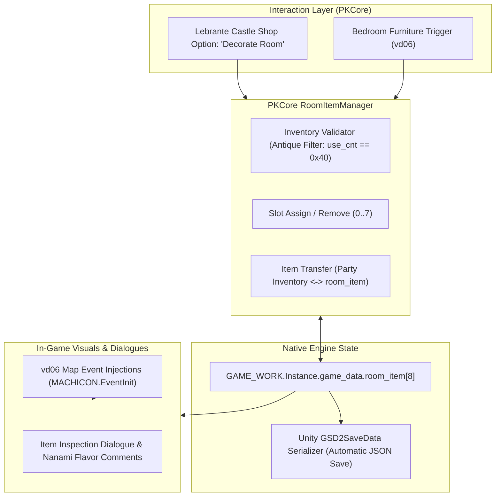

# Technical Whitepaper: The Unused `room_item` System & Restoration Blueprint for Suikoden II HD Remaster

**Document ID**: PK-WP-2026-004  
**Project**: Project Kayaro (PKCore)  
**Author**: Antigravity / PKCore Engineering  
**Target Platform**: Suikoden I & II HD Remaster (PC / Steam / BepInEx 6 IL2CPP)  
**Date**: October 2026  

---

## Executive Summary

During reverse engineering of the save data serialization architecture in **Suikoden II HD Remaster**, an unused 8-slot array named **`room_item`** was identified residing directly alongside Castle Headquarters facilities (`base_item`, `furo_item`, `food_menu`, `lib_flag`).

Detailed inspection of the native game library (`GameAssembly.dll`), Il2Cpp type metadata, and decompiled PS1 C source headers reveals that `room_item` is **vestigial cut content from the original 1998 PlayStation release**. While Konami completed the bathhouse antique display system (`furo_item`, managed by Tetsu), the sister feature intended for the **Hero's Castle Bedroom (`room_item`)** was severed prior to publication.

Because the underlying C struct alignment was frozen for PlayStation memory card backward compatibility, the 8 `room_item` slots were never removed. When Konami ported the game to Unity/IL2CPP for the HD Remaster, the reflection serializer preserved this array in modern JSON save files.

This whitepaper provides:
1. **The comprehensive reverse engineering findings** establishing what `room_item` was intended to be.
2. **A concrete architectural blueprint** for restoring the feature within **Project Kayaro (PKCore)** as an authentic, lore-friendly gameplay system.

---

## 1. Reverse Engineering & Technical Grounding

### 1.1 Structural Layout in `GAME_DATA`

In the engine's primary state container (`GAME_DATA` / original PS1 `game_data`), castle facility inventories are allocated sequentially:

| Field Name | Offset in `GAME_DATA` | Type | Max Constant | Associated Facility / System |
| :--- | :---: | :--- | :---: | :--- |
| `base_item` | `0x98` | `PARTY_ITEM[]` | `BASE_ITEM_MAX = 60` | Barbara's Vault / Warehouse |
| `furo_item` | `0xA0` | `PARTY_ITEM[]` | `FURO_ITEM_MAX = 8` | Tetsu's Bathhouse Display |
| **`room_item`** | **`0xA8`** | **`PARTY_ITEM[]`** | **`ROOM_ITEM_MAX = 8`** | **Hero's Bedroom Display (Cut)** |
| `furo_info` | `0xB0` | `ushort[]` | — | Bathhouse state flags (tub type, steam, water) |
| `food_menu` | `0xB8` | `byte[]` | `FOOD_MAX = 13` | Hai Yo's Restaurant Recipe Menu |
| `food_resipi` | `0xC8` | `byte[]` | — | Collected Recipe bitmask |
| `lib_flag` | `0xD8` | `ushort` | — | Emilia's Library Old Books collected |

In decrypted HD Remaster save files (`_decrypted_share__clrsave_GSD2.json`), `room_item` is serialized directly as a JSON array of 8 `PARTY_ITEM` structures:
```json
"furo_item": [
  { "item_no": 10, "use_cnt": 64 },
  { "item_no": 10, "use_cnt": 64 },
  ... (8 slots total)
],
"room_item": [
  { "item_no": 0, "use_cnt": 0 },
  { "item_no": 0, "use_cnt": 0 },
  ... (8 slots total)
]
```

### 1.2 Binary Instantiation in `GameAssembly.dll`

Disassembly of `GAME_DATA..ctor` at Virtual Address `0x181A46B20` (File Offset `0x1A45720` in `GameAssembly.dll`) confirms explicit memory allocation of 8 slots on startup:

```x86asm
; Allocate room_item array (8 elements)
mov   edx, 8                   ; ROOM_ITEM_MAX = 8
call  alloc_party_item_array   ; Creates Il2CppArray of PARTY_ITEM
lea   rcx, [rbx + 0xA8]        ; Offset of GAME_DATA.room_item
mov   [rbx + 0xA8], rax        ; Assign reference
mov   rdx, rax
call  il2cpp_gc_wbarrier_set   ; Write barrier
```

### 1.3 The Antique & Exhibition Classification (`ex_it_data`)

The game contains a dedicated collection of 22+ antiques, stored in `OVIT_DATA.ex_it_data` (`EX_IT_MAX = 79`) and categorized under two primary exhibition types (`EventOverlayClass/furo_h.cs`):

1. **`TENJI_KAIGA` (Exhibition: Paintings / Scrolls)**:
   - *Graffiti*, *Flower Painting*, *Lovers' Garden*, *Landscape Scroll*, *Beauties of Nature*, *Portrait of 3 People*.
2. **`TENJI_OKIMONO` (Exhibition: Ornaments & Statues)**:
   - *Celadon Urn*, *Octopus Pot*, *Fine China*, *Black Urn*, *Blue Dragon Urn*, *Peeing Boy*, *Bonsai Tree*, *Knight Statue*, *Goddess Statue*, *Hex Doll*, *Chinese Dish*, *Japanese Dish*, *Persian Lamp*, *Coral*, *Genkaku's Urn*.

In `PARTY_ITEM`, these items carry category flag `use_cnt = 0x40` (64 decimal).

---

## 2. Comparative Analysis: `furo_item` vs. `room_item`

```
┌─────────────────────────────────────────────────────────────────┐
│                    SUIKODEN II ANTIQUE SYSTEM                   │
└────────────────────────────────┬────────────────────────────────┘
                                 │
                 ┌───────────────┴───────────────┐
                 ▼                               ▼
       [Bathhouse Facility]            [Hero's Bedroom]
     Save: furo_item[8] (0xA0)       Save: room_item[8] (0xA8)
     Handler: D_bath_c / furo_h      Handler: None (Severed)
     NPC: Tetsu                      NPC: Lebrante / Riou / Nanami
     Status: Shipped (Complete)      Status: Cut Content (Unused)
```

In the bathhouse implementation:
- `D_bath_c` provides `BATH_SELECT_PUT` (place antique), `BATH_SELECT_GET` (retrieve antique), and `BATH_SELECT_WATCH` (view scene).
- The map draws placed items on fixed coordinates (`TENJI_DATA`).

For the Hero's Room:
- The data array (`room_item[8]`) was created with identical capacity (`ROOM_ITEM_MAX = 8`).
- The interactive menu and coordinate bindings were cut before the 1998 release, leaving the 8 slots dormant.

---

## 3. Restoration Blueprint for Project Kayaro (PKCore)

Restoring this feature requires zero modifications to the save format because `room_item` is already native to the engine. PKCore can implement the entire system dynamically in memory.

### 3.1 Architectural Overview



---

### 3.2 Core Component Specifications

#### Component 1: `RoomItemManager` (State & Inventory Engine)
A singleton class in `PKCore` handling slot transactions:
```csharp
public static class RoomItemManager
{
    public const int ROOM_ITEM_MAX = 8;

    public static PARTY_ITEM[] GetRoomItems()
    {
        var gameData = G2_SYS.Get_game_data();
        return gameData?.room_item;
    }

    public static bool PlaceItem(int slotIndex, PARTY_ITEM item, int partyItemIndex)
    {
        if (slotIndex < 0 || slotIndex >= ROOM_ITEM_MAX) return false;
        if (!IsDecorItem(item)) return false;

        var gameData = G2_SYS.Get_game_data();
        // Return existing slot item to party if occupied
        if (gameData.room_item[slotIndex].item_no != 0)
        {
            RetrieveItem(slotIndex);
        }

        // Store into room_item slot
        gameData.room_item[slotIndex] = new PARTY_ITEM
        {
            item_no = item.item_no,
            use_cnt = item.use_cnt
        };

        // Remove from player inventory
        RemovePartyItem(partyItemIndex);
        return true;
    }

    public static bool RetrieveItem(int slotIndex)
    {
        var gameData = G2_SYS.Get_game_data();
        var item = gameData.room_item[slotIndex];
        if (item.item_no == 0) return false;

        // Add back to player party items
        AddPartyItem(item.item_no, item.use_cnt);

        // Clear slot
        gameData.room_item[slotIndex] = new PARTY_ITEM { item_no = 0, use_cnt = 0 };
        return true;
    }

    public static bool IsDecorItem(PARTY_ITEM item)
    {
        // Category 0x40 (Antiques / Curios / Art)
        return item != null && item.item_no != 0 && (item.use_cnt & 0xF0) == 0x40;
    }
}
```

#### Component 2: Dual Interaction Modes

1. **Service Mode (Lebrante the Appraiser)**:
   - Hook Lebrante’s dialogue handler in Dunan Castle (`h_kantei_c`).
   - Add a 3rd menu option alongside *Appraise* and *Exit*: **"Decorate Commander's Room"**.
   - Opens a tailored 8-slot selection menu allowing players to assign any appraised antique directly to bedroom display slots.

2. **Direct Inspection Mode (Riou's Bedroom in `vd06`)**:
   - Following PKCore’s standard `MACHICON.EventInit` postfix pattern, hook map transition into Riou’s bedroom.
   - Inject interactable inspection hotspots (`EVENT_TALK` triggers) across tables, shelves, and walls corresponding to slots `0..7`.
   - Pressing the interact button inspects the placed antique, printing its name, historical appraisal value, and lore text.

#### Component 3: Character Flavor Text & Dynamic Reactions
When examining placed items in Riou's room, dynamic dialogue branches can fire depending on story flags and the specific item displayed:
- **Genkaku's Urn**: Touching reflections from Riou regarding his grandfather.
- **Peeing Boy**: Nanami humorously scolding Riou for putting such a tacky statue next to their bed.
- **Hex Doll**: Spooky atmospheric dialogue hinting at curses.
- **Bonsai Tree**: Nanami commenting on whether Riou remembered to water it.

---

## 4. Implementation Roadmap

| Phase | Milestone | Deliverables |
| :---: | :--- | :--- |
| **Phase 1** | **Backend Manager** | Implement `RoomItemManager.cs` in PKCore. Unit test placing, retrieving, and auto-saving via `GSD2SaveData`. |
| **Phase 2** | **Lebrante Menu Hook** | Harmony patch on `h_kantei_c` to inject the *"Decorate Room"* dialogue option and slot management UI. |
| **Phase 3** | **Map Event Injection** | Inject 8 inspection triggers in Riou's room (`vd06`) via `MACHICON.EventInit` Postfix. |
| **Phase 4** | **Flavor & Polish** | Add contextual item examination windows, Nanami reaction dialogues, and sound effects. |

---

## Conclusion

The `room_item` array is a rare example of intact historical cut content preserved across multiple decades of game releases. By leveraging Project Kayaro’s in-memory patching architecture, we can cleanly restore Konami’s intended bedroom decoration feature with zero risk to save compatibility or game stability.
