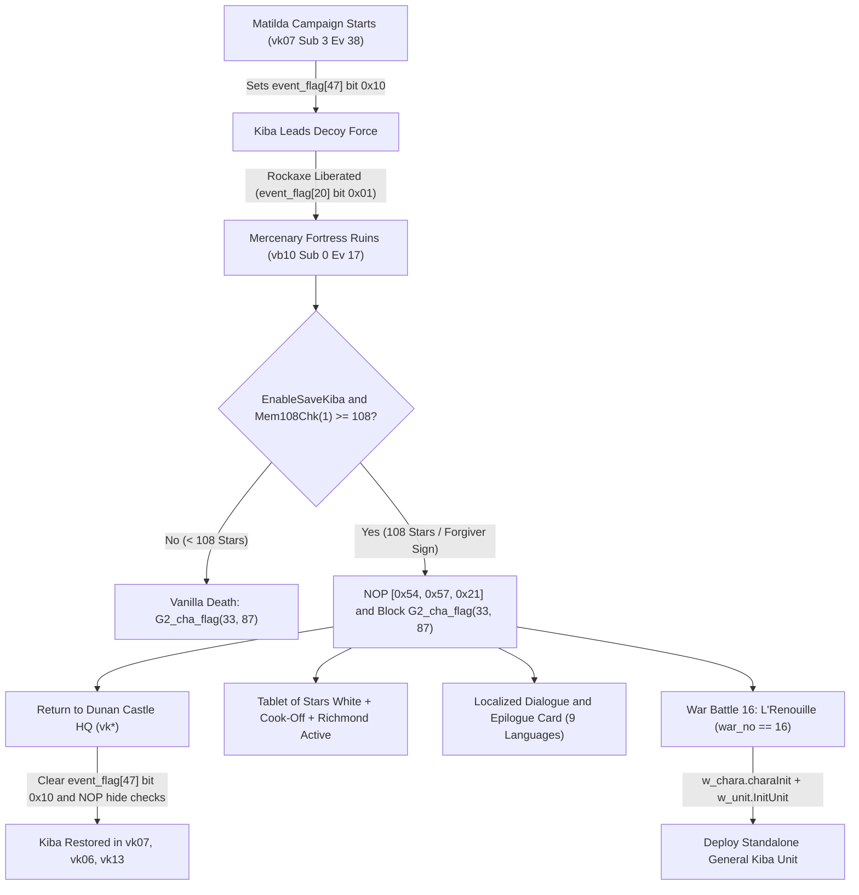

# Suikoden II — Save General Kiba & L'Renouille War Unit (`S2SaveKibaPatch`)

## Overview

In vanilla *Suikoden II*, **General Kiba Windamier** (`charaId = 87` / `0x57`) is scripted to die at the Mercenary Fortress Ruins (`vb10`) after leading the diversionary force against Leon Silverberg during the Matilda campaign. Even with all 108 Stars of Destiny recruited, vanilla offers no way to save him.

[S2SaveKibaPatch.cs](../Patches/S2SaveKibaPatch.cs) introduces a lore-friendly survival path tied to recruiting **all 108 Stars of Destiny** (unlocking Leknaat's **Forgiver Sign / Sign of Forgiveness**):

1. Prevents Kiba's scripted death in `vb10` and guards his native character status flag so he remains alive across all game systems (Tablet of Stars, Cook-Off judge pool, Richmond investigations).
2. Restores Kiba to Dunan Castle HQ (`vk07` War Room, `vk06`, `vk13` Bathhouse/Terrace) after the `vb10` scene completes.
3. Updates Kiba's ending epilogue card and key post-Rockaxe dialogue lines across all **9 official Remaster languages**.
4. Deploys Kiba as a **standalone player-controlled general unit** in War Battle 16 (**The Conquest of L'Renouille**), fully compatible with `WarAbilityPatch` (`S2WarAbilities.json`).

---

## Survival Condition (108 Stars / Forgiver Sign)

Kiba's survival is gated by the native 108 Stars check:

- `Plugin.Config.EnableSaveKiba.Value == true`
- Active game is Suikoden II (`GameDetection.IsGSD2()`)
- Kiba is recruited (`G2_SYS.G2_cha_flag(2, 87) == 1`)
- All 108 Stars of Destiny are recruited (`G2_SYS.Mem108Chk(1) >= 108`)

If the player has **fewer than 108 Stars** when entering `vb10`, the patch does not intervene and Kiba's vanilla death plays out normally.

---

## System Architecture & Execution Flow



---

## Technical Implementation Details

### 1. Preventing Kiba's Death (`vb10` & `G2_SYS.G2_cha_flag`)

In vanilla `vb10` (Mercenary Fortress Ruins), Submap 0 `Ev [17]` runs when `event_flag[20] & 0x01` is set, `event_flag[20] & 0x80` is clear, and `event_flag[171] (0xAB) & 0x40` is clear. Its `eventCom` bytecode executes:

- `09 AB 40` — Sets `event_flag[171] |= 0x40` (scene completed).
- `54 57 21` — `EVENTCON.ECCharaStatus(chara=87, mode=33)`, which calls `G2_SYS.G2_cha_flag(33, 87)` to set Kiba's dead bit (tested by `G2_cha_flag(7, 87)`).

`S2SaveKibaPatch` leaves `vb10` `Ev [17]` `eventCom` bytecode completely untouched (preserving exact `COMMAND_LINE` framing and the post-cutscene warp back to Rockaxe) and intercepts Kiba's death natively:

- **`G2_SYS.G2_cha_flag` Prefix (`ChaFlagGuardPatch`)**: Blocks any call with `mode == 33 && chano == 87` while the 108-Star condition is active, returning `0` without setting Kiba's dead bit.

Because Kiba's dead bit is never set, `EventOverlayClass.s_main` (Tablet of Stars), `ending_c.CheckNakama(87)`, `w_unit.war_CheckNakama`, Cook-Off judge selection (`Text ID 3004000178`), and Richmond investigations automatically treat Kiba as alive.

### 2. Resting in Dunan Castle HQ Left Bed (`vk07_01` / Submap 3)

Once `event_flag[171] & 0x40` is set (the `vb10` scene has finished) and Kiba is alive with 108 Stars:

- **`MACHICON.OnMapInit` Prefix (`vk*`)**: Clears `event_flag[47] &= ~0x10` (Kiba's Matilda departure hide flag).
- **`MACHICON.EventInit` Postfix (`vk07`, Submap 3)**:
  - Moves Kiba (`eventobj[8]`, `fpno = 87`) from the War Room `(42, 46)` onto the left bedroom bed at `(20, 33)` (`ano = 0`, `disp = 1`, `pri = 0`), tucked cleanly beneath the native white blanket overlay (`eventobj[19]`, `pri = 480`).
  - Hides the original sleeping head prop (`eventobj[18]`, `disp = 0`) and flips `Ev [12]` `eventCom` `[0x00, 0x1A]` (`DispOn`) -> `[0x01, 0x1A]` (`DispOff`) so the old head stays hidden while the blanket (`0x1B`) stays visible.
  - NOPs the post-Matilda hide check `[23 14 20]` -> `[00 00 00]` in `Ev [5]` `eventForm`.
  - Kiba remains resting in this bed for the remainder of HQ visits (while still deploying as a standalone general unit in War Battle 16).

### 3. Multi-Language Dialogue & Epilogue Overrides

`S2SaveKibaPatch` hooks `TextMasterData.GetSystemText` and `TextMasterData.GetSystemTextEx` at `Priority.First`, querying `LanguageSelectionPatch.EnsureLanguageDetected()` and `LanguageSelectionPatch.ActiveLanguageCode` (falling back to `"en"` if undetected).

All **9 official languages** (`en`, `ja`, `fr`, `de`, `es`, `it`, `ko`, `zh-TW`, `zh-CN`) are supported for the five overridden text IDs:

| Text ID | Vanilla Context | Survival Override Summary |
| :--- | :--- | :--- |
| `1002100157` | Kiba's Last Stand (`vb10`, Mercenary Fortress Ruins) | Adds a page where the warm light of the Sign of Forgiveness / 108 Stars shields Kiba from falling. |
| `1009010114` | Rockaxe Messenger Report (`vi01`) | Reports that Kiba was gravely wounded, shielded by a strange light, and brought back to Castle HQ to recover. |
| `1009010116` | Klaus's Reaction (`vi01`) | Changes *"Father..."* to *"Father... Thank goodness you're alive..."*. |
| `1011050014` | Viktor's Post-Rockaxe Dialogue (`vk05`) | Removed *"First Kiba and now..."* so Viktor only mourns Nanami. |
| `3001000213` | Kiba's Ending Epilogue Card (`ending_c`) | Survived his grave wounds at the Mercenary Fortress thanks to the 108 Stars and fought beside Klaus at L'Renouille. |

All strings preserve native Suikoden II control codes (`∠` line break, `∨` page break, `♂㈱` protagonist name, `♂①` castle name, `♂②` army name).

### 4. L'Renouille War Battle Unit (`war_no == 16`)

In War Battle 16 (**The Conquest of L'Renouille**, `w_dat_16`), vanilla does not place Kiba on the allied roster:

- **`w_chara.charaInit` Postfix**: Resolves Kiba's war character index dynamically via `w_unit.war_to_main_table` (`== 87`, with fallback scan for `name == 88`). If `w_dat_16.chara_16` left Kiba's stats blank (`attack == 0 && defense == 0`), hydrates all `WAR_CHARA_TYPE` fields from `w_dat_butai.chara_butai` where `name == 88`. Because `WarAbilityPatch` also hooks `w_chara.charaInit` and `WarChapter.Update`, custom `S2WarAbilities.json` overrides for `"88"` apply automatically.
- **`w_unit.InitUnit` Postfix**:
  - Verifies `OldSrcBase.sys_work.war_no == 16` and that Kiba is not already deployed (`SearchUnitForceByChara(kibaWarIdx) != 0`).
  - Locates the first unused allied slot in `w_unit.unit[0]` (`flag == 0 || chara[0] < 0`).
  - Selects a VRAM-safe `anime_no` from an active allied unit sharing Kiba's `force_type` (fallback: Riou's unit `anime_no`).
  - Finds an unoccupied, passable on-stage tile near Riou's deployment line via `w_data.CheckFieldOnStage`, `w_unit.GetUnitForce`, `w_data.GetFieldData`, and `w_data.GetMoveCost`.
  - Initializes Kiba as a standalone player-controlled unit (`chara[0] = kibaWarIdx`, `chara[1] = -1`, `chara[2] = -1`, `control = 0`).

---

## Configuration

Configured in `{gameroot}\BepInEx\config\faospark.pkcore.cfg` under `[05 Game : Suikoden 2]`:

```ini
[05 Game : Suikoden 2]

## Allows General Kiba to survive the Mercenary Fortress battle in Suikoden 2 when all 108 Stars of Destiny are recruited (Forgiver Sign unlocked), restoring him to Dunan Castle HQ, updating his epilogue card, and deploying him as a standalone general unit in the Conquest of L'Renouille war battle.
# Setting type: Boolean
# Default value: true
EnableSaveKiba = true
```

---

## Files Modified

- [S2SaveKibaPatch.cs](../Patches/S2SaveKibaPatch.cs) — Core survival, HQ restoration, 9-language text overrides, and War Battle 16 deployment logic.
- [ModConfiguration.cs](../ModConfiguration.cs) — `EnableSaveKiba` config binding.
- [Plugin.cs](../Plugin.cs) — Patch initialization.
- [CHANGELOG.md](../CHANGELOG.md) & [README.md](../README.md) — Release notes and feature list updates.
